# Adjusted NPC sell prices

Updated: **November 16, 2026**.

Vestige Rift reduces the Zeny paid by NPCs for selected loot, materials, consumables and equipment. The table below covers **82 entries across 86 item IDs**, including equipment variants.

## Why we adjusted sell prices

Repeatedly selling abundant, valuable loot creates new Zeny. With increased drop rates, this can push market prices upward and make it harder for new players to afford goods.

These reductions aim to:

- **Limit inflation:** reduce Zeny entering the economy through heavily farmed items.
- **Encourage variety:** make a wider range of hunting areas and activities worth considering.
- **Reduce abuse incentives:** lower the return from automated farming and repetitive resale abuse.

The goal is to protect purchasing power and keep player trading meaningful. These are economy-balancing goals; lower resale prices alone do not prevent botting or guarantee stable market prices.

## How the prices work

The values below are **per-item NPC resale prices before Merchant Overcharge**. Overcharge applies normally. For example, Crystal Blue sells for **250z**, or **310z with Level 10 Overcharge**.

This update changes only the listed resale values. NPC purchase prices, drop rates, item effects and movement restrictions retain their existing rules. Other items keep their current prices. For supply purchase prices, see [Convenient Dealers](dealers.md).

!!! note "Crystal Blue"
    Crystal Blue (#991) is **250z**, reduced from our previous **500z**. This is the server-specific choice, rather than the 750z listed by the reference guide.

## Complete price list

"Previous" means the base resale value in our server before this update. Item IDs distinguish ordinary items from similarly named quest or rental items.

| Item | Item ID(s) | Previous | Current |
| --- | --- | ---: | ---: |
| { .item-icon width="32" height="32" loading="lazy" } 1carat Diamond | 730 | 5,000z | **2,500z** |
| { .item-icon width="32" height="32" loading="lazy" } 2carat Diamond | 731 | 12,500z | **6,250z** |
| { .item-icon width="32" height="32" loading="lazy" } 3carat Diamond | 732 | 27,500z | **13,750z** |
| 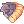{ .item-icon width="32" height="32" loading="lazy" } Armor Piece of Dullahan | 7210 | 395z | **250z** |
| 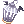{ .item-icon width="32" height="32" loading="lazy" } Bat Cage | 7214 | 440z | **300z** |
| 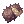{ .item-icon width="32" height="32" loading="lazy" } Black Bear Skin | 7161 | 192z | **190z** |
| 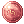{ .item-icon width="32" height="32" loading="lazy" } Bloody Rune | 7563 | 1,008z | **650z** |
| { .item-icon width="32" height="32" loading="lazy" } Blue Potion | 505 | 2,500z | **1,250z** |
| { .item-icon width="32" height="32" loading="lazy" } Broken Needle | 7215 | 345z | **250z** |
| { .item-icon width="32" height="32" loading="lazy" } Broken Shell | 7070 | 450z | **300z** |
| { .item-icon width="32" height="32" loading="lazy" } Broken Sword | 7110 | 294z | **250z** |
| { .item-icon width="32" height="32" loading="lazy" } Burning Heart | 7097 | 462z | **300z** |
| 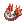{ .item-icon width="32" height="32" loading="lazy" } Burning Horseshoe | 7120 | 411z | **300z** |
| 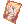{ .item-icon width="32" height="32" loading="lazy" } Contorted Self-Portrait | 7223 | 1,016z | **508z** |
| { .item-icon width="32" height="32" loading="lazy" } Crystal Blue | 991 | 500z | **250z** |
| { .item-icon width="32" height="32" loading="lazy" } Crystal Mirror | 747 | 7,500z | **3,800z** |
| 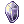{ .item-icon width="32" height="32" loading="lazy" } Cyfar | 7053 | 386z | **300z** |
| 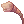{ .item-icon width="32" height="32" loading="lazy" } Decomposed Rope | 7218 | 195z | **190z** |
| { .item-icon width="32" height="32" loading="lazy" } Denture from Dragon Mask | 7266 | 218z | **200z** |
| 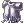{ .item-icon width="32" height="32" loading="lazy" } Destroyed Armor | 7069 | 521z | **300z** |
| { .item-icon width="32" height="32" loading="lazy" } Diamond Ring | 2613 | 22,500z | **11,250z** |
| 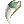{ .item-icon width="32" height="32" loading="lazy" } Dragon Canine | 1035 | 242z | **200z** |
| { .item-icon width="32" height="32" loading="lazy" } Dragon Horn | 7265 | 272z | **200z** |
| 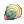{ .item-icon width="32" height="32" loading="lazy" } Dragon Scale | 1036 | 250z | **200z** |
| 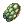{ .item-icon width="32" height="32" loading="lazy" } Dragon Skin | 7123 | 512z | **290z** |
| 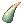{ .item-icon width="32" height="32" loading="lazy" } Dragon Tail | 1037 | 600z | **300z** |
| 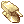{ .item-icon width="32" height="32" loading="lazy" } Emperium Anvil | 989 | 300,000z | **150,000z** |
| { .item-icon width="32" height="32" loading="lazy" } Flame Heart | 994 | 1,500z | **750z** |
| 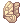{ .item-icon width="32" height="32" loading="lazy" } Giant Butterfly Wing | 7168 | 307z | **250z** |
| { .item-icon width="32" height="32" loading="lazy" } Gold | 969 | 100,000z | **55,000z** |
| { .item-icon width="32" height="32" loading="lazy" } Gold Ring | 2610 | 15,000z | **7,500z** |
| { .item-icon width="32" height="32" loading="lazy" } Great Nature | 997 | 1,500z | **750z** |
| 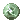{ .item-icon width="32" height="32" loading="lazy" } Green Live | 993 | 500z | **250z** |
| { .item-icon width="32" height="32" loading="lazy" } Hard Feeler | 7163 | 285z | **200z** |
| { .item-icon width="32" height="32" loading="lazy" } Harpy Feather | 7115 | 571z | **286z** |
| { .item-icon width="32" height="32" loading="lazy" } Harpy Talon | 7116 | 605z | **303z** |
| { .item-icon width="32" height="32" loading="lazy" } Helm of Dullahan | 7209 | 675z | **400z** |
| { .item-icon width="32" height="32" loading="lazy" } Hung Doll | 7212 | 510z | **300z** |
| 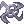{ .item-icon width="32" height="32" loading="lazy" } Huuma Giant Wheel Shuriken | 13301, 13302 | 20,000z | **10,000z** |
| { .item-icon width="32" height="32" loading="lazy" } Huuma Wing Shuriken | 13300 | 45,000z | **22,500z** |
| 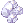{ .item-icon width="32" height="32" loading="lazy" } Ice Cubic | 7066 | 330z | **250z** |
| 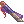{ .item-icon width="32" height="32" loading="lazy" } Khukri | 13006 | 120,000z | **55,000z** |
| 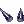{ .item-icon width="32" height="32" loading="lazy" } Little Evil Horn | 1038 | 264z | **200z** |
| { .item-icon width="32" height="32" loading="lazy" } Little Evil Wing | 1039 | 1,000z | **500z** |
| { .item-icon width="32" height="32" loading="lazy" } Little Ghost Doll | 7268 | 605z | **400z** |
| 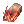{ .item-icon width="32" height="32" loading="lazy" } Live Coal | 7098 | 319z | **250z** |
| 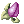{ .item-icon width="32" height="32" loading="lazy" } Mastela Fruit | 522 | 4,250z | **2,100z** |
| { .item-icon width="32" height="32" loading="lazy" } Mud Lump | 7004 | 438z | **300z** |
| { .item-icon width="32" height="32" loading="lazy" } Mystic Frozen | 995 | 1,500z | **750z** |
| { .item-icon width="32" height="32" loading="lazy" } Needle Packet | 7213 | 416z | **300z** |
| 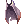{ .item-icon width="32" height="32" loading="lazy" } Old Manteau | 7207 | 525z | **300z** |
| 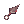{ .item-icon width="32" height="32" loading="lazy" } Old Shuriken | 7072 | 890z | **450z** |
| 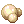{ .item-icon width="32" height="32" loading="lazy" } Pearl | 722 | 3,000z | **1,500z** |
| 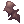{ .item-icon width="32" height="32" loading="lazy" } Piece of Black Cloth | 7205 | 263z | **200z** |
| { .item-icon width="32" height="32" loading="lazy" } Piece of Cake | 539 | 1,500z | **750z** |
| 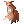{ .item-icon width="32" height="32" loading="lazy" } Ragamuffin Manteau | 2508 | 28,000z | **14,000z** |
| { .item-icon width="32" height="32" loading="lazy" } Red Blood | 990 | 500z | **250z** |
| 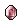{ .item-icon width="32" height="32" loading="lazy" } Red Gemstone | 716 | 300z | **200z** |
| { .item-icon width="32" height="32" loading="lazy" } Red Muffler | 7216 | 330z | **250z** |
| 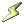{ .item-icon width="32" height="32" loading="lazy" } Rough Wind | 996 | 1,500z | **750z** |
| 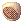{ .item-icon width="32" height="32" loading="lazy" } Royal Jelly | 526 | 3,500z | **1,750z** |
| 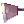{ .item-icon width="32" height="32" loading="lazy" } Rusty Kitchen Knife | 7208 | 890z | **450z** |
| 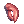{ .item-icon width="32" height="32" loading="lazy" } Scorpion Claw | 7125 | 353z | **250z** |
| { .item-icon width="32" height="32" loading="lazy" } Silver Ring | 2611 | 10,000z | **5,000z** |
| 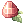{ .item-icon width="32" height="32" loading="lazy" } Solid Peach | 7164 | 200z | **190z** |
| 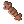{ .item-icon width="32" height="32" loading="lazy" } Spool | 7217 | 212z | **200z** |
| { .item-icon width="32" height="32" loading="lazy" } Star Crumb | 1000 | 2,250z | **1,125z** |
| 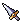{ .item-icon width="32" height="32" loading="lazy" } Stiletto | 1216, 1217, 1218 | 9,750z | **4,900z** |
| 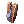{ .item-icon width="32" height="32" loading="lazy" } Strange Steel Piece | 7167 | 215z | **200z** |
| { .item-icon width="32" height="32" loading="lazy" } Striped Sock | 7219 | 460z | **300z** |
| { .item-icon width="32" height="32" loading="lazy" } Suspicious Hat | 7567 | 645z | **400z** |
| 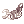{ .item-icon width="32" height="32" loading="lazy" } Tangled Chains | 7221 | 370z | **250z** |
| { .item-icon width="32" height="32" loading="lazy" } Treasure Box | 7444 | 150,000z | **100,000z** |
| 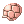{ .item-icon width="32" height="32" loading="lazy" } Turtle Shell | 967 | 340z | **250z** |
| { .item-icon width="32" height="32" loading="lazy" } Undershirt | 2522, 2523 | 10,000z | **5,000z** |
| { .item-icon width="32" height="32" loading="lazy" } White Mask | 7568 | 530z | **400z** |
| 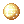{ .item-icon width="32" height="32" loading="lazy" } Wind of Verdure | 992 | 500z | **250z** |
| { .item-icon width="32" height="32" loading="lazy" } Witherless Rose | 748 | 27,500z | **13,750z** |
| { .item-icon width="32" height="32" loading="lazy" } Wooden Gnarl | 7222 | 234z | **200z** |
| 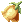{ .item-icon width="32" height="32" loading="lazy" } Yggdrasil Berry | 607 | 2,500z | **1,250z** |
| { .item-icon width="32" height="32" loading="lazy" } Yggdrasil Seed | 608 | 2,500z | **1,250z** |
| { .item-icon width="32" height="32" loading="lazy" } Zargon | 912 | 240z | **200z** |

The multiple IDs for Stiletto, Undershirt and Huuma Giant Wheel Shuriken cover their listed equipment variants. Separate quest, rental and alternate consumable items with the same display names are excluded unless their ID appears above.

The table follows the balancing approach in [Valkaria's adjusted sale-price guide](https://wiki.valkariaro.com/adjusted-price/), with names and IDs matched to our database and the Crystal Blue exception described above. The values here describe Vestige Rift's configuration.
