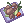

# Card exchange

Updated: **November 17, 2026**.

Trade unwanted loose cards for **account-wide card points**, then spend those points with **Putty** in [Main Office](main-office.md).

!!! info "Quick facts"
    **NPC:** Putty 
    **Location:** `/navi main_office 136/32` 
    **Entrance:** Prontera 164,167, marked **Main Office**. 
    **Exchange rate:** 10 points per accepted card 
    **Rewards:** 14 choices, including consumables, +10 stat foods, Old Card Album and Bloody Branch

## Exchange cards

1. Carry the cards in your inventory and talk to Putty.
2. Choose **Exchange cards**. Putty lists eligible inventory stacks by name, item ID and quantity; use the page options if needed.
3. Select one stack and enter how many cards to exchange.
4. Review the card name, quantity and points, then choose **Confirm exchange**.

The selected cards are permanently consumed. Canceling the confirmation leaves them untouched. Putty checks the exact selected stack again before taking it, so a changed or ineligible stack does not earn points.

Every accepted card grants **10 points**. Your characters on the same account share the balance, and it is saved between logins. These points are separate from Zeny and [hourly reward points/Gold Coins](hourly-rewards.md).

## Current reward list

Each cost is for **one item**. Giant Fly Wing Box contains **10 Giant Fly Wings**; its 7-point price buys one box.

| Reward | Item ID | Cost (card points) |
| --- | ---: | ---: |
| { .item-icon width="32" height="32" loading="lazy" } Life Insurance | 12209 | **5 points** |
| { .item-icon width="32" height="32" loading="lazy" } JOB Battle Manual | 14592 | **8 points** |
| { .item-icon width="32" height="32" loading="lazy" } Battle Manual | 12208 | **8 points** |
| { .item-icon width="32" height="32" loading="lazy" } Giant Fly Wing Box (10) | 12910 | **7 points** |
| { .item-icon width="32" height="32" loading="lazy" } Bubble Gum | 12210 | **55 points** |
| { .item-icon width="32" height="32" loading="lazy" } Gym Pass | 7776 | **55 points** |
| { .item-icon width="32" height="32" loading="lazy" } Steamed Tongue | 12202 | **65 points** |
| { .item-icon width="32" height="32" loading="lazy" } Dragon Breath Cocktail | 12204 | **65 points** |
| { .item-icon width="32" height="32" loading="lazy" } Hwergelmir's Tonic | 12205 | **65 points** |
| { .item-icon width="32" height="32" loading="lazy" } Cooked Nine Tail's Tails | 12206 | **65 points** |
| { .item-icon width="32" height="32" loading="lazy" } Stew Of Immortality | 12207 | **65 points** |
| { .item-icon width="32" height="32" loading="lazy" } Steamed Scorpion | 12203 | **65 points** |
| { .item-icon width="32" height="32" loading="lazy" } Old Card Album | 616 | **95 points** |
| { .item-icon width="32" height="32" loading="lazy" } Bloody Branch | 12103 | **120 points** |

Choose **Spend points**, select the reward and quantity, then confirm the purchase. You need enough points, inventory space and carrying capacity. Failed capacity or balance checks leave your points unspent.

### Reward variants

- **Bubble Gum (#12210): +150% item drops for 30 minutes**. This is the same item sold by [Lydia](coin-exchange.md), with a 2.5x multiplier before applicable caps and modifiers. Vestige Coin drop chances are not increased.

- **JOB Battle Manual (#14592)** is the standard +50% Job EXP version, lasting 30 minutes.
- The six **+10 stat foods** are the 30-minute variants: Steamed Tongue (STR), Dragon Breath Cocktail (INT), Hwergelmir's Tonic (DEX), Cooked Nine Tail's Tails (LUK), Stew Of Immortality (VIT) and Steamed Scorpion (AGI).
- **Gym Pass (#7776)** uses the existing Gym Pass redemption service; purchasing it does not automatically apply the weight increase.
- **Bloody Branch remains available for 120 points.** Poring Coin is not offered.

Card points remain in your account until spent. Since each accepted card grants 10 points, purchases can leave a balance that you can use toward another reward.

## Blacklisted cards

These six cards cannot be exchanged:

| Card | Item ID |
| --- | ---: |
| Thief Bug Card | 4016 |
| Female Thief Bug Card | 4026 |
| Male Thief Bug Card | 4050 |
| Tarou Card | 4028 |
| Plankton Card | 4024 |
| Thief Bug Egg Card | 4012 |

## Protected cards and restrictions

- Only **loose cards carried in inventory** are accepted. Cards in equipment, a cart or storage are not selected.
- **Bound, rental and equipped items** are excluded.
- **Favorite-tab cards are protected.** Move a card out of Favorites if you intend to exchange it.
- Cards must pass the eligibility check and cannot appear on the blacklist.
- The account balance is limited to **2,000,000,000 card points**; spend points first if another exchange would exceed that limit.

!!! warning "Review before confirming"
    Exchanging a card destroys it. Check the name, item ID and quantity, especially before exchanging a valuable card.
