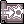
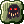
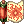

# Find your class

Choose your class to jump to its implemented changes, skill costs, and exceptions. The complete reference remains on one page so you can search or compare classes easily.

!!! tip "Rules shared by every class"
    Review [general combat and status effects](class-changes.md#general-combat-and-status-effects) alongside your class. Reflection, party animations, and map restrictions can affect multiple builds.

-   { .skill-icon } **Knight / Lord Knight**

    ---

    [View skills and changes →](class-changes.md#knight-lord-knight)

-   { .skill-icon } **Crusader / Paladin**

    ---

    [View skills and changes →](class-changes.md#crusader-paladin)

-   { .skill-icon } **Mage**

    ---

    [View skills and changes →](class-changes.md#mage)

-   { .skill-icon } **Wizard / High Wizard**

    ---

    [View skills and changes →](class-changes.md#wizard-high-wizard)

-   { .skill-icon } **Sage / Professor**

    ---

    [View skills and changes →](class-changes.md#sage-professor)

-   { .skill-icon } **Merchant / Blacksmith / Whitesmith**

    ---

    [View skills and changes →](class-changes.md#merchant-blacksmith-whitesmith)

-   { .skill-icon } **Alchemist / Creator**

    ---

    [View skills and changes →](class-changes.md#alchemist-creator)

-   { .skill-icon } **Priest / High Priest**

    ---

    [View skills and changes →](class-changes.md#priest-high-priest)

-   { .skill-icon } **Monk / Champion**

    ---

    [View skills and changes →](class-changes.md#monk-champion)

-   { .skill-icon } **Thief / Assassin / Assassin Cross**

    ---

    [View skills and changes →](class-changes.md#thief-assassin-assassin-cross)

-   { .skill-icon } **Rogue / Stalker**

    ---

    [View skills and changes →](class-changes.md#rogue-stalker)

-   { .skill-icon } **Bard / Clown and Dancer / Gypsy**

    ---

    [View skills and changes →](class-changes.md#bard-clown-and-dancer-gypsy)

-   { .skill-icon } **Super Novice / Super Baby**

    ---

    [View skills and changes →](class-changes.md#super-novice-super-baby)

-   { .skill-icon } **Taekwon**

    ---

    [View skills and changes →](class-changes.md#taekwon)

-   { .skill-icon } **Star Gladiator**

    ---

    [View skills and changes →](class-changes.md#star-gladiator)

-   { .skill-icon } **Soul Linker**

    ---

    [View skills and changes →](class-changes.md#soul-linker)

-   { .skill-icon } **Ninja**

    ---

    [View skills and changes →](class-changes.md#ninja)

-   { .skill-icon } **Gunslinger**

    ---

    [View skills and changes →](class-changes.md#gunslinger)

## Other references

- [Adopted characters](class-changes.md#adopted-characters): base stat caps and adoption rules.
- [NPC directory](class-changes.md#related-npc-directory): platinum skills, supplies, resets, and lessons.
- [Server rules](server-rules.md): level caps, rates, and map definitions.
- [Quality of life](quality-of-life.md): recovery, mail, storage, and more.
