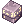
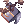
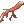
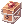
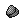
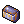
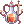

# Vestige Coin Exchange

**Lydia** exchanges Vestige Coins for supplies at **prt_in 38,108**: `/navi prt_in 38/108`. Enter the **Coin Exchange building at Prontera 133,183**, marked with a Coin Exchange bubble.

## Buying rewards

1. Carry **Vestige Coins (#35363)** in your inventory.
2. Speak to Lydia to open her item-currency shop.
3. Select the reward and quantity, add them to the exchange tray and choose **Buy**.

Each price buys **one item or one box**. The number in a box's name describes its contents. Purchases require enough coins, inventory space and carrying capacity.

## Current catalogue

| Reward | Item ID | Vestige Coins |
| --- | ---: | ---: |
| { .item-icon width="32" height="32" loading="lazy" } Field Manual 100% | 14533 | 40 |
| { .item-icon width="32" height="32" loading="lazy" } Bubble Gum | 12210 | 1,000 |
| { .item-icon width="32" height="32" loading="lazy" } LV10 Blessing Scroll | 12215 | 2 |
| { .item-icon width="32" height="32" loading="lazy" } LV10 Agi Scroll | 12216 | 2 |
| { .item-icon width="32" height="32" loading="lazy" } Kafra Card | 12211 | 20 |
| { .item-icon width="32" height="32" loading="lazy" } Kafra Card 10 Box | 12909 | 200 |
| { .item-icon width="32" height="32" loading="lazy" } Blessing Scroll 10 Box | 12913 | 20 |
| { .item-icon width="32" height="32" loading="lazy" } Increase Agility Scroll 10 Box | 12914 | 20 |
| { .item-icon width="32" height="32" loading="lazy" } Dead Branch 10 Box | 14233 | 50 |
| { .item-icon width="32" height="32" loading="lazy" } Bloody Branch | 12103 | 300 |
| { .item-icon width="32" height="32" loading="lazy" } Gym Pass | 7776 | 70 |
| { .item-icon width="32" height="32" loading="lazy" } Giant Fly Wing 50 Box | 13570 | 30 |
| { .item-icon width="32" height="32" loading="lazy" } Green Butterfly 5 Box | 13851 | 50 |
| { .item-icon width="32" height="32" loading="lazy" } Blue Butterfly 5 Box | 13855 | 50 |
| { .item-icon width="32" height="32" loading="lazy" } Red Butterfly 5 Box | 13853 | 50 |
| { .item-icon width="32" height="32" loading="lazy" } Gym Pass 10 Box | 13710 | 700 |
| { .item-icon width="32" height="32" loading="lazy" } Infinite Fly Wing | 12887 | 700 |
| { .item-icon width="32" height="32" loading="lazy" } Infinite Butterfly Wing | 35364 | 600 |
| { .item-icon width="32" height="32" loading="lazy" } Speed Potion 10 Box | 13995 | 5 |
| { .item-icon width="32" height="32" loading="lazy" } Life Insurance | 12209 | 3 |
| { .item-icon width="32" height="32" loading="lazy" } Medium Life Potion | 14535 | 15 |
| { .item-icon width="32" height="32" loading="lazy" } Medium Life Potion 10 Box | 14107 | 150 |
| { .item-icon width="32" height="32" loading="lazy" } Regeneration Potion | 14537 | 15 |
| { .item-icon width="32" height="32" loading="lazy" } Regeneration Potion 10 Box | 14113 | 150 |
| { .item-icon width="32" height="32" loading="lazy" } Tyr's Blessing | 14601 | 25 |
| { .item-icon width="32" height="32" loading="lazy" } Barricade Repair Kit | 14287 | 75 |

## Bubble Gum: one shared item

**Bubble Gum (#12210)** grants **+150% item drops for 30 minutes**, a **2.5x multiplier** before applicable caps and other modifiers. Lydia and [Putty's Card Exchange](card-exchange.md) offer the same item:

| Shop | Price |
| --- | ---: |
| Lydia | 1,000 Vestige Coins |
| Putty | 55 card points |

Previously acquired copies use the same +150% effect when consumed. Bubble Gum does not increase the fixed Vestige Coin drop chances.

## Manuals, protection and storage

- **Field Manual 100%:** +100% EXP for 30 minutes.
- **Life Insurance:** protects against death EXP loss for every death during its 30-minute effect.
- **Kafra Card:** opens Main Storage. Its 10-card box contains ten of those same cards.
- **Gym Pass:** uses the existing redemption service; buying the pass does not automatically increase your weight limit.

## Potions and supply boxes

- **Medium Life Potion:** restores 7% of maximum HP every four seconds for ten minutes, subject to its normal restrictions. Its 10-box contains ten Medium Life Potions.
- **Regeneration Potion:** increases recovery from healing skills and items by 20% for 30 minutes. Its box contains ten potions.
- **Tyr's Blessing:** ATK +20, MATK +20, HIT +30 and FLEE +30 for five minutes.
- **Barricade Repair Kit:** contains 30 Trunks, 10 Steel, 10 Emveretarcon and 5 Oridecon.
- Other boxes retain their listed quantities and ordinary item behavior.

## Travel items

- Green Butterfly Wings use their standard city menu, including Einbech. Blue and Red variants retain their own city menus.
- **Infinite Fly Wing (#12887)** is reusable and teleports to a random permitted location on your current map.
- **Infinite Butterfly Wing (#35364)** is reusable and returns you to your saved point.
- Reusable wings retain map and duel restrictions. Infinite Butterfly Wing cannot be used during Berserk.

A tradable payment currency does not make every reward tradable. Each reward keeps its own movement restrictions.

See [Vestige Coin System](vestige-coins.md) for farming chances and exclusions. Hourly Gold Coins and Card Exchange points cannot be used at Lydia.
