# Endless Cellar

Descend **77 floors** with your party, clearing every room before facing the four-stage final encounter. The Cellar follows the Tower rooms in reverse and uses the Tower's final arena. Find monster sprites, IDs and spawn counts for every floor below.

## Quick facts

| Requirement | Vestige Rift rule |
| --- | --- |
| Entry NPC | **Captain Janssen**, Prontera **217,187**, for travel to Misty Island |
| Starting stone | **Cellar Protection Stone**, `e_tower 82,110` |
| Party | **6 or more members**, each using a different account |
| Minimum Base Level | **85** for every member |
| Readiness | Every starting member types **`!ready`** within **60 seconds** |
| Time limit | **4 hours**, starting after everyone confirms readiness |
| Weekly allowance | **1 Cellar run per account**, shared by all its characters and **separate from Endless Tower** |
| Weekly reset | **Monday at 06:00 Philippines time (UTC+8)** |

## Getting there

1. Speak to **Captain Janssen**: `/navi prontera 217/187`.
2. Follow his conversations, make the **10,000z donation**, then speak to him again to continue the story and board the ship to Misty Island.
3. The first voyage unlocks the **Misty Island - 5,000z** route in the [Warper](warper.md#misty-island) for that character. Captain Janssen also offers return voyages for **10,000z**.
4. Gather the party at the **Cellar Protection Stone**: `/navi e_tower 82/110`.

### Misty Island services

| NPC | Location | Service |
| --- | --- | --- |
| Cellar Protection Stone | `e_tower 82,110` | Start a readiness check, rejoin the current floor or view weekly run information |
| Tower Protection Stone | `e_tower 81,105` | Enter [Endless Tower](endless-tower.md), with its own weekly allowance |
| Kafra Employee | `e_tower 76,99` | Main Storage, Guild Storage and return to Prontera |

## Starting a run

1. Form a party of **at least six** characters. Everyone must be **online, alive, Base Level 85+ and on Misty Island**. Close other dialogs, shops and storage.
2. The party leader chooses **Start Endless Cellar** at the Cellar Protection Stone.
3. Every member types **`!ready` in public chat within 60 seconds**. Keep the same party roster during the check.
4. Once everyone is ready, the party enters Floor 1 and each participating account consumes its weekly Cellar run.

If readiness expires or the final checks fail, everyone returns to their save point and **no run is consumed**. A member who leaves the island or disconnects during readiness must return and confirm `!ready` again.

Use **`@instanceinfo`**, or **Weekly run information** at either protection stone, to view the separate Tower, Cellar and HTF allowances and the party's active instance. A party can have one endless instance or readiness check active at a time.

## Cellar rules

| Feature | Rule |
| --- | --- |
| Clearing floors | Defeat all required monsters to open the descent gate. The remaining count is announced when **five or fewer** are left. Taming does not count as defeating a monster. |
| Progression | Descend through the gates in order. Floor skipping is unavailable. |
| Death | Normal death rules apply. Characters may be resurrected or leave and re-enter. |
| Re-entry | Only the **original starting characters** may rejoin, while at least one original party member remains inside. Use the Cellar Protection Stone to return to the party's current floor. |
| Everyone leaves | The instance closes when every original member leaves or disconnects. The weekly run remains consumed. |
| Time expires | The instance closes after four hours. The weekly run remains consumed. |
| Storage | Personal and Guild Storage are **unavailable inside**. Use island storage before entering or while restocking outside. |
| Mail | **RODEX is available** inside. |
| Bubble Gum | Does not increase Cellar drop rates. |
| Restricted actions | Random teleportation, Warp Portal, vending and branch use are blocked inside. |

### Drop rates

Ordinary Cellar monsters use their **normal configured server rates**, with these encounter-specific exceptions:

| Encounter | Drop chance |
| --- | --- |
| Wounded Morroc on Floor 76 | **10% of normal configured rates** |
| Two randomly chosen Bio Labs MVPs in the final arena | **Normal configured rates** |
| Other final-arena monsters, including Pori Pori | **10% of normal configured rates** |

The reduction applies to item drops and MVP reward slots, including items obtained through Steal. For example, a normally configured **1%** drop becomes **0.1%**; a **0.01%** card becomes **0.001%**.

## Completion and rewards

Clear all four stages on Floor 77, then speak to **Arc Pori Pori** in the final arena. Choose **Claim rewards and exit** to record completion and return to Prontera. Each original party member claims their own rewards.

The cleared Cellar stays open for up to **five minutes**, within the original four-hour limit. Claim during this window. All five rewards arrive together in **one RODEX message**; collect the attachments within **14 days**.

| Item | Reward | Quantity |
| --- | --- | ---: |
| { width="24" } | **Old Card Album** ID: `616` | **1** |
| 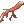{ width="24" } | **Bloody Branch** ID: `12103` | **1** |
| 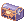{ width="24" } | **Jewelry Box** ID: `12106` | **1** |
| 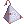{ width="24" } | **Poring Box** ID: `12109` | **1** |
| 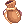{ width="24" } | **Cookie Bag** ID: `12130` | **1** |

Copies of the starting party members appear near the exit. Speak to a copy to see that character's **damage dealt, damage taken, healing done, healing received, deaths and monster kills**.

## Monster catalogue

Counts describe each starting wave. Summons created by monsters during combat are additional. Expand a floor to see its encounters.

[Floors 1-25](#floors-1-25) · [Floors 26-50](#floors-26-50) · [Floors 51-75](#floors-51-75) · [Floor 76](#floor-76-wounded-morroc) · [Floor 77](#floor-77-final-encounter)

## Floors 1-25

??? info "Floor 1 - 40 monsters"

    | Sprite | Monster | Count |
    | --- | --- | ---: |
    | 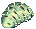{ .tower-monster-sprite loading="lazy" } | **Fabre** ID: `1007` | **20** |
    | 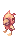{ .tower-monster-sprite loading="lazy" } | **Picky** ID: `1049` | **10** |
    | 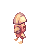{ .tower-monster-sprite loading="lazy" } | **Picky** ID: `1050` | **10** |

??? info "Floor 2 - 30 monsters"

    | Sprite | Monster | Count |
    | --- | --- | ---: |
    | 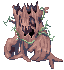{ .tower-monster-sprite loading="lazy" } | **Willow** ID: `1010` | **10** |
    | 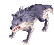{ .tower-monster-sprite loading="lazy" } | **Wolf** ID: `1013` | **10** |
    | 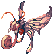{ .tower-monster-sprite loading="lazy" } | **Creamy** ID: `1018` | **10** |

??? info "Floor 3 - 30 monsters"

    | Sprite | Monster | Count |
    | --- | --- | ---: |
    | { .tower-monster-sprite loading="lazy" } | **Condor** ID: `1009` | **10** |
    | 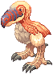{ .tower-monster-sprite loading="lazy" } | **Peco Peco** ID: `1019` | **10** |
    | 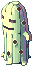{ .tower-monster-sprite loading="lazy" } | **Muka** ID: `1055` | **10** |

??? info "Floor 4 - 26 monsters"

    | Sprite | Monster | Count |
    | --- | --- | ---: |
    | 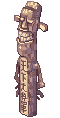{ .tower-monster-sprite loading="lazy" } | **Greatest General** ID: `1277` | **25** |
    | { .tower-monster-sprite loading="lazy" } | **Eddga** ID: `1115` | **1** |

??? info "Floor 5 - 30 monsters"

    | Sprite | Monster | Count |
    | --- | --- | ---: |
    | 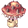{ .tower-monster-sprite loading="lazy" } | **Spore** ID: `1014` | **15** |
    | 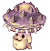{ .tower-monster-sprite loading="lazy" } | **Poison Spore** ID: `1077` | **15** |

??? info "Floor 6 - 45 monsters"

    | Sprite | Monster | Count |
    | --- | --- | ---: |
    | 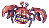{ .tower-monster-sprite loading="lazy" } | **Crab** ID: `1073` | **15** |
    | 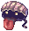{ .tower-monster-sprite loading="lazy" } | **Shellfish** ID: `1074` | **15** |
    | { .tower-monster-sprite loading="lazy" } | **Aster** ID: `1266` | **15** |

??? info "Floor 7 - 40 monsters"

    | Sprite | Monster | Count |
    | --- | --- | ---: |
    | 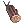{ .tower-monster-sprite loading="lazy" } | **Vadon** ID: `1066` | **10** |
    | 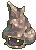{ .tower-monster-sprite loading="lazy" } | **Cornutus** ID: `1067` | **10** |
    | { .tower-monster-sprite loading="lazy" } | **Marina** ID: `1141` | **10** |
    | 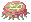{ .tower-monster-sprite loading="lazy" } | **Plankton** ID: `1161` | **10** |

??? info "Floor 8 - 31 monsters"

    | Sprite | Monster | Count |
    | --- | --- | ---: |
    | 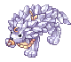{ .tower-monster-sprite loading="lazy" } | **Garm Baby** ID: `1515` | **10** |
    | { .tower-monster-sprite loading="lazy" } | **Marine Sphere** ID: `1142` | **20** |
    | 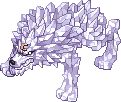{ .tower-monster-sprite loading="lazy" } | **Garm** ID: `1252` | **1** |

??? info "Floor 9 - 40 monsters"

    | Sprite | Monster | Count |
    | --- | --- | ---: |
    | 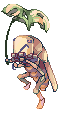{ .tower-monster-sprite loading="lazy" } | **Metaller** ID: `1058` | **20** |
    | { .tower-monster-sprite loading="lazy" } | **Magnolia** ID: `1138` | **20** |

??? info "Floor 10 - 45 monsters"

    | Sprite | Monster | Count |
    | --- | --- | ---: |
    | 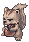{ .tower-monster-sprite loading="lazy" } | **Coco** ID: `1104` | **15** |
    | 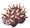{ .tower-monster-sprite loading="lazy" } | **Caramel** ID: `1103` | **15** |
    | 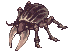{ .tower-monster-sprite loading="lazy" } | **Horn** ID: `1128` | **15** |

??? info "Floor 11 - 50 monsters"

    | Sprite | Monster | Count |
    | --- | --- | ---: |
    | { .tower-monster-sprite loading="lazy" } | **Orc Warrior** ID: `1023` | **25** |
    | 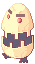{ .tower-monster-sprite loading="lazy" } | **Eggyra** ID: `1116` | **25** |

??? info "Floor 12 - 41 monsters"

    | Sprite | Monster | Count |
    | --- | --- | ---: |
    | 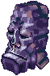{ .tower-monster-sprite loading="lazy" } | **Megalith** ID: `1274` | **10** |
    | 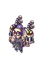{ .tower-monster-sprite loading="lazy" } | **Panzer Goblin** ID: `1308` | **10** |
    | 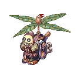{ .tower-monster-sprite loading="lazy" } | **Rotar Zairo** ID: `1392` | **10** |
    | 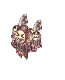{ .tower-monster-sprite loading="lazy" } | **Steam Goblin** ID: `1280` | **10** |
    | { .tower-monster-sprite loading="lazy" } | **Tao Gunka** ID: `1583` | **1** |

??? info "Floor 13 - 60 monsters"

    | Sprite | Monster | Count |
    | --- | --- | ---: |
    | 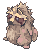{ .tower-monster-sprite loading="lazy" } | **Smokie** ID: `1056` | **15** |
    | 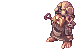{ .tower-monster-sprite loading="lazy" } | **Giearth** ID: `1121` | **15** |
    | 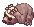{ .tower-monster-sprite loading="lazy" } | **Martin** ID: `1145` | **15** |
    | 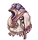{ .tower-monster-sprite loading="lazy" } | **Raggler** ID: `1254` | **15** |

??? info "Floor 14 - 50 monsters"

    | Sprite | Monster | Count |
    | --- | --- | ---: |
    | 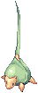{ .tower-monster-sprite loading="lazy" } | **Wormtail** ID: `1024` | **25** |
    | 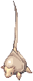{ .tower-monster-sprite loading="lazy" } | **Stem Worm** ID: `1215` | **25** |

??? info "Floor 15 - 50 monsters"

    | Sprite | Monster | Count |
    | --- | --- | ---: |
    | 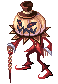{ .tower-monster-sprite loading="lazy" } | **Christmas Jakk** ID: `1244` | **10** |
    | { .tower-monster-sprite loading="lazy" } | **Christmas Goblin** ID: `1245` | **10** |
    | 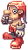{ .tower-monster-sprite loading="lazy" } | **Christmas Cookie** ID: `1246` | **10** |
    | 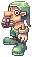{ .tower-monster-sprite loading="lazy" } | **Cookie** ID: `1265` | **10** |
    | 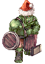{ .tower-monster-sprite loading="lazy" } | **Christmas Orc** ID: `1588` | **10** |

??? info "Floor 16 - 51 monsters"

    | Sprite | Monster | Count |
    | --- | --- | ---: |
    | { .tower-monster-sprite loading="lazy" } | **Antonio** ID: `1247` | **25** |
    | { .tower-monster-sprite loading="lazy" } | **Santa Poring** ID: `1062` | **25** |
    | 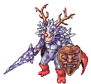{ .tower-monster-sprite loading="lazy" } | **Knight of Windstorm** ID: `1251` | **1** |

??? info "Floor 17 - 31 monsters"

    | Sprite | Monster | Count |
    | --- | --- | ---: |
    | 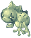{ .tower-monster-sprite loading="lazy" } | **Roda Frog** ID: `1012` | **10** |
    | 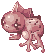{ .tower-monster-sprite loading="lazy" } | **Thara Frog** ID: `1034` | **10** |
    | { .tower-monster-sprite loading="lazy" } | **Poison Toad** ID: `1402` | **10** |
    | { .tower-monster-sprite loading="lazy" } | **Toad** ID: `1089` | **1** |

??? info "Floor 18 - 41 monsters"

    | Sprite | Monster | Count |
    | --- | --- | ---: |
    | { .tower-monster-sprite loading="lazy" } | **Lunatic** ID: `1063` | **20** |
    | 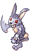{ .tower-monster-sprite loading="lazy" } | **Spring Rabbit** ID: `1322` | **20** |
    | { .tower-monster-sprite loading="lazy" } | **Eclipse** ID: `1093` | **1** |

??? info "Floor 19 - 41 monsters"

    | Sprite | Monster | Count |
    | --- | --- | ---: |
    | 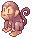{ .tower-monster-sprite loading="lazy" } | **Yoyo** ID: `1057` | **20** |
    | { .tower-monster-sprite loading="lazy" } | **Mime Monkey** ID: `1585` | **20** |
    | 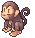{ .tower-monster-sprite loading="lazy" } | **Choco** ID: `1214` | **1** |

??? info "Floor 20 - 41 monsters"

    | Sprite | Monster | Count |
    | --- | --- | ---: |
    | 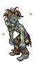{ .tower-monster-sprite loading="lazy" } | **Ghoul** ID: `1036` | **10** |
    | 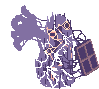{ .tower-monster-sprite loading="lazy" } | **Myst** ID: `1151` | **10** |
    | 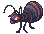{ .tower-monster-sprite loading="lazy" } | **Vitata** ID: `1176` | **10** |
    | { .tower-monster-sprite loading="lazy" } | **Zenorc** ID: `1177` | **10** |
    | { .tower-monster-sprite loading="lazy" } | **Dracula** ID: `1389` | **1** |

??? info "Floor 21 - 50 monsters"

    | Sprite | Monster | Count |
    | --- | --- | ---: |
    | { .tower-monster-sprite loading="lazy" } | **Stainer** ID: `1174` | **30** |
    | { .tower-monster-sprite loading="lazy" } | **Brilight** ID: `1211` | **20** |

??? info "Floor 22 - 60 monsters"

    | Sprite | Monster | Count |
    | --- | --- | ---: |
    | { .tower-monster-sprite loading="lazy" } | **Marc** ID: `1045` | **15** |
    | { .tower-monster-sprite loading="lazy" } | **Tri Joint** ID: `1279` | **15** |
    | { .tower-monster-sprite loading="lazy" } | **Fur Seal** ID: `1317` | **15** |
    | { .tower-monster-sprite loading="lazy" } | **Sea Otter** ID: `1323` | **15** |

??? info "Floor 23 - 50 monsters"

    | Sprite | Monster | Count |
    | --- | --- | ---: |
    | { .tower-monster-sprite loading="lazy" } | **Wood Goblin** ID: `1880` | **20** |
    | { .tower-monster-sprite loading="lazy" } | **Les** ID: `1881` | **20** |
    | { .tower-monster-sprite loading="lazy" } | **Mavka** ID: `1884` | **10** |

??? info "Floor 24 - 31 monsters"

    | Sprite | Monster | Count |
    | --- | --- | ---: |
    | { .tower-monster-sprite loading="lazy" } | **Baba Yaga** ID: `1882` | **20** |
    | { .tower-monster-sprite loading="lazy" } | **Uzhas** ID: `1883` | **10** |
    | { .tower-monster-sprite loading="lazy" } | **Gopinich** ID: `1885` | **1** |

??? info "Floor 25 - 60 monsters"

    | Sprite | Monster | Count |
    | --- | --- | ---: |
    | { .tower-monster-sprite loading="lazy" } | **Kaho** ID: `1072` | **15** |
    | { .tower-monster-sprite loading="lazy" } | **Blazer** ID: `1367` | **15** |
    | { .tower-monster-sprite loading="lazy" } | **Driller** ID: `1380` | **15** |
    | { .tower-monster-sprite loading="lazy" } | **Horong** ID: `1129` | **10** |
    | { .tower-monster-sprite loading="lazy" } | **Minorous** ID: `1149` | **5** |

## Floors 26-50

??? info "Floor 26 - 60 monsters"

    | Sprite | Monster | Count |
    | --- | --- | ---: |
    | { .tower-monster-sprite loading="lazy" } | **Dokebi** ID: `1110` | **30** |
    | { .tower-monster-sprite loading="lazy" } | **Am Mut** ID: `1301` | **20** |
    | { .tower-monster-sprite loading="lazy" } | **Sage Worm** ID: `1281` | **10** |

??? info "Floor 27 - 60 monsters"

    | Sprite | Monster | Count |
    | --- | --- | ---: |
    | { .tower-monster-sprite loading="lazy" } | **Savage** ID: `1166` | **30** |
    | { .tower-monster-sprite loading="lazy" } | **Gullinbursti** ID: `1311` | **20** |
    | { .tower-monster-sprite loading="lazy" } | **Goat** ID: `1372` | **10** |

??? info "Floor 28 - 71 monsters"

    | Sprite | Monster | Count |
    | --- | --- | ---: |
    | { .tower-monster-sprite loading="lazy" } | **Beetle King** ID: `1494` | **20** |
    | { .tower-monster-sprite loading="lazy" } | **Bacsojin** ID: `1518` | **10** |
    | { .tower-monster-sprite loading="lazy" } | **Chung E** ID: `1519` | **10** |
    | { .tower-monster-sprite loading="lazy" } | **Tamruan** ID: `1584` | **30** |
    | { .tower-monster-sprite loading="lazy" } | **Lady Tanee** ID: `1688` | **1** |

??? info "Floor 29 - 60 monsters"

    | Sprite | Monster | Count |
    | --- | --- | ---: |
    | { .tower-monster-sprite loading="lazy" } | **Requiem** ID: `1164` | **25** |
    | { .tower-monster-sprite loading="lazy" } | **Zerom** ID: `1178` | **25** |
    | { .tower-monster-sprite loading="lazy" } | **Skeleton General** ID: `1290` | **10** |

??? info "Floor 30 - 50 monsters"

    | Sprite | Monster | Count |
    | --- | --- | ---: |
    | { .tower-monster-sprite loading="lazy" } | **Leaf Cat** ID: `1586` | **25** |
    | { .tower-monster-sprite loading="lazy" } | **Wild Rose** ID: `1261` | **25** |

??? info "Floor 31 - 40 monsters"

    | Sprite | Monster | Count |
    | --- | --- | ---: |
    | { .tower-monster-sprite loading="lazy" } | **Dustiness** ID: `1114` | **10** |
    | { .tower-monster-sprite loading="lazy" } | **Giant Spider** ID: `1304` | **10** |
    | { .tower-monster-sprite loading="lazy" } | **Porcellio** ID: `1619` | **10** |
    | { .tower-monster-sprite loading="lazy" } | **Pitman** ID: `1616` | **10** |

??? info "Floor 32 - 51 monsters"

    | Sprite | Monster | Count |
    | --- | --- | ---: |
    | { .tower-monster-sprite loading="lazy" } | **Mineral** ID: `1614` | **10** |
    | { .tower-monster-sprite loading="lazy" } | **Waste Stove** ID: `1617` | **10** |
    | { .tower-monster-sprite loading="lazy" } | **Noxious** ID: `1620` | **10** |
    | { .tower-monster-sprite loading="lazy" } | **Venomous** ID: `1621` | **10** |
    | { .tower-monster-sprite loading="lazy" } | **Teddy Bear** ID: `1622` | **10** |
    | { .tower-monster-sprite loading="lazy" } | **RSX 0806** ID: `1623` | **1** |

??? info "Floor 33 - 45 monsters"

    | Sprite | Monster | Count |
    | --- | --- | ---: |
    | { .tower-monster-sprite loading="lazy" } | **Bathory** ID: `1102` | **15** |
    | { .tower-monster-sprite loading="lazy" } | **Sohee** ID: `1170` | **15** |
    | { .tower-monster-sprite loading="lazy" } | **Violy** ID: `1390` | **15** |

??? info "Floor 34 - 60 monsters"

    | Sprite | Monster | Count |
    | --- | --- | ---: |
    | { .tower-monster-sprite loading="lazy" } | **Dragon Tail** ID: `1321` | **15** |
    | { .tower-monster-sprite loading="lazy" } | **Geographer** ID: `1368` | **15** |
    | { .tower-monster-sprite loading="lazy" } | **Galapago** ID: `1391` | **15** |
    | { .tower-monster-sprite loading="lazy" } | **Kapha** ID: `1406` | **15** |

??? info "Floor 35 - 45 monsters"

    | Sprite | Monster | Count |
    | --- | --- | ---: |
    | { .tower-monster-sprite loading="lazy" } | **Rice Cake Boy** ID: `1409` | **15** |
    | { .tower-monster-sprite loading="lazy" } | **Boiled Rice** ID: `1520` | **15** |
    | { .tower-monster-sprite loading="lazy" } | **Baby Leopard** ID: `1415` | **15** |

??? info "Floor 36 - 51 monsters"

    | Sprite | Monster | Count |
    | --- | --- | ---: |
    | { .tower-monster-sprite loading="lazy" } | **Disguise** ID: `1506` | **30** |
    | { .tower-monster-sprite loading="lazy" } | **Dark Priest** ID: `1198` | **20** |
    | { .tower-monster-sprite loading="lazy" } | **Lord of Death** ID: `1373` | **1** |

??? info "Floor 37 - 50 monsters"

    | Sprite | Monster | Count |
    | --- | --- | ---: |
    | { .tower-monster-sprite loading="lazy" } | **Wootan Shooter** ID: `1498` | **25** |
    | { .tower-monster-sprite loading="lazy" } | **Wootan Fighter** ID: `1499` | **25** |

??? info "Floor 38 - 40 monsters"

    | Sprite | Monster | Count |
    | --- | --- | ---: |
    | { .tower-monster-sprite loading="lazy" } | **Mole** ID: `1628` | **30** |
    | { .tower-monster-sprite loading="lazy" } | **Maya Purple** ID: `1289` | **10** |

??? info "Floor 39 - 40 monsters"

    | Sprite | Monster | Count |
    | --- | --- | ---: |
    | { .tower-monster-sprite loading="lazy" } | **Safeguard Chief** ID: `1981` | **10** |
    | { .tower-monster-sprite loading="lazy" } | **Orc Sniper** ID: `1982` | **10** |
    | { .tower-monster-sprite loading="lazy" } | **Depraved Orc Spirit** ID: `1983` | **10** |
    | { .tower-monster-sprite loading="lazy" } | **Shaman Cargalache** ID: `1984` | **10** |

??? info "Floor 40 - 45 monsters"

    | Sprite | Monster | Count |
    | --- | --- | ---: |
    | { .tower-monster-sprite loading="lazy" } | **Magmaring** ID: `1836` | **15** |
    | { .tower-monster-sprite loading="lazy" } | **Knocker** ID: `1838` | **15** |
    | { .tower-monster-sprite loading="lazy" } | **Imp** ID: `1837` | **15** |

??? info "Floor 41 - 50 monsters"

    | Sprite | Monster | Count |
    | --- | --- | ---: |
    | { .tower-monster-sprite loading="lazy" } | **Remover** ID: `1682` | **25** |
    | { .tower-monster-sprite loading="lazy" } | **Gemini-S58** ID: `1681` | **25** |

??? info "Floor 42 - 50 monsters"

    | Sprite | Monster | Count |
    | --- | --- | ---: |
    | { .tower-monster-sprite loading="lazy" } | **Breeze** ID: `1692` | **25** |
    | { .tower-monster-sprite loading="lazy" } | **Roween** ID: `1782` | **25** |

??? info "Floor 43 - 50 monsters"

    | Sprite | Monster | Count |
    | --- | --- | ---: |
    | { .tower-monster-sprite loading="lazy" } | **Gremlin** ID: `1632` | **25** |
    | { .tower-monster-sprite loading="lazy" } | **Hodremlin** ID: `1773` | **25** |

??? info "Floor 44 - 51 monsters"

    | Sprite | Monster | Count |
    | --- | --- | ---: |
    | { .tower-monster-sprite loading="lazy" } | **Novus** ID: `1715` | **25** |
    | { .tower-monster-sprite loading="lazy" } | **Acidus** ID: `1716` | **25** |
    | { .tower-monster-sprite loading="lazy" } | **Detale** ID: `1719` | **1** |

??? info "Floor 45 - 50 monsters"

    | Sprite | Monster | Count |
    | --- | --- | ---: |
    | { .tower-monster-sprite loading="lazy" } | **Banshee Master** ID: `1974` | **25** |
    | { .tower-monster-sprite loading="lazy" } | **Banshee** ID: `1868` | **25** |

??? info "Floor 46 - 55 monsters"

    | Sprite | Monster | Count |
    | --- | --- | ---: |
    | { .tower-monster-sprite loading="lazy" } | **Beholder Master** ID: `1975` | **25** |
    | { .tower-monster-sprite loading="lazy" } | **Beholder** ID: `1633` | **15** |
    | { .tower-monster-sprite loading="lazy" } | **Seeker** ID: `1774` | **15** |

??? info "Floor 47 - 50 monsters"

    | Sprite | Monster | Count |
    | --- | --- | ---: |
    | { .tower-monster-sprite loading="lazy" } | **Cobalt Mineral** ID: `1976` | **25** |
    | { .tower-monster-sprite loading="lazy" } | **Heavy Metaling** ID: `1977` | **25** |

??? info "Floor 48 - 61 monsters"

    | Sprite | Monster | Count |
    | --- | --- | ---: |
    | { .tower-monster-sprite loading="lazy" } | **Alicel** ID: `1735` | **30** |
    | { .tower-monster-sprite loading="lazy" } | **Constant** ID: `1738` | **30** |
    | { .tower-monster-sprite loading="lazy" } | **Kiel D-01** ID: `1734` | **1** |

??? info "Floor 49 - 50 monsters"

    | Sprite | Monster | Count |
    | --- | --- | ---: |
    | { .tower-monster-sprite loading="lazy" } | **Frus** ID: `1753` | **50** |

??? info "Floor 50 - 50 monsters"

    | Sprite | Monster | Count |
    | --- | --- | ---: |
    | { .tower-monster-sprite loading="lazy" } | **Hell Apocalips** ID: `1978` | **25** |
    | { .tower-monster-sprite loading="lazy" } | **Apocalypse** ID: `1365` | **25** |

## Floors 51-75

??? info "Floor 51 - 50 monsters"

    | Sprite | Monster | Count |
    | --- | --- | ---: |
    | { .tower-monster-sprite loading="lazy" } | **Zukadam** ID: `1979` | **25** |
    | { .tower-monster-sprite loading="lazy" } | **Archdam** ID: `1668` | **25** |

??? info "Floor 52 - 51 monsters"

    | Sprite | Monster | Count |
    | --- | --- | ---: |
    | { .tower-monster-sprite loading="lazy" } | **Aunoe** ID: `1796` | **25** |
    | { .tower-monster-sprite loading="lazy" } | **Fanat** ID: `1797` | **25** |
    | { .tower-monster-sprite loading="lazy" } | **Gloom Under Night** ID: `1768` | **1** |

??? info "Floor 53 - 50 monsters"

    | Sprite | Monster | Count |
    | --- | --- | ---: |
    | { .tower-monster-sprite loading="lazy" } | **Zombie Slaughter** ID: `1864` | **25** |
    | { .tower-monster-sprite loading="lazy" } | **Hell Poodle** ID: `1866` | **25** |

??? info "Floor 54 - 60 monsters"

    | Sprite | Monster | Count |
    | --- | --- | ---: |
    | { .tower-monster-sprite loading="lazy" } | **Siroma** ID: `1776` | **30** |
    | { .tower-monster-sprite loading="lazy" } | **Snowier** ID: `1775` | **20** |
    | { .tower-monster-sprite loading="lazy" } | **Ice Titan** ID: `1777` | **10** |

??? info "Floor 55 - 75 monsters"

    | Sprite | Monster | Count |
    | --- | --- | ---: |
    | { .tower-monster-sprite loading="lazy" } | **Iceicle** ID: `1789` | **75** |

??? info "Floor 56 - 31 monsters"

    | Sprite | Monster | Count |
    | --- | --- | ---: |
    | { .tower-monster-sprite loading="lazy" } | **Gazeti** ID: `1778` | **30** |
    | { .tower-monster-sprite loading="lazy" } | **Ktullanux** ID: `1779` | **1** |

??? info "Floor 57 - 41 monsters"

    | Sprite | Monster | Count |
    | --- | --- | ---: |
    | { .tower-monster-sprite loading="lazy" } | **Photon Cannon** ID: `1664` | **10** |
    | { .tower-monster-sprite loading="lazy" } | **Photon Cannon** ID: `1665` | **10** |
    | { .tower-monster-sprite loading="lazy" } | **Photon Cannon** ID: `1666` | **10** |
    | { .tower-monster-sprite loading="lazy" } | **Photon Cannon** ID: `1667` | **10** |
    | { .tower-monster-sprite loading="lazy" } | **Vesper** ID: `1685` | **1** |

??? info "Floor 58 - 15 monsters"

    | Sprite | Monster | Count |
    | --- | --- | ---: |
    | { .tower-monster-sprite loading="lazy" } | **Ghostring** ID: `1120` | **3** |
    | { .tower-monster-sprite loading="lazy" } | **Angeling** ID: `1096` | **3** |
    | { .tower-monster-sprite loading="lazy" } | **Deviling** ID: `1582` | **3** |
    | { .tower-monster-sprite loading="lazy" } | **Archangeling** ID: `1388` | **3** |
    | { .tower-monster-sprite loading="lazy" } | **Mastering** ID: `1090` | **3** |

??? info "Floor 59 - 48 monsters"

    | Sprite | Monster | Count |
    | --- | --- | ---: |
    | { .tower-monster-sprite loading="lazy" } | **Thanatos Odium** ID: `1704` | **12** |
    | { .tower-monster-sprite loading="lazy" } | **Thanatos Despero** ID: `1705` | **12** |
    | { .tower-monster-sprite loading="lazy" } | **Thanatos Maero** ID: `1706` | **12** |
    | { .tower-monster-sprite loading="lazy" } | **Thanatos Dolor** ID: `1707` | **12** |

??? info "Floor 60 - 1 monsters"

    | Sprite | Monster | Count |
    | --- | --- | ---: |
    | { .tower-monster-sprite loading="lazy" } | **Thanatos** ID: `1708` | **1** |

??? info "Floor 61 - 80 monsters"

    | Sprite | Monster | Count |
    | --- | --- | ---: |
    | { .tower-monster-sprite loading="lazy" } | **Pinguicula** ID: `1995` | **40** |
    | { .tower-monster-sprite loading="lazy" } | **Dark Pinguicula** ID: `2015` | **40** |

??? info "Floor 62 - 90 monsters"

    | Sprite | Monster | Count |
    | --- | --- | ---: |
    | { .tower-monster-sprite loading="lazy" } | **Nepenthes** ID: `1988` | **60** |
    | { .tower-monster-sprite loading="lazy" } | **Luciola Vespa** ID: `1994` | **30** |

??? info "Floor 63 - 70 monsters"

    | Sprite | Monster | Count |
    | --- | --- | ---: |
    | { .tower-monster-sprite loading="lazy" } | **Naga** ID: `1993` | **50** |
    | { .tower-monster-sprite loading="lazy" } | **Cornus** ID: `1992` | **20** |

??? info "Floor 64 - 17 monsters"

    | Sprite | Monster | Count |
    | --- | --- | ---: |
    | { .tower-monster-sprite loading="lazy" } | **Hillslion** ID: `1989` | **15** |
    | { .tower-monster-sprite loading="lazy" } | **Tendrillion** ID: `1991` | **2** |

??? info "Floor 65 - 75 monsters"

    | Sprite | Monster | Count |
    | --- | --- | ---: |
    | { .tower-monster-sprite loading="lazy" } | **Centipede Larva** ID: `1999` | **50** |
    | { .tower-monster-sprite loading="lazy" } | **Centipede** ID: `1987` | **25** |

??? info "Floor 66 - 80 monsters"

    | Sprite | Monster | Count |
    | --- | --- | ---: |
    | { .tower-monster-sprite loading="lazy" } | **Draco Egg** ID: `2014` | **30** |
    | { .tower-monster-sprite loading="lazy" } | **Draco** ID: `2013` | **10** |
    | { .tower-monster-sprite loading="lazy" } | **Tatacho** ID: `1986` | **40** |

??? info "Floor 67 - 60 monsters"

    | Sprite | Monster | Count |
    | --- | --- | ---: |
    | { .tower-monster-sprite loading="lazy" } | **Bradium Golem** ID: `2024` | **30** |
    | { .tower-monster-sprite loading="lazy" } | **Stalactic Golem** ID: `1278` | **10** |
    | { .tower-monster-sprite loading="lazy" } | **Lava Golem** ID: `1366` | **20** |

??? info "Floor 68 - 12 monsters"

    | Sprite | Monster | Count |
    | --- | --- | ---: |
    | { .tower-monster-sprite loading="lazy" } | **Tatacho** ID: `1986` | **10** |
    | { .tower-monster-sprite loading="lazy" } | **Hardrock Mammoth** ID: `1990` | **2** |

??? info "Floor 69 - 75 monsters"

    | Sprite | Monster | Count |
    | --- | --- | ---: |
    | { .tower-monster-sprite loading="lazy" } | **Aqua Elemental** ID: `2016` | **25** |
    | { .tower-monster-sprite loading="lazy" } | **Rhyncho** ID: `2020` | **25** |
    | { .tower-monster-sprite loading="lazy" } | **Phylla** ID: `2021` | **25** |

??? info "Floor 70 - 50 monsters"

    | Sprite | Monster | Count |
    | --- | --- | ---: |
    | { .tower-monster-sprite loading="lazy" } | **Ancient Tree** ID: `2019` | **35** |
    | { .tower-monster-sprite loading="lazy" } | **Dark Shadow** ID: `2023` | **15** |

??? info "Floor 71 - 24 monsters"

    | Sprite | Monster | Count |
    | --- | --- | ---: |
    | { .tower-monster-sprite loading="lazy" } | **Rata** ID: `2017` | **12** |
    | { .tower-monster-sprite loading="lazy" } | **Duneyrr** ID: `2018` | **12** |

??? info "Floor 72 - 1 monsters"

    | Sprite | Monster | Count |
    | --- | --- | ---: |
    | { .tower-monster-sprite loading="lazy" } | **Nidhoggr's Shadow** ID: `2022` | **1** |

??? info "Floor 73 - 16 monsters"

    | Sprite | Monster | Count |
    | --- | --- | ---: |
    | { .tower-monster-sprite loading="lazy" } | **Byorgue** ID: `1839` | **16** |

??? info "Floor 74 - 12 monsters"

    | Sprite | Monster | Count |
    | --- | --- | ---: |
    | { .tower-monster-sprite loading="lazy" } | **Lord Knight Seyren** ID: `1640` | **2** |
    | { .tower-monster-sprite loading="lazy" } | **Assassin Cross Eremes** ID: `1641` | **2** |
    | { .tower-monster-sprite loading="lazy" } | **Whitesmith Harword** ID: `1642` | **2** |
    | { .tower-monster-sprite loading="lazy" } | **High Priest Magaleta** ID: `1643` | **2** |
    | { .tower-monster-sprite loading="lazy" } | **Sniper Shecil** ID: `1644` | **2** |
    | { .tower-monster-sprite loading="lazy" } | **High Wizard Katrinn** ID: `1645` | **2** |

??? info "Floor 75 - 28 monsters"

    | Sprite | Monster | Count |
    | --- | --- | ---: |
    | { .tower-monster-sprite loading="lazy" } | **Incarnation of Morroc** ID: `1918` | **7** |
    | { .tower-monster-sprite loading="lazy" } | **Incarnation of Morroc** ID: `1919` | **7** |
    | { .tower-monster-sprite loading="lazy" } | **Incarnation of Morroc** ID: `1920` | **7** |
    | { .tower-monster-sprite loading="lazy" } | **Incarnation of Morroc** ID: `1921` | **7** |

## Floor 76 - Wounded Morroc

??? warning "Floor 76 - Wounded Morroc"

    Wounded Morroc uses **10% of normal configured drop rates**.

    | Sprite | Monster | Count |
    | --- | --- | ---: |
    | { .tower-monster-sprite loading="lazy" } | **Wounded Morroc** ID: `1917` | **1** |

## Floor 77 - Final encounter

The stages run in order. Defeat every required monster in a stage to begin the next after a **three-second interval**.

1. **Poring**.
2. **Two distinct Bio Labs MVPs**, chosen randomly from the six candidates in the table. Each selected MVP spawns once.
3. **Super Baphomet**, **two Piamettes** and **two Wish Maidens**.
4. **Pori Pori**, **10 Golden Savages**, **10 Pourings** and **20 Bomb Porings**.

Only the two selected Bio Labs MVPs keep their normal configured drops. All other final-arena monsters use **10%**.

??? danger "Floor 77 - Four-stage final encounter"

    | Stage | Sprite | Monster | Count |
    | ---: | --- | --- | ---: |
    | 1 | { .tower-monster-sprite loading="lazy" } | **Poring** ID: `1002` | **1** |
    | 2 | { .tower-monster-sprite loading="lazy" } | **Lord Knight Seyren** ID: `1646` | **1 if selected** |
    | 2 | { .tower-monster-sprite loading="lazy" } | **Assassin Cross Eremes** ID: `1647` | **1 if selected** |
    | 2 | { .tower-monster-sprite loading="lazy" } | **MasterSmith Howard** ID: `1648` | **1 if selected** |
    | 2 | { .tower-monster-sprite loading="lazy" } | **High Priest Margaretha** ID: `1649` | **1 if selected** |
    | 2 | { .tower-monster-sprite loading="lazy" } | **Sniper Cecil** ID: `1650` | **1 if selected** |
    | 2 | { .tower-monster-sprite loading="lazy" } | **High Wizard Kathryne** ID: `1651` | **1 if selected** |
    | 3 | { .tower-monster-sprite loading="lazy" } | **Super Baphomet** ID: `1399` | **1** |
    | 3 | { .tower-monster-sprite loading="lazy" } | **Piamette** ID: `1930` | **2** |
    | 3 | { .tower-monster-sprite loading="lazy" } | **Wish Maiden** ID: `1931` | **2** |
    | 4 | { .tower-monster-sprite loading="lazy" } | **Pori Pori** ID: `1502` | **1** |
    | 4 | { .tower-monster-sprite loading="lazy" } | **Golden Savage** ID: `1840` | **10** |
    | 4 | { .tower-monster-sprite loading="lazy" } | **Pouring** ID: `1894` | **10** |
    | 4 | { .tower-monster-sprite loading="lazy" } | **Bomb Poring** ID: `1904` | **20** |

## Related guides

- [Endless Tower](endless-tower.md)
- [Warper](warper.md#misty-island)
- [Hunting and instances](dungeons.md)
