# Endless Tower

Climb **101 floors** with your party, defeat every floor's monsters and face **Naght Sieger** at the top. The full monster catalogue below includes sprites, monster IDs and spawn counts for each floor.

## Quick facts

| Requirement | Vestige Rift rule |
| --- | --- |
| Entry NPC | **Captain Janssen**, Prontera **217,187** |
| Staging area | **Misty Island** (`e_tower`) |
| Party | **6 or more members**, each using a different account |
| Minimum Base Level | **85** for every member |
| Readiness | Every starting member types **`!ready`** within **60 seconds** |
| Time limit | **4 hours**, starting after everyone confirms readiness |
| Weekly allowance | **1 run per account**, shared by all its characters |
| Weekly reset | **Monday at 06:00 Philippines time (UTC+8)** |

## Getting there

1. Speak to **Captain Janssen** in Prontera: `/navi prontera 217/187`.
2. Follow his conversations and make the **10,000z donation** when asked. Speak to him again to continue the story and board the ship to Misty Island.
3. Your first voyage unlocks the **Misty Island - 5,000z** route in the [Warper](warper.md#misty-island) for this character.
4. Gather the entire party on Misty Island and visit the **Tower Protection Stone**.

Captain Janssen also offers return voyages for **10,000z**. The unlocked Warper route costs **5,000z** per trip.

### Misty Island services

| NPC | Location | Service |
| --- | --- | --- |
| Tower Protection Stone | `e_tower 81,105` | Start a readiness check, rejoin the current floor or view weekly run information |
| Cellar Protection Stone | `e_tower 82,110` | Start or rejoin [Endless Cellar](endless-cellar.md), which has a separate weekly allowance |
| Kafra Employee | `e_tower 76,99` | Main Storage, Guild Storage and return to Prontera |

## Starting a run

1. Form a party of **at least six** characters. Every member must be **online, alive, Base Level 85+ and present on Misty Island**. Close other dialogs, shops and storage.
2. The party leader selects **Start Endless Tower** at the Tower Protection Stone.
3. Every member types **`!ready` in public chat within 60 seconds**. Keep the same party roster throughout the readiness check.
4. Once everyone is ready, the party is sent to Floor 1 and each participating account consumes its weekly run.

If readiness expires or the party fails the final checks, the party returns to its save points and **no weekly run is consumed**. A member who disconnects or leaves the island during readiness must return and confirm `!ready` again.

Use **`@instanceinfo`**, or **Weekly run information** at the stone, to see the account's remaining allowance and the party's active tower status.

## Tower rules

| Feature | Rule |
| --- | --- |
| Clearing floors | Defeat every required monster to open the next gate. **Taming does not count as defeating a monster.** |
| Floor skips | Advance through the floor gates; skipping floors is unavailable. |
| Death | Normal death rules apply. Players may be resurrected or leave and re-enter. |
| Re-entry | Only the **original characters in the starting party** may rejoin, while at least one original party member remains inside. Rejoin through the island stone to reach the party's current floor. |
| Everyone leaves | The instance closes when every original member leaves or disconnects. The weekly run remains consumed. |
| Time expires | The instance closes after four hours. The weekly run remains consumed. |
| Storage | Personal and Guild Storage are **unavailable inside**. Island storage is available before entry or while restocking outside. |
| Mail | **RODEX is available** inside the tower. |
| Drops | Monsters use their normal configured drops. **Bubble Gum does not increase tower drop rates.** |
| Restricted actions | Random teleportation, Warp Portal, vending and branch use are blocked inside. |

The weekly allowance belongs to the **account**. Switching characters does not grant another run, and a successful clear still uses that week's single run.

## Completion and rewards

After defeating **Naght Sieger**, speak to the **Lost Soul** and exit through the NPC to record completion. The cleared tower remains available for up to **five minutes**, within the original four-hour limit.

Copies of the starting party members appear near the exit. Speak to a copy to see that character's **damage dealt, damage taken, healing done, healing received, deaths and monster kills** for the run.

### Violet Fear exchange

The Lost Soul can combine **one Twin Edge of Naght Sieger (#13412)** and **one Twin Edge of Naght Sieger (#13413)** into **one Violet Fear (#1185)**. Refinements and cards on the two original swords are lost when they are consumed.

## Monster catalogue

The tables list the configured floor encounters. Counts describe the starting wave; monsters summoned during combat are additional. Expand a floor to see its monsters.

[Floors 1-25](#floors-1-25) · [Floors 26-50](#floors-26-50) · [Floors 51-75](#floors-51-75) · [Floors 76-98](#floors-76-98) · [Floor 99](#floor-99-random-encounters) · [Floor 100](#floor-100-entweihen-crothen) · [Floor 101](#floor-101-final-encounter)

## Floors 1-25

??? info "Floor 1 - 36 monsters"

    | Sprite | Monster | Count |
    | --- | --- | ---: |
    | { .tower-monster-sprite loading="lazy" } | **Metaling** ID: `1613` | **15** |
    | { .tower-monster-sprite loading="lazy" } | **Marin** ID: `1242` | **5** |
    | { .tower-monster-sprite loading="lazy" } | **Poporing** ID: `1031` | **5** |
    | { .tower-monster-sprite loading="lazy" } | **Drops** ID: `1113` | **5** |
    | { .tower-monster-sprite loading="lazy" } | **Mastering** ID: `1090` | **1** |
    | { .tower-monster-sprite loading="lazy" } | **Poring** ID: `1002` | **5** |

??? info "Floor 2 - 31 monsters"

    | Sprite | Monster | Count |
    | --- | --- | ---: |
    | 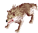{ .tower-monster-sprite loading="lazy" } | **Desert Wolf** ID: `1106` | **20** |
    | 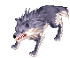{ .tower-monster-sprite loading="lazy" } | **Vagabond Wolf** ID: `1092` | **1** |
    | 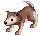{ .tower-monster-sprite loading="lazy" } | **Baby Desert Wolf** ID: `1107` | **10** |

??? info "Floor 3 - 30 monsters"

    | Sprite | Monster | Count |
    | --- | --- | ---: |
    | 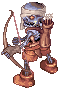{ .tower-monster-sprite loading="lazy" } | **Archer Skeleton** ID: `1016` | **5** |
    | 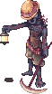{ .tower-monster-sprite loading="lazy" } | **Skel Worker** ID: `1169` | **5** |
    | 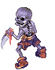{ .tower-monster-sprite loading="lazy" } | **Soldier Skeleton** ID: `1028` | **5** |
    | 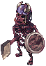{ .tower-monster-sprite loading="lazy" } | **Orc Skeleton** ID: `1152` | **5** |
    | 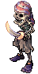{ .tower-monster-sprite loading="lazy" } | **Pirate Skeleton** ID: `1071` | **5** |
    | { .tower-monster-sprite loading="lazy" } | **Skeleton** ID: `1076` | **5** |

??? info "Floor 4 - 36 monsters"

    | Sprite | Monster | Count |
    | --- | --- | ---: |
    | 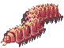{ .tower-monster-sprite loading="lazy" } | **Argiope** ID: `1099` | **15** |
    | 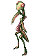{ .tower-monster-sprite loading="lazy" } | **Mantis** ID: `1139` | **5** |
    | 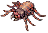{ .tower-monster-sprite loading="lazy" } | **Argos** ID: `1100` | **5** |
    | 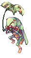{ .tower-monster-sprite loading="lazy" } | **Vocal** ID: `1088` | **1** |
    | { .tower-monster-sprite loading="lazy" } | **Rocker** ID: `1052` | **5** |
    | 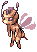{ .tower-monster-sprite loading="lazy" } | **Hornet** ID: `1004` | **5** |

??? info "Floor 5 - 51 monsters"

    | Sprite | Monster | Count |
    | --- | --- | ---: |
    | 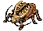{ .tower-monster-sprite loading="lazy" } | **Golden Thief Bug** ID: `1086` | **1** |
    | 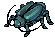{ .tower-monster-sprite loading="lazy" } | **Thief Bug Male** ID: `1054` | **15** |
    | 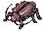{ .tower-monster-sprite loading="lazy" } | **Thief Bug Female** ID: `1053` | **15** |
    | 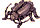{ .tower-monster-sprite loading="lazy" } | **Thief Bug** ID: `1051` | **15** |
    | { .tower-monster-sprite loading="lazy" } | **Thief Bug Egg** ID: `1048` | **5** |

??? info "Floor 6 - 20 monsters"

    | Sprite | Monster | Count |
    | --- | --- | ---: |
    | { .tower-monster-sprite loading="lazy" } | **Dragon Egg** ID: `1721` | **5** |
    | { .tower-monster-sprite loading="lazy" } | **Thief Bug Egg** ID: `1048` | **5** |
    | { .tower-monster-sprite loading="lazy" } | **Ant Egg** ID: `1097` | **5** |
    | 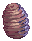{ .tower-monster-sprite loading="lazy" } | **Pupa** ID: `1008` | **5** |

??? info "Floor 7 - 60 monsters"

    | Sprite | Monster | Count |
    | --- | --- | ---: |
    | 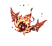{ .tower-monster-sprite loading="lazy" } | **Explosion** ID: `1383` | **15** |
    | 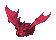{ .tower-monster-sprite loading="lazy" } | **Drainliar** ID: `1111` | **15** |
    | { .tower-monster-sprite loading="lazy" } | **Anopheles** ID: `1627` | **15** |
    | 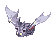{ .tower-monster-sprite loading="lazy" } | **Farmiliar** ID: `1005` | **15** |

??? info "Floor 8 - 30 monsters"

    | Sprite | Monster | Count |
    | --- | --- | ---: |
    | 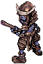{ .tower-monster-sprite loading="lazy" } | **Firelock Soldier** ID: `1403` | **15** |
    | 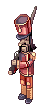{ .tower-monster-sprite loading="lazy" } | **Cruiser** ID: `1248` | **15** |

??? info "Floor 9 - 40 monsters"

    | Sprite | Monster | Count |
    | --- | --- | ---: |
    | 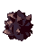{ .tower-monster-sprite loading="lazy" } | **Obsidian** ID: `1615` | **15** |
    | 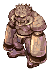{ .tower-monster-sprite loading="lazy" } | **Golem** ID: `1040` | **15** |
    | 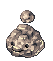{ .tower-monster-sprite loading="lazy" } | **Stapo** ID: `1784` | **10** |

??? info "Floor 10 - 46 monsters"

    | Sprite | Monster | Count |
    | --- | --- | ---: |
    | 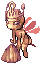{ .tower-monster-sprite loading="lazy" } | **Mistress** ID: `1059` | **1** |
    | 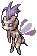{ .tower-monster-sprite loading="lazy" } | **Giant Hornet** ID: `1303` | **25** |
    | { .tower-monster-sprite loading="lazy" } | **Hornet** ID: `1004` | **20** |

??? info "Floor 11 - 50 monsters"

    | Sprite | Monster | Count |
    | --- | --- | ---: |
    | 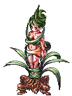{ .tower-monster-sprite loading="lazy" } | **Dryad** ID: `1493` | **15** |
    | { .tower-monster-sprite loading="lazy" } | **Parasite** ID: `1500` | **15** |
    | 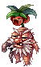{ .tower-monster-sprite loading="lazy" } | **Hermit Plant** ID: `1413` | **15** |
    | 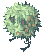{ .tower-monster-sprite loading="lazy" } | **Rafflesia** ID: `1162` | **5** |

??? info "Floor 12 - 50 monsters"

    | Sprite | Monster | Count |
    | --- | --- | ---: |
    | 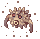{ .tower-monster-sprite loading="lazy" } | **Demon Pungus** ID: `1378` | **25** |
    | 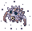{ .tower-monster-sprite loading="lazy" } | **Punk** ID: `1199` | **25** |

??? info "Floor 13 - 40 monsters"

    | Sprite | Monster | Count |
    | --- | --- | ---: |
    | 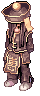{ .tower-monster-sprite loading="lazy" } | **Yao Yun** ID: `1512` | **15** |
    | 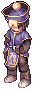{ .tower-monster-sprite loading="lazy" } | **Bongunn** ID: `1188` | **15** |
    | { .tower-monster-sprite loading="lazy" } | **Munak** ID: `1026` | **10** |

??? info "Floor 14 - 45 monsters"

    | Sprite | Monster | Count |
    | --- | --- | ---: |
    | 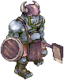{ .tower-monster-sprite loading="lazy" } | **High Orc** ID: `1213` | **15** |
    | 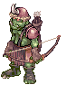{ .tower-monster-sprite loading="lazy" } | **Orc Archer** ID: `1189` | **10** |
    | 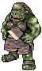{ .tower-monster-sprite loading="lazy" } | **Orc Lady** ID: `1273` | **10** |
    | 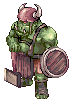{ .tower-monster-sprite loading="lazy" } | **Orc Warrior** ID: `1023` | **5** |
    | 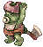{ .tower-monster-sprite loading="lazy" } | **Orc Baby** ID: `1686` | **5** |

??? info "Floor 15 - 52 monsters"

    | Sprite | Monster | Count |
    | --- | --- | ---: |
    | 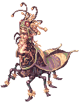{ .tower-monster-sprite loading="lazy" } | **Maya** ID: `1147` | **1** |
    | 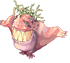{ .tower-monster-sprite loading="lazy" } | **Phreeoni** ID: `1159` | **1** |
    | 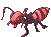{ .tower-monster-sprite loading="lazy" } | **Deniro** ID: `1105` | **15** |
    | 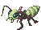{ .tower-monster-sprite loading="lazy" } | **Pierre** ID: `1160` | **15** |
    | 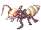{ .tower-monster-sprite loading="lazy" } | **Andre** ID: `1095` | **15** |
    | { .tower-monster-sprite loading="lazy" } | **Ant Egg** ID: `1097` | **5** |

??? info "Floor 16 - 40 monsters"

    | Sprite | Monster | Count |
    | --- | --- | ---: |
    | 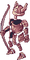{ .tower-monster-sprite loading="lazy" } | **Raydric Archer** ID: `1276` | **10** |
    | { .tower-monster-sprite loading="lazy" } | **Orc Archer** ID: `1189` | **10** |
    | 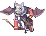{ .tower-monster-sprite loading="lazy" } | **Gargoyle** ID: `1253` | **10** |
    | { .tower-monster-sprite loading="lazy" } | **Archer Skeleton** ID: `1016` | **10** |

??? info "Floor 17 - 40 monsters"

    | Sprite | Monster | Count |
    | --- | --- | ---: |
    | 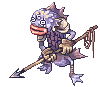{ .tower-monster-sprite loading="lazy" } | **Merman** ID: `1264` | **10** |
    | 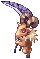{ .tower-monster-sprite loading="lazy" } | **Baphomet Jr.** ID: `1101` | **10** |
    | 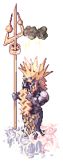{ .tower-monster-sprite loading="lazy" } | **Strouf** ID: `1065` | **15** |
    | { .tower-monster-sprite loading="lazy" } | **Hill Wind** ID: `1629` | **5** |

??? info "Floor 18 - 40 monsters"

    | Sprite | Monster | Count |
    | --- | --- | ---: |
    | { .tower-monster-sprite loading="lazy" } | **Cramp** ID: `1209` | **25** |
    | { .tower-monster-sprite loading="lazy" } | **Tarou** ID: `1175` | **15** |

??? info "Floor 19 - 40 monsters"

    | Sprite | Monster | Count |
    | --- | --- | ---: |
    | { .tower-monster-sprite loading="lazy" } | **Deviace** ID: `1108` | **10** |
    | { .tower-monster-sprite loading="lazy" } | **Megalodon** ID: `1064` | **10** |
    | { .tower-monster-sprite loading="lazy" } | **Swordfish** ID: `1069` | **10** |
    | { .tower-monster-sprite loading="lazy" } | **Phen** ID: `1158` | **10** |

??? info "Floor 20 - 51 monsters"

    | Sprite | Monster | Count |
    | --- | --- | ---: |
    | { .tower-monster-sprite loading="lazy" } | **Drake** ID: `1112` | **1** |
    | { .tower-monster-sprite loading="lazy" } | **Pirate Skeleton** ID: `1071` | **50** |

??? info "Floor 21 - 35 monsters"

    | Sprite | Monster | Count |
    | --- | --- | ---: |
    | { .tower-monster-sprite loading="lazy" } | **Plasma** ID: `1693` | **10** |
    | { .tower-monster-sprite loading="lazy" } | **Plasma** ID: `1696` | **10** |
    | { .tower-monster-sprite loading="lazy" } | **Plasma** ID: `1695` | **5** |
    | { .tower-monster-sprite loading="lazy" } | **Plasma** ID: `1697` | **5** |
    | { .tower-monster-sprite loading="lazy" } | **Plasma** ID: `1694` | **5** |

??? info "Floor 22 - 80 monsters"

    | Sprite | Monster | Count |
    | --- | --- | ---: |
    | { .tower-monster-sprite loading="lazy" } | **Muscipular** ID: `1780` | **15** |
    | { .tower-monster-sprite loading="lazy" } | **Drosera** ID: `1781` | **15** |
    | { .tower-monster-sprite loading="lazy" } | **Flora** ID: `1118` | **15** |
    | { .tower-monster-sprite loading="lazy" } | **Hydra** ID: `1068` | **15** |
    | { .tower-monster-sprite loading="lazy" } | **Mandragora** ID: `1020` | **10** |
    | { .tower-monster-sprite loading="lazy" } | **Rafflesia** ID: `1162` | **10** |

??? info "Floor 23 - 50 monsters"

    | Sprite | Monster | Count |
    | --- | --- | ---: |
    | { .tower-monster-sprite loading="lazy" } | **Penomena** ID: `1216` | **15** |
    | { .tower-monster-sprite loading="lazy" } | **Obeaune** ID: `1044` | **10** |
    | { .tower-monster-sprite loading="lazy" } | **Marse** ID: `1144` | **10** |
    | { .tower-monster-sprite loading="lazy" } | **Swordfish** ID: `1069` | **10** |
    | { .tower-monster-sprite loading="lazy" } | **Hydra** ID: `1068` | **5** |

??? info "Floor 24 - 40 monsters"

    | Sprite | Monster | Count |
    | --- | --- | ---: |
    | { .tower-monster-sprite loading="lazy" } | **Joker** ID: `1131` | **15** |
    | { .tower-monster-sprite loading="lazy" } | **Carat** ID: `1267` | **15** |
    | { .tower-monster-sprite loading="lazy" } | **Jakk** ID: `1130` | **10** |

??? info "Floor 25 - 31 monsters"

    | Sprite | Monster | Count |
    | --- | --- | ---: |
    | { .tower-monster-sprite loading="lazy" } | **Cat o' Nine Tails** ID: `1307` | **15** |
    | { .tower-monster-sprite loading="lazy" } | **Moonlight** ID: `1150` | **1** |
    | { .tower-monster-sprite loading="lazy" } | **Nine Tail** ID: `1180` | **15** |

## Floors 26-50

??? info "Floor 26 - 45 monsters"

    | Sprite | Monster | Count |
    | --- | --- | ---: |
    | { .tower-monster-sprite loading="lazy" } | **Gibbet** ID: `1503` | **10** |
    | { .tower-monster-sprite loading="lazy" } | **Enchanted Peach Tree** ID: `1410` | **10** |
    | { .tower-monster-sprite loading="lazy" } | **Wooden Golem** ID: `1497` | **10** |
    | { .tower-monster-sprite loading="lazy" } | **Stone Shooter** ID: `1495` | **10** |
    | { .tower-monster-sprite loading="lazy" } | **Elder Willow** ID: `1033` | **5** |

??? info "Floor 27 - 40 monsters"

    | Sprite | Monster | Count |
    | --- | --- | ---: |
    | { .tower-monster-sprite loading="lazy" } | **Goblin Archer** ID: `1258` | **10** |
    | { .tower-monster-sprite loading="lazy" } | **Goblin** ID: `1122` | **10** |
    | { .tower-monster-sprite loading="lazy" } | **Goblin** ID: `1123` | **5** |
    | { .tower-monster-sprite loading="lazy" } | **Goblin** ID: `1124` | **5** |
    | { .tower-monster-sprite loading="lazy" } | **Gobin** ID: `1125` | **5** |
    | { .tower-monster-sprite loading="lazy" } | **Goblin** ID: `1126` | **5** |

??? info "Floor 28 - 70 monsters"

    | Sprite | Monster | Count |
    | --- | --- | ---: |
    | { .tower-monster-sprite loading="lazy" } | **Arclouse** ID: `1194` | **30** |
    | { .tower-monster-sprite loading="lazy" } | **Neraid** ID: `1255` | **15** |
    | { .tower-monster-sprite loading="lazy" } | **Pest** ID: `1256` | **15** |
    | { .tower-monster-sprite loading="lazy" } | **Kukre** ID: `1070` | **10** |

??? info "Floor 29 - 50 monsters"

    | Sprite | Monster | Count |
    | --- | --- | ---: |
    | { .tower-monster-sprite loading="lazy" } | **Dark Frame** ID: `1260` | **10** |
    | { .tower-monster-sprite loading="lazy" } | **The Paper** ID: `1375` | **10** |
    | { .tower-monster-sprite loading="lazy" } | **Hylozoist** ID: `1510` | **10** |
    | { .tower-monster-sprite loading="lazy" } | **Quve** ID: `1508` | **5** |
    | { .tower-monster-sprite loading="lazy" } | **Lude** ID: `1509` | **5** |
    | { .tower-monster-sprite loading="lazy" } | **Whisper** ID: `1179` | **10** |

??? info "Floor 30 - 31 monsters"

    | Sprite | Monster | Count |
    | --- | --- | ---: |
    | { .tower-monster-sprite loading="lazy" } | **White Lady** ID: `1630` | **1** |
    | { .tower-monster-sprite loading="lazy" } | **Evil Nymph** ID: `1416` | **30** |

??? info "Floor 31 - 50 monsters"

    | Sprite | Monster | Count |
    | --- | --- | ---: |
    | { .tower-monster-sprite loading="lazy" } | **Gig** ID: `1387` | **20** |
    | { .tower-monster-sprite loading="lazy" } | **Iron Fist** ID: `1212` | **15** |
    | { .tower-monster-sprite loading="lazy" } | **Argiope** ID: `1099` | **10** |
    | { .tower-monster-sprite loading="lazy" } | **Scorpion** ID: `1001` | **5** |

??? info "Floor 32 - 41 monsters"

    | Sprite | Monster | Count |
    | --- | --- | ---: |
    | { .tower-monster-sprite loading="lazy" } | **Goblin Leader** ID: `1299` | **1** |
    | { .tower-monster-sprite loading="lazy" } | **Goblin Archer** ID: `1258` | **10** |
    | { .tower-monster-sprite loading="lazy" } | **Goblin** ID: `1122` | **10** |
    | { .tower-monster-sprite loading="lazy" } | **Goblin** ID: `1123` | **5** |
    | { .tower-monster-sprite loading="lazy" } | **Goblin** ID: `1124` | **5** |
    | { .tower-monster-sprite loading="lazy" } | **Goblin** ID: `1125` | **5** |
    | { .tower-monster-sprite loading="lazy" } | **Goblin** ID: `1126` | **5** |

??? info "Floor 33 - 46 monsters"

    | Sprite | Monster | Count |
    | --- | --- | ---: |
    | { .tower-monster-sprite loading="lazy" } | **Kobold Leader** ID: `1296` | **1** |
    | { .tower-monster-sprite loading="lazy" } | **Kobold** ID: `1133` | **15** |
    | { .tower-monster-sprite loading="lazy" } | **Kobold_Archer** ID: `1282` | **15** |
    | { .tower-monster-sprite loading="lazy" } | **Kobold** ID: `1134` | **10** |
    | { .tower-monster-sprite loading="lazy" } | **Kobold** ID: `1135` | **5** |

??? info "Floor 34 - 40 monsters"

    | Sprite | Monster | Count |
    | --- | --- | ---: |
    | { .tower-monster-sprite loading="lazy" } | **Flame Skull** ID: `1869` | **20** |
    | { .tower-monster-sprite loading="lazy" } | **Whisper** ID: `1179` | **10** |
    | { .tower-monster-sprite loading="lazy" } | **Giant Whisper** ID: `1186` | **10** |

??? info "Floor 35 - 41 monsters"

    | Sprite | Monster | Count |
    | --- | --- | ---: |
    | { .tower-monster-sprite loading="lazy" } | **Turtle General** ID: `1312` | **1** |
    | { .tower-monster-sprite loading="lazy" } | **Freezer** ID: `1319` | **10** |
    | { .tower-monster-sprite loading="lazy" } | **Solider** ID: `1316` | **10** |
    | { .tower-monster-sprite loading="lazy" } | **Heater** ID: `1318` | **10** |
    | { .tower-monster-sprite loading="lazy" } | **Permeter** ID: `1314` | **10** |

??? info "Floor 36 - 50 monsters"

    | Sprite | Monster | Count |
    | --- | --- | ---: |
    | { .tower-monster-sprite loading="lazy" } | **Anolian** ID: `1206` | **30** |
    | { .tower-monster-sprite loading="lazy" } | **Grove** ID: `1687` | **10** |
    | { .tower-monster-sprite loading="lazy" } | **Alligator** ID: `1271` | **10** |

??? info "Floor 37 - 50 monsters"

    | Sprite | Monster | Count |
    | --- | --- | ---: |
    | { .tower-monster-sprite loading="lazy" } | **Clock Tower Manager** ID: `1270` | **10** |
    | { .tower-monster-sprite loading="lazy" } | **Clock** ID: `1269` | **10** |
    | { .tower-monster-sprite loading="lazy" } | **Alarm** ID: `1193` | **30** |

??? info "Floor 38 - 50 monsters"

    | Sprite | Monster | Count |
    | --- | --- | ---: |
    | { .tower-monster-sprite loading="lazy" } | **Death Word** ID: `1698` | **25** |
    | { .tower-monster-sprite loading="lazy" } | **Rideword** ID: `1195` | **25** |

??? info "Floor 39 - 45 monsters"

    | Sprite | Monster | Count |
    | --- | --- | ---: |
    | { .tower-monster-sprite loading="lazy" } | **Evil Nymph** ID: `1416` | **10** |
    | { .tower-monster-sprite loading="lazy" } | **Mao Gui** ID: `1513` | **10** |
    | { .tower-monster-sprite loading="lazy" } | **Taoist Hermit** ID: `1412` | **10** |
    | { .tower-monster-sprite loading="lazy" } | **Zhu Po Long** ID: `1514` | **10** |
    | { .tower-monster-sprite loading="lazy" } | **Jin Guai** ID: `1517` | **5** |

??? info "Floor 40 - 41 monsters"

    | Sprite | Monster | Count |
    | --- | --- | ---: |
    | { .tower-monster-sprite loading="lazy" } | **Samurai Specter** ID: `1492` | **1** |
    | { .tower-monster-sprite loading="lazy" } | **Shinobi** ID: `1401` | **10** |
    | { .tower-monster-sprite loading="lazy" } | **Tengu** ID: `1405` | **10** |
    | { .tower-monster-sprite loading="lazy" } | **Firelock Soldier** ID: `1403` | **5** |
    | { .tower-monster-sprite loading="lazy" } | **Miyabi Doll** ID: `1404` | **10** |
    | { .tower-monster-sprite loading="lazy" } | **Karakasa** ID: `1400` | **5** |

??? info "Floor 41 - 50 monsters"

    | Sprite | Monster | Count |
    | --- | --- | ---: |
    | { .tower-monster-sprite loading="lazy" } | **Kraben** ID: `1587` | **50** |

??? info "Floor 42 - 50 monsters"

    | Sprite | Monster | Count |
    | --- | --- | ---: |
    | { .tower-monster-sprite loading="lazy" } | **Sleeper** ID: `1386` | **20** |
    | { .tower-monster-sprite loading="lazy" } | **Sting** ID: `1207` | **10** |
    | { .tower-monster-sprite loading="lazy" } | **Mi Gao** ID: `1516` | **10** |
    | { .tower-monster-sprite loading="lazy" } | **Sandman** ID: `1165` | **5** |
    | { .tower-monster-sprite loading="lazy" } | **Hode** ID: `1127` | **5** |

??? info "Floor 43 - 60 monsters"

    | Sprite | Monster | Count |
    | --- | --- | ---: |
    | { .tower-monster-sprite loading="lazy" } | **Medusa** ID: `1148` | **10** |
    | { .tower-monster-sprite loading="lazy" } | **Sidewinder** ID: `1037` | **40** |
    | { .tower-monster-sprite loading="lazy" } | **Anacondaq** ID: `1030` | **5** |
    | { .tower-monster-sprite loading="lazy" } | **Boa** ID: `1025` | **5** |

??? info "Floor 44 - 61 monsters"

    | Sprite | Monster | Count |
    | --- | --- | ---: |
    | { .tower-monster-sprite loading="lazy" } | **Hatii Baby** ID: `1515` | **20** |
    | { .tower-monster-sprite loading="lazy" } | **Baphomet Jr.** ID: `1101` | **20** |
    | { .tower-monster-sprite loading="lazy" } | **Orc Baby** ID: `1686` | **1** |
    | { .tower-monster-sprite loading="lazy" } | **Baby Desert Wolf** ID: `1107` | **10** |
    | { .tower-monster-sprite loading="lazy" } | **Savage Babe** ID: `1167` | **10** |

??? info "Floor 45 - 51 monsters"

    | Sprite | Monster | Count |
    | --- | --- | ---: |
    | { .tower-monster-sprite loading="lazy" } | **Osiris** ID: `1038` | **1** |
    | { .tower-monster-sprite loading="lazy" } | **Ancient Mummy** ID: `1297` | **15** |
    | { .tower-monster-sprite loading="lazy" } | **Verit** ID: `1032` | **15** |
    | { .tower-monster-sprite loading="lazy" } | **Mummy** ID: `1041` | **20** |

??? info "Floor 46 - 40 monsters"

    | Sprite | Monster | Count |
    | --- | --- | ---: |
    | { .tower-monster-sprite loading="lazy" } | **Seeker** ID: `1774` | **20** |
    | { .tower-monster-sprite loading="lazy" } | **Beholder** ID: `1633` | **20** |

??? info "Floor 47 - 50 monsters"

    | Sprite | Monster | Count |
    | --- | --- | ---: |
    | { .tower-monster-sprite loading="lazy" } | **Deleter** ID: `1384` | **20** |
    | { .tower-monster-sprite loading="lazy" } | **Deleter** ID: `1385` | **10** |
    | { .tower-monster-sprite loading="lazy" } | **Petite** ID: `1156` | **10** |
    | { .tower-monster-sprite loading="lazy" } | **Petite** ID: `1155` | **10** |

??? info "Floor 48 - 30 monsters"

    | Sprite | Monster | Count |
    | --- | --- | ---: |
    | { .tower-monster-sprite loading="lazy" } | **Ancient Worm** ID: `1305` | **10** |
    | { .tower-monster-sprite loading="lazy" } | **Ancient Mummy** ID: `1297` | **10** |
    | { .tower-monster-sprite loading="lazy" } | **Ancient Mimic** ID: `1699` | **10** |

??? info "Floor 49 - 42 monsters"

    | Sprite | Monster | Count |
    | --- | --- | ---: |
    | { .tower-monster-sprite loading="lazy" } | **Grizzly** ID: `1381` | **20** |
    | { .tower-monster-sprite loading="lazy" } | **Leib Olmai** ID: `1306` | **7** |
    | { .tower-monster-sprite loading="lazy" } | **Zipper Bear** ID: `1417` | **5** |
    | { .tower-monster-sprite loading="lazy" } | **Sasquatch** ID: `1243` | **5** |
    | { .tower-monster-sprite loading="lazy" } | **Bigfoot** ID: `1060` | **5** |

??? info "Floor 50 - 32 monsters"

    | Sprite | Monster | Count |
    | --- | --- | ---: |
    | { .tower-monster-sprite loading="lazy" } | **Pharaoh** ID: `1157` | **1** |
    | { .tower-monster-sprite loading="lazy" } | **Amon Ra** ID: `1511` | **1** |
    | { .tower-monster-sprite loading="lazy" } | **Anubis** ID: `1098` | **10** |
    | { .tower-monster-sprite loading="lazy" } | **Marduk** ID: `1140` | **10** |
    | { .tower-monster-sprite loading="lazy" } | **Matyr** ID: `1146` | **10** |

## Floors 51-75

??? info "Floor 51 - 50 monsters"

    | Sprite | Monster | Count |
    | --- | --- | ---: |
    | { .tower-monster-sprite loading="lazy" } | **Mini Demon** ID: `1292` | **20** |
    | { .tower-monster-sprite loading="lazy" } | **Diabolic** ID: `1382` | **20** |
    | { .tower-monster-sprite loading="lazy" } | **Deviruchi** ID: `1109` | **10** |

??? info "Floor 52 - 60 monsters"

    | Sprite | Monster | Count |
    | --- | --- | ---: |
    | { .tower-monster-sprite loading="lazy" } | **Harpy** ID: `1376` | **20** |
    | { .tower-monster-sprite loading="lazy" } | **Grand Peco** ID: `1369` | **10** |
    | { .tower-monster-sprite loading="lazy" } | **Bloody Butterfly** ID: `1408` | **10** |
    | { .tower-monster-sprite loading="lazy" } | **Gargoyle** ID: `1253` | **10** |
    | { .tower-monster-sprite loading="lazy" } | **Hill Wind** ID: `1680` | **5** |
    | { .tower-monster-sprite loading="lazy" } | **Hill Wind** ID: `1629` | **5** |

??? info "Floor 53 - 55 monsters"

    | Sprite | Monster | Count |
    | --- | --- | ---: |
    | { .tower-monster-sprite loading="lazy" } | **Assaulter** ID: `1315` | **25** |
    | { .tower-monster-sprite loading="lazy" } | **Shinobi** ID: `1401` | **30** |

??? info "Floor 54 - 30 monsters"

    | Sprite | Monster | Count |
    | --- | --- | ---: |
    | { .tower-monster-sprite loading="lazy" } | **Chepet** ID: `1250` | **10** |
    | { .tower-monster-sprite loading="lazy" } | **Mariontte** ID: `1143` | **10** |
    | { .tower-monster-sprite loading="lazy" } | **Miyabi Doll** ID: `1404` | **10** |

??? info "Floor 55 - 56 monsters"

    | Sprite | Monster | Count |
    | --- | --- | ---: |
    | { .tower-monster-sprite loading="lazy" } | **Medusa** ID: `1148` | **25** |
    | { .tower-monster-sprite loading="lazy" } | **Evil Snake Lord** ID: `1418` | **1** |
    | { .tower-monster-sprite loading="lazy" } | **Isis** ID: `1029` | **15** |
    | { .tower-monster-sprite loading="lazy" } | **Sidewinder** ID: `1037` | **15** |

??? info "Floor 56 - 55 monsters"

    | Sprite | Monster | Count |
    | --- | --- | ---: |
    | { .tower-monster-sprite loading="lazy" } | **Freezer** ID: `1319` | **10** |
    | { .tower-monster-sprite loading="lazy" } | **Hatii Baby** ID: `1515` | **10** |
    | { .tower-monster-sprite loading="lazy" } | **Ice Titan** ID: `1777` | **15** |
    | { .tower-monster-sprite loading="lazy" } | **Snowier** ID: `1775` | **10** |
    | { .tower-monster-sprite loading="lazy" } | **Gazeti** ID: `1778` | **10** |

??? info "Floor 57 - 45 monsters"

    | Sprite | Monster | Count |
    | --- | --- | ---: |
    | { .tower-monster-sprite loading="lazy" } | **Arc Angeling** ID: `1388` | **1** |
    | { .tower-monster-sprite loading="lazy" } | **Deviling** ID: `1582` | **1** |
    | { .tower-monster-sprite loading="lazy" } | **Angeling** ID: `1096` | **1** |
    | { .tower-monster-sprite loading="lazy" } | **Ghostring** ID: `1120` | **1** |
    | { .tower-monster-sprite loading="lazy" } | **Mastering** ID: `1090` | **1** |
    | { .tower-monster-sprite loading="lazy" } | **Metaling** ID: `1613` | **25** |
    | { .tower-monster-sprite loading="lazy" } | **Marin** ID: `1242` | **5** |
    | { .tower-monster-sprite loading="lazy" } | **Poporing** ID: `1031` | **5** |
    | { .tower-monster-sprite loading="lazy" } | **Drops** ID: `1113` | **5** |

??? info "Floor 58 - 50 monsters"

    | Sprite | Monster | Count |
    | --- | --- | ---: |
    | { .tower-monster-sprite loading="lazy" } | **Phendark** ID: `1202` | **20** |
    | { .tower-monster-sprite loading="lazy" } | **Rybio** ID: `1201` | **10** |
    | { .tower-monster-sprite loading="lazy" } | **Zombie Prisoner** ID: `1197` | **10** |
    | { .tower-monster-sprite loading="lazy" } | **Skeleton Prisoner** ID: `1196` | **5** |
    | { .tower-monster-sprite loading="lazy" } | **Injustice** ID: `1257` | **5** |

??? info "Floor 59 - 60 monsters"

    | Sprite | Monster | Count |
    | --- | --- | ---: |
    | { .tower-monster-sprite loading="lazy" } | **Ancient Mimic** ID: `1699` | **30** |
    | { .tower-monster-sprite loading="lazy" } | **Mimic** ID: `1191` | **20** |
    | { .tower-monster-sprite loading="lazy" } | **Mystcase** ID: `1249` | **10** |

??? info "Floor 60 - 62 monsters"

    | Sprite | Monster | Count |
    | --- | --- | ---: |
    | { .tower-monster-sprite loading="lazy" } | **Egnigem Cenia** ID: `1658` | **1** |
    | { .tower-monster-sprite loading="lazy" } | **Doppelganger** ID: `1046` | **1** |
    | { .tower-monster-sprite loading="lazy" } | **Armeyer Dinze** ID: `1654` | **10** |
    | { .tower-monster-sprite loading="lazy" } | **Wickebine Tres** ID: `1653` | **10** |
    | { .tower-monster-sprite loading="lazy" } | **Laurell Winder** ID: `1657` | **10** |
    | { .tower-monster-sprite loading="lazy" } | **Kavach Icarus** ID: `1656` | **10** |
    | { .tower-monster-sprite loading="lazy" } | **Errende Ebecee** ID: `1655` | **10** |
    | { .tower-monster-sprite loading="lazy" } | **Egnigem Cenia** ID: `1652` | **10** |

??? info "Floor 61 - 50 monsters"

    | Sprite | Monster | Count |
    | --- | --- | ---: |
    | { .tower-monster-sprite loading="lazy" } | **Agav** ID: `1769` | **10** |
    | { .tower-monster-sprite loading="lazy" } | **Echio** ID: `1770` | **10** |
    | { .tower-monster-sprite loading="lazy" } | **Isilla** ID: `1772` | **5** |
    | { .tower-monster-sprite loading="lazy" } | **Mobster** ID: `1313` | **10** |
    | { .tower-monster-sprite loading="lazy" } | **Pasana** ID: `1154` | **10** |
    | { .tower-monster-sprite loading="lazy" } | **Vanberk** ID: `1771` | **5** |

??? info "Floor 62 - 35 monsters"

    | Sprite | Monster | Count |
    | --- | --- | ---: |
    | { .tower-monster-sprite loading="lazy" } | **Wanderer** ID: `1208` | **35** |

??? info "Floor 63 - 45 monsters"

    | Sprite | Monster | Count |
    | --- | --- | ---: |
    | { .tower-monster-sprite loading="lazy" } | **Ragged Zombie** ID: `1865` | **20** |
    | { .tower-monster-sprite loading="lazy" } | **Zombie Master** ID: `1298` | **10** |
    | { .tower-monster-sprite loading="lazy" } | **Zombie Prisoner** ID: `1197` | **5** |
    | { .tower-monster-sprite loading="lazy" } | **Orc Zombie** ID: `1153` | **5** |
    | { .tower-monster-sprite loading="lazy" } | **Zombie** ID: `1015` | **5** |

??? info "Floor 64 - 40 monsters"

    | Sprite | Monster | Count |
    | --- | --- | ---: |
    | { .tower-monster-sprite loading="lazy" } | **Ungoliant** ID: `1618` | **30** |
    | { .tower-monster-sprite loading="lazy" } | **Ancient Worm** ID: `1305` | **2** |
    | { .tower-monster-sprite loading="lazy" } | **Caterpillar** ID: `1300` | **2** |
    | { .tower-monster-sprite loading="lazy" } | **Creamy Fear** ID: `1293` | **2** |
    | { .tower-monster-sprite loading="lazy" } | **Killer Mantis** ID: `1294` | **2** |
    | { .tower-monster-sprite loading="lazy" } | **Giant Hornet** ID: `1303` | **2** |

??? info "Floor 65 - 21 monsters"

    | Sprite | Monster | Count |
    | --- | --- | ---: |
    | { .tower-monster-sprite loading="lazy" } | **Atros** ID: `1785` | **1** |
    | { .tower-monster-sprite loading="lazy" } | **Galion** ID: `1783` | **20** |

??? info "Floor 66 - 50 monsters"

    | Sprite | Monster | Count |
    | --- | --- | ---: |
    | { .tower-monster-sprite loading="lazy" } | **Incubus** ID: `1374` | **20** |
    | { .tower-monster-sprite loading="lazy" } | **Aliot** ID: `1736` | **20** |
    | { .tower-monster-sprite loading="lazy" } | **Injustice** ID: `1257` | **10** |

??? info "Floor 67 - 40 monsters"

    | Sprite | Monster | Count |
    | --- | --- | ---: |
    | { .tower-monster-sprite loading="lazy" } | **Acidus** ID: `1716` | **10** |
    | { .tower-monster-sprite loading="lazy" } | **Acidus** ID: `1713` | **10** |
    | { .tower-monster-sprite loading="lazy" } | **Deleter** ID: `1384` | **5** |
    | { .tower-monster-sprite loading="lazy" } | **Mutant Dragonoid** ID: `1262` | **10** |
    | { .tower-monster-sprite loading="lazy" } | **Petite** ID: `1156` | **5** |

??? info "Floor 68 - 40 monsters"

    | Sprite | Monster | Count |
    | --- | --- | ---: |
    | { .tower-monster-sprite loading="lazy" } | **Lava Golem** ID: `1366` | **10** |
    | { .tower-monster-sprite loading="lazy" } | **Stalactic Golem** ID: `1278` | **10** |
    | { .tower-monster-sprite loading="lazy" } | **Ice Titan** ID: `1777` | **10** |
    | { .tower-monster-sprite loading="lazy" } | **Wooden Golem** ID: `1497` | **5** |
    | { .tower-monster-sprite loading="lazy" } | **Golem** ID: `1040` | **5** |

??? info "Floor 69 - 60 monsters"

    | Sprite | Monster | Count |
    | --- | --- | ---: |
    | { .tower-monster-sprite loading="lazy" } | **Dame of Sentinel** ID: `1700` | **20** |
    | { .tower-monster-sprite loading="lazy" } | **Mistress of Shelter** ID: `1701` | **10** |
    | { .tower-monster-sprite loading="lazy" } | **Baroness of Retribution** ID: `1702` | **10** |
    | { .tower-monster-sprite loading="lazy" } | **Lady Solace** ID: `1703` | **10** |
    | { .tower-monster-sprite loading="lazy" } | **False Angel** ID: `1371` | **10** |

??? info "Floor 70 - 22 monsters"

    | Sprite | Monster | Count |
    | --- | --- | ---: |
    | { .tower-monster-sprite loading="lazy" } | **Orc Hero** ID: `1087` | **1** |
    | { .tower-monster-sprite loading="lazy" } | **Orc Lord** ID: `1190` | **1** |
    | { .tower-monster-sprite loading="lazy" } | **Orc Baby** ID: `1686` | **20** |

??? info "Floor 71 - 65 monsters"

    | Sprite | Monster | Count |
    | --- | --- | ---: |
    | { .tower-monster-sprite loading="lazy" } | **Succubus** ID: `1370` | **20** |
    | { .tower-monster-sprite loading="lazy" } | **Nightmare Terror** ID: `1379` | **20** |
    | { .tower-monster-sprite loading="lazy" } | **Incubus** ID: `1374` | **20** |
    | { .tower-monster-sprite loading="lazy" } | **Nightmare** ID: `1061` | **5** |

??? info "Floor 72 - 40 monsters"

    | Sprite | Monster | Count |
    | --- | --- | ---: |
    | { .tower-monster-sprite loading="lazy" } | **Margaretha Sorin** ID: `1637` | **10** |
    | { .tower-monster-sprite loading="lazy" } | **Permeter** ID: `1314` | **10** |
    | { .tower-monster-sprite loading="lazy" } | **Errende Ebecee** ID: `1655` | **10** |
    | { .tower-monster-sprite loading="lazy" } | **Enchanted Peach Tree** ID: `1410` | **10** |

??? info "Floor 73 - 60 monsters"

    | Sprite | Monster | Count |
    | --- | --- | ---: |
    | { .tower-monster-sprite loading="lazy" } | **Succubus** ID: `1370` | **10** |
    | { .tower-monster-sprite loading="lazy" } | **Loli Ruri** ID: `1505` | **20** |
    | { .tower-monster-sprite loading="lazy" } | **Aliza** ID: `1737` | **10** |
    | { .tower-monster-sprite loading="lazy" } | **Zealotus** ID: `1200` | **5** |
    | { .tower-monster-sprite loading="lazy" } | **Alice** ID: `1275` | **5** |
    | { .tower-monster-sprite loading="lazy" } | **Green Maiden** ID: `1519` | **10** |

??? info "Floor 74 - 54 monsters"

    | Sprite | Monster | Count |
    | --- | --- | ---: |
    | { .tower-monster-sprite loading="lazy" } | **Dimik** ID: `1671` | **6** |
    | { .tower-monster-sprite loading="lazy" } | **Dimik** ID: `1673` | **6** |
    | { .tower-monster-sprite loading="lazy" } | **Dimik** ID: `1672` | **6** |
    | { .tower-monster-sprite loading="lazy" } | **Venatu** ID: `1677` | **6** |
    | { .tower-monster-sprite loading="lazy" } | **Dimik** ID: `1670` | **6** |
    | { .tower-monster-sprite loading="lazy" } | **Archdam** ID: `1668` | **6** |
    | { .tower-monster-sprite loading="lazy" } | **Venatu** ID: `1678` | **6** |
    | { .tower-monster-sprite loading="lazy" } | **Venatu** ID: `1679` | **6** |
    | { .tower-monster-sprite loading="lazy" } | **Venatu** ID: `1676` | **6** |

??? info "Floor 75 - 32 monsters"

    | Sprite | Monster | Count |
    | --- | --- | ---: |
    | { .tower-monster-sprite loading="lazy" } | **Baphomet** ID: `1039` | **1** |
    | { .tower-monster-sprite loading="lazy" } | **Dark Lord** ID: `1272` | **1** |
    | { .tower-monster-sprite loading="lazy" } | **Baphomet Jr.** ID: `1101` | **20** |
    | { .tower-monster-sprite loading="lazy" } | **Dark Illusion** ID: `1302` | **10** |

## Floors 76-98

??? info "Floor 76 - 60 monsters"

    | Sprite | Monster | Count |
    | --- | --- | ---: |
    | { .tower-monster-sprite loading="lazy" } | **Abysmal Knight** ID: `1219` | **30** |
    | { .tower-monster-sprite loading="lazy" } | **Nightmare Terror** ID: `1379` | **20** |
    | { .tower-monster-sprite loading="lazy" } | **Nightmare** ID: `1061` | **10** |

??? info "Floor 77 - 70 monsters"

    | Sprite | Monster | Count |
    | --- | --- | ---: |
    | { .tower-monster-sprite loading="lazy" } | **Banshee** ID: `1867` | **30** |
    | { .tower-monster-sprite loading="lazy" } | **Wraith Dead** ID: `1291` | **10** |
    | { .tower-monster-sprite loading="lazy" } | **Evil Druid** ID: `1117` | **10** |
    | { .tower-monster-sprite loading="lazy" } | **Wraith** ID: `1192` | **10** |
    | { .tower-monster-sprite loading="lazy" } | **Wind Ghost** ID: `1263` | **10** |

??? info "Floor 78 - 50 monsters"

    | Sprite | Monster | Count |
    | --- | --- | ---: |
    | { .tower-monster-sprite loading="lazy" } | **Sword Master** ID: `1829` | **5** |
    | { .tower-monster-sprite loading="lazy" } | **Bloody Knight** ID: `1268` | **10** |
    | { .tower-monster-sprite loading="lazy" } | **Abysmal Knight** ID: `1219` | **5** |
    | { .tower-monster-sprite loading="lazy" } | **Dullahan** ID: `1504` | **10** |
    | { .tower-monster-sprite loading="lazy" } | **Raydric** ID: `1163` | **20** |

??? info "Floor 79 - 40 monsters"

    | Sprite | Monster | Count |
    | --- | --- | ---: |
    | { .tower-monster-sprite loading="lazy" } | **Hydro** ID: `1720` | **10** |
    | { .tower-monster-sprite loading="lazy" } | **Ferus** ID: `1714` | **10** |
    | { .tower-monster-sprite loading="lazy" } | **Ferus** ID: `1717` | **10** |
    | { .tower-monster-sprite loading="lazy" } | **Deleter** ID: `1385` | **5** |
    | { .tower-monster-sprite loading="lazy" } | **Petite** ID: `1155` | **5** |

??? info "Floor 80 - 16 monsters"

    | Sprite | Monster | Count |
    | --- | --- | ---: |
    | { .tower-monster-sprite loading="lazy" } | **Falling Bishop** ID: `1871` | **1** |
    | { .tower-monster-sprite loading="lazy" } | **Necromancer** ID: `1870` | **15** |

??? info "Floor 81 - 60 monsters"

    | Sprite | Monster | Count |
    | --- | --- | ---: |
    | { .tower-monster-sprite loading="lazy" } | **Mysteltainn** ID: `1203` | **20** |
    | { .tower-monster-sprite loading="lazy" } | **Ogretooth** ID: `1204` | **20** |
    | { .tower-monster-sprite loading="lazy" } | **Executioner** ID: `1205` | **20** |

??? info "Floor 82 - 50 monsters"

    | Sprite | Monster | Count |
    | --- | --- | ---: |
    | { .tower-monster-sprite loading="lazy" } | **Bloody Knight** ID: `1268` | **10** |
    | { .tower-monster-sprite loading="lazy" } | **Agav** ID: `1769` | **10** |
    | { .tower-monster-sprite loading="lazy" } | **Bloody Murderer** ID: `1507` | **10** |
    | { .tower-monster-sprite loading="lazy" } | **Skogul** ID: `1752` | **10** |
    | { .tower-monster-sprite loading="lazy" } | **Injustice** ID: `1257` | **10** |

??? info "Floor 83 - 40 monsters"

    | Sprite | Monster | Count |
    | --- | --- | ---: |
    | { .tower-monster-sprite loading="lazy" } | **Skeggiold** ID: `1754` | **10** |
    | { .tower-monster-sprite loading="lazy" } | **Dark Illusion** ID: `1302` | **10** |
    | { .tower-monster-sprite loading="lazy" } | **Gryphon** ID: `1259` | **10** |
    | { .tower-monster-sprite loading="lazy" } | **Chimera** ID: `1283` | **10** |

??? info "Floor 84 - 60 monsters"

    | Sprite | Monster | Count |
    | --- | --- | ---: |
    | { .tower-monster-sprite loading="lazy" } | **Succubus** ID: `1370` | **10** |
    | { .tower-monster-sprite loading="lazy" } | **Dark Illusion** ID: `1302` | **20** |
    | { .tower-monster-sprite loading="lazy" } | **Owl Duke** ID: `1320` | **10** |
    | { .tower-monster-sprite loading="lazy" } | **Owl Baron** ID: `1295` | **10** |
    | { .tower-monster-sprite loading="lazy" } | **Incubus** ID: `1374` | **10** |

??? info "Floor 85 - 1 monsters"

    | Sprite | Monster | Count |
    | --- | --- | ---: |
    | { .tower-monster-sprite loading="lazy" } | **Ifrit** ID: `1832` | **1** |

??? info "Floor 86 - 40 monsters"

    | Sprite | Monster | Count |
    | --- | --- | ---: |
    | { .tower-monster-sprite loading="lazy" } | **Hydro** ID: `1720` | **10** |
    | { .tower-monster-sprite loading="lazy" } | **Gryphon** ID: `1259` | **10** |
    | { .tower-monster-sprite loading="lazy" } | **Chimera** ID: `1283` | **10** |
    | { .tower-monster-sprite loading="lazy" } | **Majoruros** ID: `1310` | **10** |

??? info "Floor 87 - 60 monsters"

    | Sprite | Monster | Count |
    | --- | --- | ---: |
    | { .tower-monster-sprite loading="lazy" } | **Salamander** ID: `1831` | **15** |
    | { .tower-monster-sprite loading="lazy" } | **Kasa** ID: `1833` | **20** |
    | { .tower-monster-sprite loading="lazy" } | **Lava Golem** ID: `1366` | **15** |
    | { .tower-monster-sprite loading="lazy" } | **Gajomart** ID: `1309` | **10** |

??? info "Floor 88 - 60 monsters"

    | Sprite | Monster | Count |
    | --- | --- | ---: |
    | { .tower-monster-sprite loading="lazy" } | **Necromancer** ID: `1870` | **15** |
    | { .tower-monster-sprite loading="lazy" } | **Anubis** ID: `1098` | **15** |
    | { .tower-monster-sprite loading="lazy" } | **Wraith Dead** ID: `1291` | **10** |
    | { .tower-monster-sprite loading="lazy" } | **Ancient Mummy** ID: `1297` | **10** |
    | { .tower-monster-sprite loading="lazy" } | **Khalitzburg** ID: `1132` | **10** |

??? info "Floor 89 - 24 monsters"

    | Sprite | Monster | Count |
    | --- | --- | ---: |
    | { .tower-monster-sprite loading="lazy" } | **Odium of Thanatos** ID: `1704` | **6** |
    | { .tower-monster-sprite loading="lazy" } | **Despero of Thanatos** ID: `1705` | **6** |
    | { .tower-monster-sprite loading="lazy" } | **Maero of Thanatos** ID: `1706` | **6** |
    | { .tower-monster-sprite loading="lazy" } | **Dolor of Thanatos** ID: `1707` | **6** |

??? info "Floor 90 - 31 monsters"

    | Sprite | Monster | Count |
    | --- | --- | ---: |
    | { .tower-monster-sprite loading="lazy" } | **Valkyrie Randgris** ID: `1751` | **1** |
    | { .tower-monster-sprite loading="lazy" } | **Baroness of Retribution** ID: `1702` | **10** |
    | { .tower-monster-sprite loading="lazy" } | **Lady Solace** ID: `1703` | **10** |
    | { .tower-monster-sprite loading="lazy" } | **False Angel** ID: `1371` | **10** |

??? info "Floor 91 - 50 monsters"

    | Sprite | Monster | Count |
    | --- | --- | ---: |
    | { .tower-monster-sprite loading="lazy" } | **Cecil Damon** ID: `1638` | **10** |
    | { .tower-monster-sprite loading="lazy" } | **Bow Master** ID: `1830` | **10** |
    | { .tower-monster-sprite loading="lazy" } | **Kavac** ID: `1656` | **30** |

??? info "Floor 92 - 55 monsters"

    | Sprite | Monster | Count |
    | --- | --- | ---: |
    | { .tower-monster-sprite loading="lazy" } | **Kathryne Keyron** ID: `1639` | **15** |
    | { .tower-monster-sprite loading="lazy" } | **Elder** ID: `1377` | **10** |
    | { .tower-monster-sprite loading="lazy" } | **Laurell Weinder** ID: `1657` | **10** |
    | { .tower-monster-sprite loading="lazy" } | **Wind Ghost** ID: `1263` | **10** |
    | { .tower-monster-sprite loading="lazy" } | **Marduk** ID: `1140` | **10** |

??? info "Floor 93 - 45 monsters"

    | Sprite | Monster | Count |
    | --- | --- | ---: |
    | { .tower-monster-sprite loading="lazy" } | **Seyren Windsor** ID: `1634` | **15** |
    | { .tower-monster-sprite loading="lazy" } | **Bloody Knight** ID: `1268` | **10** |
    | { .tower-monster-sprite loading="lazy" } | **Abysmal Knight** ID: `1219` | **10** |
    | { .tower-monster-sprite loading="lazy" } | **Wanderer** ID: `1208` | **10** |

??? info "Floor 94 - 30 monsters"

    | Sprite | Monster | Count |
    | --- | --- | ---: |
    | { .tower-monster-sprite loading="lazy" } | **Sword Master** ID: `1829` | **15** |
    | { .tower-monster-sprite loading="lazy" } | **Bow Master** ID: `1830` | **15** |

??? info "Floor 95 - 46 monsters"

    | Sprite | Monster | Count |
    | --- | --- | ---: |
    | { .tower-monster-sprite loading="lazy" } | **Beelzebub** ID: `1873` | **1** |
    | { .tower-monster-sprite loading="lazy" } | **Hunter Fly** ID: `1035` | **30** |
    | { .tower-monster-sprite loading="lazy" } | **Steel Chonchon** ID: `1042` | **5** |
    | { .tower-monster-sprite loading="lazy" } | **Dragon FLy** ID: `1091` | **5** |
    | { .tower-monster-sprite loading="lazy" } | **Chonchon** ID: `1011` | **5** |

??? info "Floor 96 - 25 monsters"

    | Sprite | Monster | Count |
    | --- | --- | ---: |
    | { .tower-monster-sprite loading="lazy" } | **Valkyrie** ID: `1765` | **5** |
    | { .tower-monster-sprite loading="lazy" } | **Skeggiold** ID: `1755` | **10** |
    | { .tower-monster-sprite loading="lazy" } | **Skeggiold** ID: `1754` | **10** |

??? info "Floor 97 - 20 monsters"

    | Sprite | Monster | Count |
    | --- | --- | ---: |
    | { .tower-monster-sprite loading="lazy" } | **Incarnation of Morroc** ID: `1918` | **5** |
    | { .tower-monster-sprite loading="lazy" } | **Incarnation of Morroc** ID: `1919` | **5** |
    | { .tower-monster-sprite loading="lazy" } | **Incarnation of Morroc** ID: `1920` | **5** |
    | { .tower-monster-sprite loading="lazy" } | **Incarnation of Morroc** ID: `1921` | **5** |

??? info "Floor 98 - 12 monsters"

    | Sprite | Monster | Count |
    | --- | --- | ---: |
    | { .tower-monster-sprite loading="lazy" } | **Kathryne Keyron** ID: `1639` | **2** |
    | { .tower-monster-sprite loading="lazy" } | **Seyren Windsor** ID: `1634` | **2** |
    | { .tower-monster-sprite loading="lazy" } | **Margaretha Sorin** ID: `1637` | **2** |
    | { .tower-monster-sprite loading="lazy" } | **Eremes Guile** ID: `1635` | **2** |
    | { .tower-monster-sprite loading="lazy" } | **Howard Alt-Eisen** ID: `1636` | **2** |
    | { .tower-monster-sprite loading="lazy" } | **Cecil Damon** ID: `1638` | **2** |

## Floor 99 - random encounters

**Seven groups** are selected independently from the following **30 possibilities**. A group can be selected more than once, so its monsters may appear repeatedly. The count shown is the number spawned each time that group is selected.

| Group | Sprite | Monster | Per selection |
| --- | --- | --- | ---: |
| 1 | { .tower-monster-sprite loading="lazy" } | **Kathryne Keyron** ID: `1639` | **2** |
| 2 | { .tower-monster-sprite loading="lazy" } | **Seyren Windsor** ID: `1634` | **2** |
| 3 | { .tower-monster-sprite loading="lazy" } | **Margaretha Sorin** ID: `1637` | **2** |
| 4 | { .tower-monster-sprite loading="lazy" } | **Eremes Guile** ID: `1635` | **2** |
| 5 | { .tower-monster-sprite loading="lazy" } | **Howard Alt-Eisen** ID: `1636` | **2** |
| 6 | { .tower-monster-sprite loading="lazy" } | **Cecil Damon** ID: `1638` | **2** |
| 7 | { .tower-monster-sprite loading="lazy" } | **Incarnation of Morroc** ID: `1918` | **5** |
| 8 | { .tower-monster-sprite loading="lazy" } | **Incarnation of Morroc** ID: `1919` | **5** |
| 9 | { .tower-monster-sprite loading="lazy" } | **Incarnation of Morroc** ID: `1920` | **5** |
| 10 | { .tower-monster-sprite loading="lazy" } | **Incarnation of Morroc** ID: `1921` | **5** |
| 11 | { .tower-monster-sprite loading="lazy" } | **Valkyrie** ID: `1765` | **5** |
| 12 | { .tower-monster-sprite loading="lazy" } | **Skeggiold** ID: `1755` | **10** |
| 13 | { .tower-monster-sprite loading="lazy" } | **Skeggiold** ID: `1754` | **10** |
| 14 | { .tower-monster-sprite loading="lazy" } | **Seyren Windsor** ID: `1634` | **15** |
| 15 | { .tower-monster-sprite loading="lazy" } | **Bloody Knight** ID: `1268` | **10** |
| 16 | { .tower-monster-sprite loading="lazy" } | **Abysmal Knight** ID: `1219` | **10** |
| 17 | { .tower-monster-sprite loading="lazy" } | **Wanderer** ID: `1208` | **10** |
| 18 | { .tower-monster-sprite loading="lazy" } | **Sword Master** ID: `1829` | **15** |
| 19 | { .tower-monster-sprite loading="lazy" } | **Bow Master** ID: `1830` | **15** |
| 20 | { .tower-monster-sprite loading="lazy" } | **Kathryne Keyron** ID: `1639` | **15** |
| 21 | { .tower-monster-sprite loading="lazy" } | **Elder** ID: `1377` | **10** |
| 22 | { .tower-monster-sprite loading="lazy" } | **Laurell Weinder** ID: `1657` | **10** |
| 23 | { .tower-monster-sprite loading="lazy" } | **Wind Ghost** ID: `1263` | **10** |
| 24 | { .tower-monster-sprite loading="lazy" } | **Marduk** ID: `1140` | **10** |
| 25 | { .tower-monster-sprite loading="lazy" } | **Cecil Damon** ID: `1638` | **10** |
| 26 | { .tower-monster-sprite loading="lazy" } | **Bow Master** ID: `1830` | **10** |
| 27 | { .tower-monster-sprite loading="lazy" } | **Kavach Icarus** ID: `1656` | **30** |
| 28 | { .tower-monster-sprite loading="lazy" } | **Baroness of Retribution** ID: `1702` | **10** |
| 29 | { .tower-monster-sprite loading="lazy" } | **Lady Solace** ID: `1703` | **10** |
| 30 | { .tower-monster-sprite loading="lazy" } | **False Angel** ID: `1371` | **10** |

## Floor 100 - Entweihen Crothen

Face **Entweihen Crothen** with the following fixed thorn spawns. **Two additional thorns** also spawn; each is randomly selected from **Thorny Skeleton, Thorn of Magic or Thorn of Pureness**.

| Sprite | Monster | Count |
| --- | --- | ---: |
| { .tower-monster-sprite loading="lazy" } | **Entweihen Crothen** ID: `1957` | **1** |
| { .tower-monster-sprite loading="lazy" } | **Thorny Skeleton** ID: `1958` | **9** |
| { .tower-monster-sprite loading="lazy" } | **Thorn of Magic** ID: `1960` | **8** |
| { .tower-monster-sprite loading="lazy" } | **Thorn of Pureness** ID: `1961` | **4** |
| { .tower-monster-sprite loading="lazy" } | **Thorn of Recovery** ID: `1959` | **4** |

## Floor 101 - final encounter

Clear the waves in order. Each wave must be defeated before the next encounter begins; **Naght Sieger** is the final opponent. The names shown below are the tower-specific monster names.

| Wave | Sprite | Monster | Count |
| --- | --- | --- | ---: |
| 1 | { .tower-monster-sprite loading="lazy" } | **Watcher's Son** ID: `1627` | **10** |
| 2 | { .tower-monster-sprite loading="lazy" } | **Bone Guardian** ID: `1152` | **100** |
| 3 | { .tower-monster-sprite loading="lazy" } | **Wind Guardian** ID: `1263` | **60** |
| 4 | { .tower-monster-sprite loading="lazy" } | **Sword Edge Guardian** ID: `1132` | **40** |
| 5 | { .tower-monster-sprite loading="lazy" } | **Naght Sieger** ID: `1956` | **1** |

## Related guides

- [Hunting and Instance Guide](dungeons.md)
- [Warper](warper.md)
- [RODEX mail](quality-of-life.md#rodex-mail)
