# Headgear Quests

**Astrid** crafts headgear from **Vestige Coins** and materials. Find her at **Prontera 147,187**: `/navi prontera 147/187`.

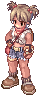{ .npc-sprite width="80" height="192" }

## Using Astrid's shop

1. Speak to Astrid to open the headgear catalogue with item pictures.
2. Select **one headgear** and click **Buy** to open its quest requirements.
3. Check each material's **owned/required** count. **Red** means you are short; **green** means you have enough eligible materials.
4. Choose **Preview** to try on its appearance, **Purchase** to craft it, or **Cancel** to leave. Leaving the preview restores your equipped appearance.

Each purchase creates **one headgear** and consumes the listed materials. There is **no Zeny fee**. Carry the materials in your inventory and leave room for the reward.

Equipment materials must be identified, unequipped, unrefined, unbroken and free of cards or random options. Bound, rental and favorite items are protected. Requirement counts include only eligible copies.

## Headgear catalogue

All coin requirements below use [**Vestige Coin (#35363)**](vestige-coins.md). A slot marker such as **[1]** identifies the required version of a material or reward.

| Item | Requirements | Description |
| --- | --- | --- |
| 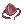{ .item-icon width="32" height="32" loading="lazy" } **Advanced Assassin Mask** Item ID: `18774` | 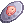{ .item-icon width="32" height="32" loading="lazy" } **1,000** x Vestige Coin (`35363`) { .item-icon width="32" height="32" loading="lazy" } **1** x Assassin Mask (`5096`) 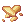{ .item-icon width="32" height="32" loading="lazy" } **50** x Star Crumb (`1000`) | CRIT +1. Critical damage +1%. ________________________ **Defense:** 0 **Position:** Lower **Weight:** 10 **Required level:** 70 **Jobs:** All |
| 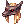{ .item-icon width="32" height="32" loading="lazy" } **Anubis Helm** Item ID: `5490` | { .item-icon width="32" height="32" loading="lazy" } **1,500** x Vestige Coin (`35363`) 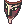{ .item-icon width="32" height="32" loading="lazy" } **1,000** x Cultish Masque (`1045`) 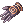{ .item-icon width="32" height="32" loading="lazy" } **3** x Celebrant's Mitten (`2617`) | MDEF +5. Damage taken from Boss monsters -10%. Healing received from skills and items +10%. ________________________ **Defense:** 3 **Position:** Upper **Weight:** 0 **Required level:** 65 **Jobs:** All |
| 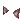{ .item-icon width="32" height="32" loading="lazy" } **Wickebine's Black Cat Ears** Item ID: `5360` | { .item-icon width="32" height="32" loading="lazy" } **1,000** x Vestige Coin (`35363`) 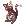{ .item-icon width="32" height="32" loading="lazy" } **500** x Black Cat Doll (`7206`) 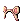{ .item-icon width="32" height="32" loading="lazy" } **1** x Kitty Band (`2213`) | Critical damage +10%. CRIT +3. FLEE +10. DEF -50%. ________________________ **Defense:** 2 **Position:** Upper **Weight:** 20 **Required level:** 45 **Jobs:** All |
| 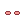{ .item-icon width="32" height="32" loading="lazy" } **Blush of Groom** Item ID: `5800` | { .item-icon width="32" height="32" loading="lazy" } **1,500** x Vestige Coin (`35363`) { .item-icon width="32" height="32" loading="lazy" } **1** x Blush (`5040`) 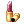{ .item-icon width="32" height="32" loading="lazy" } **10** x Rouge (`739`) | Damage taken from Demi-Humans/players -3%. ________________________ **Defense:** 0 **Position:** Middle **Weight:** 5 **Required level:** 1 **Jobs:** All |
| 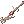{ .item-icon width="32" height="32" loading="lazy" } **Antique Smoking Pipe** Item ID: `5377` | { .item-icon width="32" height="32" loading="lazy" } **1,500** x Vestige Coin (`35363`) 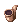{ .item-icon width="32" height="32" loading="lazy" } **1** x Pipe (`2268`) 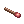{ .item-icon width="32" height="32" loading="lazy" } **5** x Matchstick (`7035`) | Damage taken from Demi-Humans/players -2%. ________________________ **Defense:** 0 **Position:** Lower **Weight:** 10 **Required level:** 1 **Jobs:** All |
| 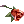{ .item-icon width="32" height="32" loading="lazy" } **Crimson Rose** Item ID: `5548` | { .item-icon width="32" height="32" loading="lazy" } **2,000** x Vestige Coin (`35363`) 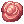{ .item-icon width="32" height="32" loading="lazy" } **10** x Rose Quartz (`7293`) 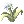{ .item-icon width="32" height="32" loading="lazy" } **10** x Illusion Flower (`710`) | LUK +1. 1% fixed chance to drop a Witherless Rose when killing a monster. ________________________ **Defense:** 0 **Position:** Lower **Weight:** 10 **Required level:** 50 **Jobs:** All |
| 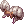{ .item-icon width="32" height="32" loading="lazy" } **Gigantic Majestic Goat (DEF)** Item ID: `5374` | { .item-icon width="32" height="32" loading="lazy" } **1,200** x Vestige Coin (`35363`) ![Majestic Goat [1]](assets/headgear-quests/5160.png){ .item-icon width="32" height="32" loading="lazy" } **1** x Majestic Goat [1] (`5160`) 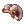{ .item-icon width="32" height="32" loading="lazy" } **1** x Majestic Goat (`2256`) | Damage taken from Demi-Humans/players -12%. ATK increases by floor(Job Level x 2 / 7). ________________________ **Defense:** 5 **Position:** Upper **Weight:** 80 **Required level:** 50 **Jobs:** All |
| 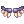{ .item-icon width="32" height="32" loading="lazy" } **Filir's Pinions** Item ID: `5664` | { .item-icon width="32" height="32" loading="lazy" } **1,500** x Vestige Coin (`35363`) 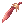{ .item-icon width="32" height="32" loading="lazy" } **25** x Red Feather (`7440`) 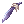{ .item-icon width="32" height="32" loading="lazy" } **25** x Blue Feather (`7441`) | Attack speed +2%. Cast time -2%. ________________________ **Defense:** 1 **Position:** Middle **Weight:** 10 **Required level:** 70 **Jobs:** All |
| 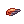{ .item-icon width="32" height="32" loading="lazy" } **Pecopeco Wing Ears** Item ID: `5358` | { .item-icon width="32" height="32" loading="lazy" } **1,000** x Vestige Coin (`35363`) 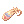{ .item-icon width="32" height="32" loading="lazy" } **500** x Peco Peco Feather (`7101`) { .item-icon width="32" height="32" loading="lazy" } **10** x Illusion Flower (`710`) | AGI +1. MDEF +2. ________________________ **Defense:** 1 **Position:** Middle **Weight:** 10 **Required level:** 70 **Jobs:** All |
| ![Darkness Helm [1]](assets/headgear-quests/5653.png){ .item-icon width="32" height="32" loading="lazy" } **Darkness Helm [1]** Item ID: `5653` | { .item-icon width="32" height="32" loading="lazy" } **1,500** x Vestige Coin (`35363`) ![Bone Helm [1]](assets/headgear-quests/5162.png){ .item-icon width="32" height="32" loading="lazy" } **1** x Bone Helm [1] (`5162`) 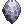{ .item-icon width="32" height="32" loading="lazy" } **500** x Crystal of Darkness (`7799`) | With Evil Wing Ears: STR +1, ATK +5%. With Angel Wing Ears: STR +1, attack speed +2%. With Pecopeco Wing Ears: AGI +1, FLEE +3. With Black Frame Glasses: INT +1, MATK +2%. ________________________ **Defense:** 3 **Position:** Upper **Weight:** 50 **Required level:** 70 **Jobs:** All |
| 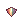{ .item-icon width="32" height="32" loading="lazy" } **Rainbow Scarf** Item ID: `5463` | { .item-icon width="32" height="32" loading="lazy" } **1,200** x Vestige Coin (`35363`) 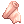{ .item-icon width="32" height="32" loading="lazy" } **500** x Soft Silk (`7166`) { .item-icon width="32" height="32" loading="lazy" } **10** x Red Feather (`7440`) { .item-icon width="32" height="32" loading="lazy" } **10** x Blue Feather (`7441`) | MATK +1%. INT +1. MDEF +2. ________________________ **Defense:** 1 **Position:** Lower **Weight:** 10 **Required level:** 90 **Jobs:** All |
| 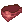{ .item-icon width="32" height="32" loading="lazy" } **Gangster Scarf** Item ID: `5361` | { .item-icon width="32" height="32" loading="lazy" } **1,200** x Vestige Coin (`35363`) 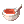{ .item-icon width="32" height="32" loading="lazy" } **20** x Scarlet Dyestuffs (`975`) 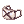{ .item-icon width="32" height="32" loading="lazy" } **5** x Gangster Mask (`2265`) 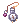{ .item-icon width="32" height="32" loading="lazy" } **2** x Pocket Watch (`7513`) | ATK +5. Rogue classes can use Lv1 Gangster Paradise. ________________________ **Defense:** 0 **Position:** Lower **Weight:** 10 **Required level:** 60 **Jobs:** All except Novice |
| ![Skull Cap [1]](assets/headgear-quests/18539.png){ .item-icon width="32" height="32" loading="lazy" } **Skull Cap [1]** Item ID: `18539` | { .item-icon width="32" height="32" loading="lazy" } **3,000** x Vestige Coin (`35363`) 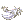{ .item-icon width="32" height="32" loading="lazy" } **200** x Soft Feather (`7063`) 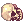{ .item-icon width="32" height="32" loading="lazy" } **500** x Skull (`7005`) 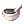{ .item-icon width="32" height="32" loading="lazy" } **1** x Black Dyestuffs (`983`) | MATK +2%. At +5: an additional MATK +3%. At +7: an additional MATK +3%. With Elven Ears [0]: skill SP cost -3%. With Evil Bone Wand [0] or Thorn Staff of Darkness [0]: MATK +1% per weapon refine level. At weapon refine +10 or higher: cast time -10%. ________________________ **Defense:** 0 **Position:** Upper **Weight:** 40 **Required level:** 10 **Jobs:** All |
| ![Devil's Bone Helm [1]](assets/headgear-quests/5529.png){ .item-icon width="32" height="32" loading="lazy" } **Devil's Bone Helm [1]** Item ID: `5529` | { .item-icon width="32" height="32" loading="lazy" } **2,000** x Vestige Coin (`35363`) 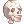{ .item-icon width="32" height="32" loading="lazy" } **350** x Clattering Skull (`7752`) 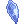{ .item-icon width="32" height="32" loading="lazy" } **5** x Ice Scale (`7562`) { .item-icon width="32" height="32" loading="lazy" } **350** x Glacial Heart (`7561`) | DEX +3. Enables Lv1 Frost Nova. Damage taken from Neutral attacks -5%. ________________________ **Defense:** 6 **Position:** Upper, Middle **Weight:** 60 **Required level:** 1 **Jobs:** All |
| ![Large Orc Hero Helm [1]](assets/headgear-quests/5375.png){ .item-icon width="32" height="32" loading="lazy" } **Large Orc Hero Helm [1]** Item ID: `5375` | { .item-icon width="32" height="32" loading="lazy" } **4,000** x Vestige Coin (`35363`) 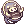{ .item-icon width="32" height="32" loading="lazy" } **100** x Heroic Emblem (`968`) 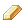{ .item-icon width="32" height="32" loading="lazy" } **20** x Gold (`969`) | STR +2. 3% chance to cast Lv3 Weapon Perfection when receiving physical damage. ________________________ **Defense:** 5 **Position:** Upper, Middle **Weight:** 90 **Required level:** 1 **Jobs:** All |
| 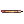{ .item-icon width="32" height="32" loading="lazy" } **Well-Chewed Pencil** Item ID: `5574` | { .item-icon width="32" height="32" loading="lazy" } **700** x Vestige Coin (`35363`) 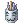{ .item-icon width="32" height="32" loading="lazy" } **7** x Pencil Case (`738`) 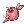{ .item-icon width="32" height="32" loading="lazy" } **1** x Apple of Archer (`2285`) 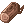{ .item-icon width="32" height="32" loading="lazy" } **450** x Wooden Gnarl (`7222`) | HIT +3. With Model Training Hat: DEX +2, DEF +2. ________________________ **Defense:** 0 **Position:** Lower **Weight:** 10 **Required level:** 10 **Jobs:** All |
| ![Alice Doll [1]](assets/headgear-quests/5137.png){ .item-icon width="32" height="32" loading="lazy" } **Alice Doll [1]** Item ID: `5137` | { .item-icon width="32" height="32" loading="lazy" } **2,000** x Vestige Coin (`35363`) 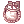{ .item-icon width="32" height="32" loading="lazy" } **500** x Alice's Apron (`7047`) 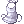{ .item-icon width="32" height="32" loading="lazy" } **3** x Soft Apron (`661`) ![Marionette Doll [1]](assets/headgear-quests/5141.png){ .item-icon width="32" height="32" loading="lazy" } **1** x Marionette Doll [1] (`5141`) 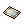{ .item-icon width="32" height="32" loading="lazy" } **1** x Hydra Card (`4035`) | STR +1. Physical damage against Demi-Humans/players +10%. May inflict Sleep on the wearer when attacking. ________________________ **Defense:** 0 **Position:** Upper **Weight:** 50 **Required level:** 30 **Jobs:** All except Novice |
| ![Dress Hat [1]](assets/headgear-quests/5211.png){ .item-icon width="32" height="32" loading="lazy" } **Dress Hat [1]** Item ID: `5211` | { .item-icon width="32" height="32" loading="lazy" } **2,000** x Vestige Coin (`35363`) 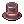{ .item-icon width="32" height="32" loading="lazy" } **1** x Magician Hat (`5045`) { .item-icon width="32" height="32" loading="lazy" } **500** x Soft Feather (`7063`) | STR +1. INT +1. ATK +2%. MATK +2%. MDEF +7. Healing skill effectiveness +5%. At +7 or higher: additional ATK +1%, MATK +1%, and healing skill effectiveness +1%. ________________________ **Defense:** 2 **Position:** Upper **Weight:** 20 **Required level:** 20 **Jobs:** All |
| ![Rideword Hat [1]](assets/headgear-quests/5208.png){ .item-icon width="32" height="32" loading="lazy" } **Rideword Hat [1]** Item ID: `5208` | { .item-icon width="32" height="32" loading="lazy" } **2,000** x Vestige Coin (`35363`) 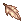{ .item-icon width="32" height="32" loading="lazy" } **200** x Bookclip in Memory (`7015`) 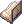{ .item-icon width="32" height="32" loading="lazy" } **2** x Old Magicbook (`1006`) | 5% chance to absorb 8% of physical damage as HP. 1% chance to absorb 4% of physical damage as SP. Loses 10 HP every 5 seconds while equipped. ________________________ **Defense:** 2 **Position:** Upper **Weight:** 30 **Required level:** 40 **Jobs:** All |
| 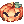{ .item-icon width="32" height="32" loading="lazy" } **Festival Pumpkin Hat** Item ID: `5356` | { .item-icon width="32" height="32" loading="lazy" } **1,200** x Vestige Coin (`35363`) { .item-icon width="32" height="32" loading="lazy" } **1,000** x Pumpkin Lantern (`7225`) { .item-icon width="32" height="32" loading="lazy" } **20** x Four Leaf Clover (`706`) | All stats +3. Physical and magical damage against Demons +5%. ________________________ **Defense:** 3 **Position:** Upper **Weight:** 20 **Required level:** 1 **Jobs:** All |
| { .item-icon width="32" height="32" loading="lazy" } **Pirate Dagger** Item ID: `5305` | { .item-icon width="32" height="32" loading="lazy" } **1,200** x Vestige Coin (`35363`) { .item-icon width="32" height="32" loading="lazy" } **20** x Well-Dried Bone (`628`) { .item-icon width="32" height="32" loading="lazy" } **120** x Wooden Heart (`7189`) | ATK +5. ________________________ **Defense:** 0 **Position:** Lower **Weight:** 10 **Required level:** 1 **Jobs:** All |
| ![Purple Cowboy Hat [1]](assets/headgear-quests/5409.png){ .item-icon width="32" height="32" loading="lazy" } **Purple Cowboy Hat [1]** Item ID: `5409` | { .item-icon width="32" height="32" loading="lazy" } **1,200** x Vestige Coin (`35363`) { .item-icon width="32" height="32" loading="lazy" } **1** x Corsair (`5019`) { .item-icon width="32" height="32" loading="lazy" } **300** x Soft Feather (`7063`) | INT +2. VIT +2. Max SP +50. ________________________ **Defense:** 4 **Position:** Upper **Weight:** 50 **Required level:** 1 **Jobs:** All |

