# Horror Toy Factory

Explore four haunted factory areas in Lutie, uncover the workers' memories and defeat **Celine Kimi and her phantom**. Complete the run with ten shared treasure chests and spend **Bloody Coins** at Mister Cat.

## Quick facts

| Requirement | Vestige Rift rule |
| --- | --- |
| Entry NPC | **Catherine Jet Johnson**, `xmas 237,303` |
| Party | **3 or more members**, each using a different account |
| Minimum Base Level | **90** for every member |
| Readiness | Every starting member types **`!ready` in public chat within 60 seconds** |
| Time limit | **1 hour**, starting after everyone confirms readiness |
| Weekly allowance | **1 HTF run per account**, shared by its characters and separate from Tower and Cellar |
| Weekly reset | **Monday at 06:00 Philippines time (UTC+8)** |

## Getting there

| NPC | Location | Service |
| --- | --- | --- |
| **Catherine Jet Johnson** | `/navi xmas 237/303` | Start HTF, rejoin the current area or view weekly run information |
| **Mister Cat** | `/navi xmas 240/300` | Exchange Bloody Coins for equipment, costumes and supplies |

1. Gather the entire party in **Lutie**. Everyone must be online, alive and Base Level 90+, with other dialogs, shops and storage closed.
2. The leader selects **Start Horror Toy Factory** at Catherine.
3. Every starting member types **`!ready` in public chat within 60 seconds**, keeping the same party roster.
4. Once everyone is ready, the party enters the first factory area and each account consumes its weekly HTF run.

An expired or unsuccessful readiness check returns the party to its save points without consuming a run. A member who disconnects or leaves Lutie during readiness must return and confirm again.

Use **`@instanceinfo`**, or Catherine's **Weekly run information**, to see the separate HTF, Tower and Cellar allowances. A party can have one of these instances or readiness checks active at a time.

## Instance rules

| Feature | Rule |
| --- | --- |
| Progression | Complete the four areas in order, then enter the treasure room. |
| Death | Normal death rules apply. Players can be resurrected or leave and re-enter. |
| Re-entry | Only the original starting characters can rejoin, while at least one original member remains inside. Return through Catherine to the current area. |
| Everyone leaves | The instance closes when all original members leave or disconnect. The weekly run remains consumed. |
| Storage | Personal and Guild Storage are unavailable inside. |
| Mail | RODEX is available inside. |
| Drops | Monsters use the configured server drop rates. Bubble Gum does not increase HTF drops. |
| Chests | Each of the ten shared party chests opens once and places its rewards on the ground. Chest chances are fixed. |
| Completion | Use the final exit portal after the boss and treasure room to record completion. |
| Time limit | The original one-hour timer covers encounters and treasure collection. |

## Factory walkthrough

### Area 1 - Production line

Speak to a **Uniform Box** to become a **Red Cookie for three minutes**. Refresh the disguise before it expires. Exploring without the required disguise can attract **Nightmare Cruiser guards**, which give no EXP or loot.

Defeat **38** of the production line's **67 monsters**. The line then clears and its remaining monsters disappear. Visit the **Coordinator** in the northwest while disguised, use the nearby **Packaged Present** to become a **Myst Case**, then enter the east portal.

| Monster | Starting count |
| --- | ---: |
| **Vicious Cookie** ID: `2989` | 31 |
| **Evil Dwelling Box** ID: `2991` | 36 |

### Area 2 - Workers' memories

Renew your **Red Cookie** disguise at the Uniform Box near Catherine. Speak to **all ten workers**, each with a three-second listening period. You remain vulnerable to nearby monsters while hearing their memories.

Once all ten workers have spoken, the remaining area monsters disappear. Return to the entrance portal to continue north. Before completing the objective, that portal returns you to the first area.

| Monster | Starting count |
| --- | ---: |
| **Malicious Baby Ghost** ID: `2993` | 19 |
| **Evil Dwelling Box** ID: `2991` | 16 |
| **Abandoned Teddy Bear** ID: `23901` | 22 |
| **Creepy Demon** ID: `2992` | 16 |

### Area 3 - Antonio

Speak to **Captured Santa** in the central hall to confront Antonio. Search the western room and central hallway. **Defeat Antonio** to clear the remaining enemies and open the eastern route to Kimi.

| Monster | Starting count |
| --- | ---: |
| **Dancing Marionette** ID: `2994` | 37 |
| **Decorated Evil Tree** ID: `2987` | 31 |
| **Abandoned Teddy Bear** ID: `23901` | 43 |
| **Creepy Demon** ID: `2992` | 31 |
| **Antonio** ID: `2988` | 1 |

### Final area - Celine Kimi

Speak to **Celine Kimi** and choose to face her and the phantom. Defeat **both** to open the southwest treasure-room portal.

| Enemy | Count | Role |
| --- | ---: | --- |
| **Celine Kimi** ID: `2996` | 1 | MVP |
| **Kimi's Phantom** ID: `2997` | 1 | Companion boss |

| Mechanic | Behavior |
| --- | --- |
| Keep them together | Separating Kimi and the phantom by more than **7 cells** lets both recover **25% of maximum HP per second**, up to full HP. |
| Balance the damage | If their HP differs by more than **1.5% of Kimi's maximum HP**, the lower-HP boss heals for **eight times the difference**, capped at maximum HP. |
| Fight inside the room | Pulling Kimi outside her fighting area resets the encounter. Speak to her to begin again. |
| Boss abilities | Both use Dispell, Critical Wounds, Darkness Attack and Soul Strike. Kimi also uses Power Up below **40% HP**. |

## Monsters and MVPs

These are the current **Classic Pre-Renewal** database stats. ATK lists the normal attack range; skill damage and temporary buffs can change the damage received.

### Factory monsters and guards

| Sprite | Monster | Level | HP | ATK | DEF / MDEF | Race / Element |
| --- | --- | ---: | ---: | --- | --- | --- |
| 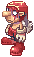{ .tower-monster-sprite loading="lazy" } | **Vicious Cookie** ID: `2989` | 86 | 30,000 | 500-700 | 15 / 15 | Demon Shadow 3 |
| 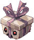{ .tower-monster-sprite loading="lazy" } | **Evil Dwelling Box** ID: `2991` | 88 | 40,000 | 600-850 | 25 / 20 | Demon Shadow 3 |
| 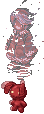{ .tower-monster-sprite loading="lazy" } | **Malicious Baby Ghost** ID: `2993` | 90 | 42,000 | 650-900 | 20 / 35 | Demon Shadow 3 |
| 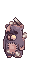{ .tower-monster-sprite loading="lazy" } | **Abandoned Teddy Bear** ID: `23901` | 93 | 60,000 | 800-1,150 | 35 / 25 | Demon Undead 3 |
| 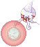{ .tower-monster-sprite loading="lazy" } | **Creepy Demon** ID: `2992` | 89 | 35,000 | 600-850 | 20 / 30 | Undead Shadow 3 |
| 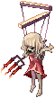{ .tower-monster-sprite loading="lazy" } | **Dancing Marionette** ID: `2994` | 92 | 48,000 | 700-1,050 | 30 / 30 | Demon Ghost 1 |
| 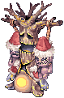{ .tower-monster-sprite loading="lazy" } | **Decorated Evil Tree** ID: `2987` | 90 | 55,000 | 700-950 | 30 / 25 | Demon Undead 3 |
| 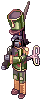{ .tower-monster-sprite loading="lazy" } | **Nightmare Cruiser** ID: `2990` | 90 | 35,000 | 650-950 | 20 / 20 | Demon Undead 3 |

### Bosses and MVP

| Sprite | Monster | Level | HP | ATK | DEF / MDEF | Race / Element |
| --- | --- | ---: | ---: | --- | --- | --- |
| 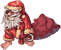{ .tower-monster-sprite loading="lazy" } | **Antonio** ID: `2988` | 95 | 450,000 | 1,100-1,600 | 35 / 30 | Undead Shadow 3 |
| 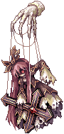{ .tower-monster-sprite loading="lazy" } | **Celine Kimi** ID: `2996` | 99 | 6,666,666 | 1,800-2,600 | 45 / 55 | Undead Ghost 1 |
| { .tower-monster-sprite loading="lazy" } | **Kimi's Phantom** ID: `2997` | 99 | 6,666,666 | 1,500-2,200 | 45 / 55 | Undead Ghost 1 |

**Celine Kimi is the MVP.** Antonio is the Area 3 boss; the phantom is Kimi's companion boss. Nightmare Cruisers and the phantom give no EXP or loot.

Before server rates, ordinary factory monsters give **3,500 Base / 2,200 Job EXP**, Antonio gives **18,000 / 10,000**, and Kimi gives **400,000 / 220,000**, plus **50,000 MVP bonus EXP**.

## Treasure chests

After the boss clear, enter the southwest portal. The **ten chests are shared by the party**, and each opens once. Every chest drops **2-10 Bloody Coins** plus independent rolls for the four listed rewards.

Chest rewards appear on the ground. Their listed chances stay fixed, independent of server drop multipliers and Bubble Gum. Collect the rewards and use the final exit portal before the one-hour timer expires.

??? success "Chest 1"

    | Item | Quantity | Chance |
    | --- | ---: | ---: |
    | 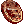{ width="24" loading="lazy" } **Bloody Coin** ID: `7642` | **2-10** | **100%** |
    | 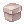{ width="24" loading="lazy" } **Gift Box** ID: `644` | 1 | 85% |
    | 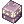{ width="24" loading="lazy" } **Old Purple Box** ID: `617` | 1 | 40% |
    | 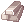{ width="24" loading="lazy" } **Silver Bullion** ID: `7229` | 1 | 10% |
    | 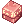{ width="24" loading="lazy" } **Elite Siege Supply Box** ID: `14003` | 1 | 30% |

??? success "Chest 2"

    | Item | Quantity | Chance |
    | --- | ---: | ---: |
    | { width="24" loading="lazy" } **Bloody Coin** ID: `7642` | **2-10** | **100%** |
    | { width="24" loading="lazy" } **Old Blue Box** ID: `603` | 1 | 60% |
    | 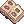{ width="24" loading="lazy" } **Old Card Album** ID: `616` | 1 | 30% |
    | { width="24" loading="lazy" } **Gold Bullion** ID: `7228` | 1 | 5% |
    | { width="24" loading="lazy" } **Elite Siege Supply Box** ID: `14003` | 1 | 30% |

??? success "Chest 3"

    | Item | Quantity | Chance |
    | --- | ---: | ---: |
    | { width="24" loading="lazy" } **Bloody Coin** ID: `7642` | **2-10** | **100%** |
    | { width="24" loading="lazy" } **Silver Bullion** ID: `7229` | 1 | 15% |
    | { width="24" loading="lazy" } **Gift Box** ID: `644` | 1 | 40% |
    | { width="24" loading="lazy" } **Platinum Bullion** ID: `7230` | 1 | 5% |
    | { width="24" loading="lazy" } **Elite Siege Supply Box** ID: `14003` | 1 | 30% |

??? success "Chest 4"

    | Item | Quantity | Chance |
    | --- | ---: | ---: |
    | { width="24" loading="lazy" } **Bloody Coin** ID: `7642` | **2-10** | **100%** |
    | { width="24" loading="lazy" } **Gold Bullion** ID: `7228` | 1 | 30% |
    | { width="24" loading="lazy" } **Old Purple Box** ID: `617` | 1 | 40% |
    | 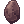{ width="24" loading="lazy" } **Enriched Elunium** ID: `7619` | 1 | 10% |
    | { width="24" loading="lazy" } **Elite Siege Supply Box** ID: `14003` | 1 | 30% |

??? success "Chest 5"

    | Item | Quantity | Chance |
    | --- | ---: | ---: |
    | { width="24" loading="lazy" } **Bloody Coin** ID: `7642` | **2-10** | **100%** |
    | { width="24" loading="lazy" } **Gift Box** ID: `644` | 1 | 85% |
    | { width="24" loading="lazy" } **Old Card Album** ID: `616` | 1 | 30% |
    | { width="24" loading="lazy" } **Enriched Oridecon** ID: `7620` | 1 | 5% |
    | { width="24" loading="lazy" } **Gentle Heart [1]** ID: `2978` | 1 | 1% |

??? success "Chest 6"

    | Item | Quantity | Chance |
    | --- | ---: | ---: |
    | { width="24" loading="lazy" } **Bloody Coin** ID: `7642` | **2-10** | **100%** |
    | { width="24" loading="lazy" } **Old Blue Box** ID: `603` | 1 | 60% |
    | { width="24" loading="lazy" } **Old Purple Box** ID: `617` | 1 | 40% |
    | { width="24" loading="lazy" } **Gift Box** ID: `644` | 1 | 5% |
    | { width="24" loading="lazy" } **Wounded Heart [1]** ID: `2977` | 1 | 1% |

??? success "Chest 7"

    | Item | Quantity | Chance |
    | --- | ---: | ---: |
    | { width="24" loading="lazy" } **Bloody Coin** ID: `7642` | **2-10** | **100%** |
    | { width="24" loading="lazy" } **Silver Bullion** ID: `7229` | 1 | 15% |
    | { width="24" loading="lazy" } **Old Purple Box** ID: `617` | 1 | 40% |
    | { width="24" loading="lazy" } **Gold Bullion** ID: `7228` | 1 | 10% |
    | { width="24" loading="lazy" } **Elite Siege Supply Box** ID: `14003` | 1 | 30% |

??? success "Chest 8"

    | Item | Quantity | Chance |
    | --- | ---: | ---: |
    | { width="24" loading="lazy" } **Bloody Coin** ID: `7642` | **2-10** | **100%** |
    | { width="24" loading="lazy" } **Gold Bullion** ID: `7228` | 1 | 30% |
    | { width="24" loading="lazy" } **Old Card Album** ID: `616` | 1 | 40% |
    | { width="24" loading="lazy" } **Enriched Elunium** ID: `7619` | 1 | 4% |
    | { width="24" loading="lazy" } **Elite Siege Supply Box** ID: `14003` | 1 | 30% |

??? success "Chest 9"

    | Item | Quantity | Chance |
    | --- | ---: | ---: |
    | { width="24" loading="lazy" } **Bloody Coin** ID: `7642` | **2-10** | **100%** |
    | { width="24" loading="lazy" } **Gift Box** ID: `644` | 1 | 85% |
    | { width="24" loading="lazy" } **Old Purple Box** ID: `617` | 1 | 40% |
    | { width="24" loading="lazy" } **Enriched Oridecon** ID: `7620` | 1 | 5% |
    | { width="24" loading="lazy" } **Wounded Heart [1]** ID: `2977` | 1 | 1% |

??? success "Chest 10"

    | Item | Quantity | Chance |
    | --- | ---: | ---: |
    | { width="24" loading="lazy" } **Bloody Coin** ID: `7642` | **2-10** | **100%** |
    | { width="24" loading="lazy" } **Old Blue Box** ID: `603` | 1 | 60% |
    | { width="24" loading="lazy" } **Old Purple Box** ID: `617` | 1 | 40% |
    | { width="24" loading="lazy" } **Silver Bullion** ID: `7229` | 1 | 10% |
    | { width="24" loading="lazy" } **Gentle Heart [1]** ID: `2978` | 1 | 1% |

### Treasure item descriptions

| Item | Description |
| --- | --- |
| { width="24" loading="lazy" } **Old Blue Box** ID: `603` | Opens into one random item from the Old Blue Box reward pool. |
| { width="24" loading="lazy" } **Old Card Album** ID: `616` | Opens into one random card from the Old Card Album reward pool. |
| { width="24" loading="lazy" } **Old Purple Box** ID: `617` | Opens into one random item from the Old Purple Box reward pool. |
| { width="24" loading="lazy" } **Gift Box** ID: `644` | Opens into one random item from the Gift Box reward pool. |
| { width="24" loading="lazy" } **Wounded Heart [1]** ID: `2977` | DEX +2, AGI +1. Physical damage to all races +5%. Required Level: 90 Jobs: Transcendent classes. |
| { width="24" loading="lazy" } **Gentle Heart [1]** ID: `2978` | STR +2, DEX +1. Physical damage to all races +5%. Required Level: 90 Jobs: Transcendent classes. |
| { width="24" loading="lazy" } **Gold Bullion** ID: `7228` | Valuable gold bullion that can be sold to an NPC merchant. |
| { width="24" loading="lazy" } **Silver Bullion** ID: `7229` | Valuable silver bullion that can be sold to an NPC merchant. |
| { width="24" loading="lazy" } **Platinum Bullion** ID: `7230` | Valuable platinum bullion that can be sold to an NPC merchant. |
| { width="24" loading="lazy" } **Enriched Elunium** ID: `7619` | Enriched armor-refining material used by the [Visual Refiner](refining.md#visual-refiner). |
| { width="24" loading="lazy" } **Enriched Oridecon** ID: `7620` | Enriched weapon-refining material used by the [Visual Refiner](refining.md#visual-refiner). |
| { width="24" loading="lazy" } **Bloody Coin** ID: `7642` | A currency earned in Horror Toy Factory. Exchange with Mister Cat in Lutie. Weight: 1 |
| { width="24" loading="lazy" } **Elite Siege Supply Box** ID: `14003` | Contains **100 WoE White Potions** and **50 WoE Blue Potions**. |

## Bloody Coin shop

Visit **Mister Cat** at `/navi xmas 240/300`. Prices below are in **Bloody Coins (#7642)** and purchase one item or box per exchange unit.

| Item | Bloody Coins | Description |
| --- | ---: | --- |
| 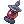{ width="24" loading="lazy" } **Red Lantern [1]** ID: `2976` | **500** | Max SP -300. Enables Sight Level 1. 0.5% chance each to obtain Alcohol, Detrimindexta or Karvodailnirol when defeating a monster. Required Level: 20 Jobs: All except Novice, Taekwon and Star Gladiator. |
| 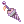{ width="24" loading="lazy" } **Old Parasol [3]** ID: `13442` | **500** | Holy-element one-handed sword. ATK +5 for each refine level. ATK: 120. Required Level: 80. Jobs: Swordsman, Merchant and Thief families. |
| 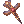{ width="24" loading="lazy" } **Noble Cross [1]** ID: `16029` | **500** | Holy-element mace. MATK +125. 5% chance to cast Level 6 Turn Undead when attacking. Chance +1% for each refine level from +5 onward. Restore 1 SP per hit against Undead monsters. Restore 12 SP per Undead monster killed with physical attacks. ATK: 195. Required Level: 40. Jobs: High Priest and Champion. |
| 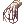{ width="24" loading="lazy" } **Evil Glove [1]** ID: `2980` | **600** | Max HP +300, Max SP +50, INT +2. Jobs: Transcendent classes except Novice. |
| 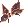{ width="24" loading="lazy" } **Celine's Ribbon [1]** ID: `18849` | **600** | DEX +3, MATK +20. MATK +1 for each refine level. Lose 25 HP every 5 seconds. Jobs: All Transcendent classes. |
| { width="24" loading="lazy" } **Costume Lush Rose** ID: `19687` | **200** | A rose-themed upper-head costume. |
| { width="24" loading="lazy" } **Costume Santa Doll Headband** ID: `19686` | **200** | An upper-head costume decorated with a Santa doll. |
| { width="24" loading="lazy" } **Sweet Canape** ID: `11564` | **3** | Restores 1,000 HP. Weight: 2 |
| { width="24" loading="lazy" } **Hot Tea** ID: `11563` | **2** | Restores 100 SP. Weight: 2 |
| { width="24" loading="lazy" } **Big Defense Potion 10 Box** ID: `13749` | **3** | Contains **10 Big Defense Potions**. |
| { width="24" loading="lazy" } **Big Magic Defense Potion 10 Box** ID: `13755` | **3** | Contains **10 Big Magic Defense Potions**. |

Healing amounts shown are the items' base values, before applicable healing bonuses. Equipment descriptions above follow the server's Classic item effects.

## Related guides

- [Hunting and instances](dungeons.md)
- [Endless Tower](endless-tower.md)
- [Endless Cellar](endless-cellar.md)
- [Server rates and rules](server-rules.md)
- [Refining System](refining.md)
