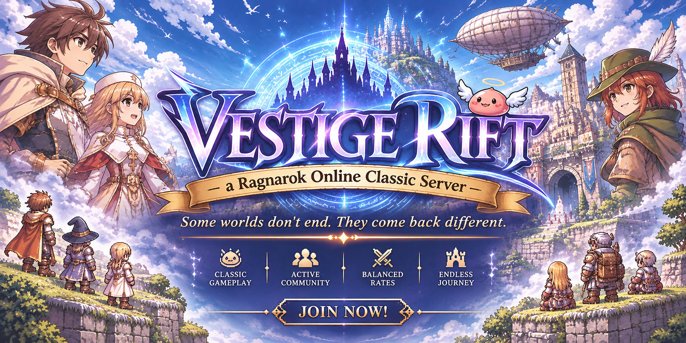

{ .home-banner-image width="1774" height="887" fetchpriority="high" }

  
<strong>99 / 70</strong>Base / maximum Job Level*

  
<strong>190</strong>Maximum ASPD

  
<strong>20× / 25×</strong>Weekday / weekend monster EXP

  
<strong>14.2</strong>Adapted Eclage content profile

*Job caps vary by class. See [core settings](server-rules.md#core-settings) for the full breakdown. Updated **November 18, 2026**.

## Browse by topic

| Section | Start here |
| --- | --- |
| Welcome | [Server Information](server-rules.md) and [All Pages (A-Z)](all-pages.md) |
| Getting Started | [How to Start](getting-started.md), [Novice Training Grounds](novice-training.md), [your class](classes.md) and [personal settings](personal-settings.md) |
| Features & Enhancements | [Features, changes and enhancements](features.md) |
| Dungeons & Instances | [Endless Tower, Endless Cellar, Horror Toy Factory and Bio Labs 4](dungeons.md) |
| Events & Activities | [Rewards and recurring activities](events.md) |
| Patch Notes | [Latest updates](updates.md) |

## Visit Main Office

**One stop for builds, platinum skills, supplies and card points.** Enter at **Prontera 164,167**, beneath the **Main Office** bubble, and use the numbered map to find all eleven services.

[Explore Main Office](main-office.md){ .md-button .md-button--primary }
[Find the Coin Exchange building](main-office.md#coin-exchange-building){ .md-button }

## Latest update: November 23

**November 23 — Monster Changes:** [illustrated loot tables, Bio Labs 3 spawns and combat rules](monster-changes.md). [Patch notes](updates/2026-11-23.md).

### November 22: Instance updates

[Endless Tower](endless-tower.md) is ready for parties of **six or more**, all **Base Level 85+**. Complete the `!ready` check on Misty Island, then climb within **four hours**. Each account receives **one run per week**, resetting **Monday at 06:00 Philippines time**.

Explore **101 illustrated Tower floor tables** and the **77-floor [Endless Cellar](endless-cellar.md) descent**, each with its own weekly account allowance. The guides cover final encounters, re-entry, island services, drop rules and rewards.

[Horror Toy Factory](horror-toy-factory.md) is open for **three or more Level 90+ adventurers**, with a **one-hour** timer and its own weekly account allowance. Explore the monster/MVP profiles, **24 illustrated rewards**, chest chances and Bloody Coin shop.

[Explore Endless Tower](endless-tower.md){ .md-button .md-button--primary }
[Explore Endless Cellar](endless-cellar.md){ .md-button }
[Explore Horror Toy Factory](horror-toy-factory.md){ .md-button }
[Read the November 22 update](updates/2026-11-22.md){ .md-button }

## Make yourself at home

-   🔮 **Build your character**

    ---

    Find your class, compare skill adjustments, and look up custom platinum skills.

    [Browse the class directory &rarr;](classes.md)

-   🧭 **Know the world**

    ---

    Check rates, level caps, the episode profile, and important map restrictions.

    [Read the server rules &rarr;](server-rules.md)

-   🦋 **Enjoy the conveniences**

    ---

    Learn about sitting recovery, mail, party buff indicators, bulk purchases, and storage.

    [Explore quality of life &rarr;](quality-of-life.md)

-   📍 **Find the right NPC**

    ---

    Start with Main Office, then find coin exchanges, supplies, memory resets and Plagiarism lessons.

    [Explore the Main Office directory &rarr;](main-office.md)

## Useful stops

| Looking for… | Go to |
| --- | --- |
| Your first lessons and graduation package | [Novice Training Grounds](novice-training.md) |
| Main Office, service map and NPC locations | [Main Office](main-office.md) |
| Job changes, appearance options and healing | [Character Services](character-services.md) |
| Town travel, fees and quest unlocks | [Warper](warper.md) |
| Becoming a baby without adoption | [Baby Characters and Sister Elara](baby-characters.md) |
| Save and reload stat/skill setups | [Build Manager](build-manager.md) |
| Free platinum skills | [Platinum Skill NPC and other services](class-changes.md#related-npc-directory) |
| Custom Super Novice skills | [Free platinum skills](class-changes.md#free-platinum-skills) |
| Bag of Gold Coins and Avarice | [Merchant upgrades](class-changes.md#bag-of-gold-coins-and-avarice) |
| Weekend rates | [Rates and schedule](server-rules.md#rates) |
| Daily attendance rewards | [Attendance rewards](attendance.md) |
| Hourly points, Gold Coins and the costume shop | [Hourly rewards](hourly-rewards.md) |
| Tool, Pet, Ninja and Gunslinger supplies | [Convenient dealers](dealers.md) |
| Protected monsters, party access and release timers | [Kill Steal Protection](kill-steal-protection.md) |
| Nearby ground pickup | [Area Loot](area-loot.md) |
| Normal-monster card guarantee | [Mercy System](mercy-system.md) |
| Remove cards from equipped items | [Card Removal](card-removal.md) |
| Normal and enriched refining | [Refining System](refining.md) |
| Tradable hunting currency and rewards | [Vestige Coins](vestige-coins.md) and [Lydia](coin-exchange.md) |
| Kill history, card-drop streaks and an overhead counter | [Kill Count](kill-count.md) |
| Card finds, copy numbers and announcement visibility | [Card Drop Announcements](card-drop-announcements.md) |
| Unwanted cards and Card Exchange rewards | [Card exchange](card-exchange.md) |
| Market Street, shop searches and offline vendors | [Vendor system](vendor-system.md) |
| Saved preferences and default chat channels | [Personal settings](personal-settings.md) |
| Autoloot filters, ignored items and farming lists | [Advanced autoloot](autoloot.md) |
| Restock targets and all-unit Quick Store | [Fast storage](fast-storage.md) |
| What the party buff letters mean | [Party buff indicators](quality-of-life.md#party-buff-letters) |
| Quest retries, the New World test, and ore splitting | [Quest changes](quest-changes.md) |

!!! info "About this handbook"
    These pages describe the final implemented settings, rather than a chronological patch log. The content profile adapts Episode 14.2 to classic mechanics. Skill names may have different English translations; aliases are included where useful.
