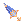
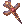
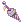
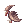
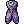
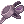

# Item Changes

Compare original item behavior with the equipment, card, consumable and acquisition changes available on **Vestige Rift**. Images and item IDs match the items used in game.

The **Original description** column summarizes the original mechanics relevant to the change. The **Vestige Rift changes** column gives our configured behavior. Bonus values accumulate unless a row says they replace an earlier total.

[Weapons](#weapons) ? [Armor and accessories](#armor-and-accessories) ? [Consumables](#consumables) ? [Materials and currency](#materials-and-currency) ? [Cards](#cards) ? [Upgrade services](#upgrade-services)

## Weapons

| Item | Original description | Vestige Rift changes |
| --- | --- | --- |
| { .item-icon loading="lazy" } **Alca Bringer** ID `1191` | Level 100; Rune Knight equipment. ASPD +1 per two refines. | Unbreakable in battle. ASPD +1 for every 2 refine levels. **Required Level: 85 Jobs: Lord Knight / Paladin** |
| { .item-icon loading="lazy" } **Black Wing** ID `13061` **2 slots** | One slot. Fatal Menace damage +30%; from +6, each further refine step adds +2% Fatal Menace damage and +3 MATK. | Backstab damage +25%. For each refine above +6: ATK +5 and an additional +5% Backstab damage. **Required Level: 90 Jobs: Rogue** Source: [BioShop](#bioshop). |
| { .item-icon loading="lazy" } **Cannon Spear** ID `1435` **1 slot** | Max SP -100. Cannon Spear damage +10%; ATK +1 per three refines. | Max HP +500. Physical damage +4% per refine level. Holy Cross damage +3% per refine level. **Required Level: 90 Jobs: Crusader** Source: [BioShop](#bioshop). |
| { .item-icon loading="lazy" } **Catapult** ID `18109` **2 slots** | Triangle Shot damage +2% per refine, with its SP cost reduced by 2 per refine. | DEX +2. At +7: ranged physical damage +10% and ASPD +10%. At +8: normal ranged attacks can trigger learned Snatcher, using your learned Steal level. Both skills must be learned. At +10: an additional ranged physical damage +10% and ASPD +10%. **Required Level: 90 Jobs: Rogue** Source: [BioShop](#bioshop). |
| { .item-icon loading="lazy" } **Death Fire** ID `13192` **2 slots** | Level 108, weapon level 3, ATK 400, one slot. Ranged damage +5%, HIT -50 and after-cast delay -10%. | ASPD +3% per refine level. At +7: DEX +3. At +9: ranged physical damage +10%. **Required Level: 95 Jobs: Gunslinger** |
| { .item-icon loading="lazy" } **Elder's Staff** ID `26107` **2 slots** | Three slots. Healing effectiveness +10%, with another +5% at +7 and +10% at +9. | MATK +15%, healing effectiveness +10%. At +7: additional healing effectiveness +5%. At +9: additional healing effectiveness +10% (total +25%). At +10: after-cast delay -15%. **Required Level: 90 Jobs: Acolyte / Priest / Monk** Source: [Weapon conversions](#weapon-conversions). |
| { .item-icon loading="lazy" } **Elemental Sword** ID `13414` **3 slots** | The automatic bolt chain can activate from either hand, including two equipped copies. | STR +2, INT +4, DEX +1, MATK +5%. Physical damage against Neutral targets +10%. In the main hand: 5% chance to cast Level 3 Cold Bolt on physical attacks. Cold Bolt triggers Level 3 Fire Bolt, then Lightning Bolt, then Earth Spike. These automatic spells are disabled in the off hand. **Required Level: 70 Jobs: Transcendent jobs** |
| { .item-icon loading="lazy" } **Elven Bow** ID `1746` Variants: `1746` (0 slots), `35656` (1 slot) | Level 100, ATK 160, DEX +2 and one slot. | DEX +2. With Elven Arrow: ranged physical damage +50%. With Rogue's Treasure and Cold Heart: physical damage against Medium targets +20%. **Required Level: 90 Jobs: Hunter / Bard / Dancer** See [Socketing](#socketing). Source: [Weapon conversions](#weapon-conversions). |
| { .item-icon loading="lazy" } **Gigantic Lance** ID `1490` **2 slots** | No slots. Flat ASPD -10, Spiral Pierce cooldown +20 seconds, and ATK +300 at base STR 120. | ASPD -10%. At +7: after-cast delay -15%. At +8: an additional -15%. At +9: an additional -15% (total -45%). **Required Level: 90 Jobs: Lord Knight** Source: [Weapon conversions](#weapon-conversions). |
| { .item-icon loading="lazy" } **Glorious Holy Avenger** ID `13418` | INT bonus follows (refine - 5), without the extra flat +6 INT. | INT +(refine level + 1), MATK +10%. Unbreakable in battle. At +6: skill SP consumption -10%. At +9: Gloria Domini also casts Level 1 Lex Divina. At +10: additional INT +5. **Required Level: 80 Jobs: Swordsman / Merchant / Knight / Blacksmith / Crusader / Alchemist** |
| { .item-icon loading="lazy" } **Glorious Jamadhar** ID `1282` | Ignores 20% of Demi-Human DEF. | Physical damage against Demi-Human targets +70%. Critical damage +20%. Unbreakable in battle. At +6: Demi-Human critical rate +5; additional damage against Demi-Humans +(refine - 4) squared percent. At +9: 7% chance on physical attacks to gain +100% ASPD for 3 seconds. **Required Level: 80 Jobs: Assassin** |
| { .item-icon loading="lazy" } **Golden Wrench** ID `1333` **2 slots** | Level 170 Mechanic/Meister weapon; ATK 220. Uses ATK/refine scaling and bonuses for third-job axe skills. | STR +3. Unbreakable in battle. At +7: CRIT +20. At +8: ASPD +10%. At +9: ATK +50. **Required Level: 85 Jobs: Whitesmith** Source: [Weapon conversions](#weapon-conversions). |
| { .item-icon loading="lazy" } **Green Whistle** ID `1930` **1 slot** | Cast-time and SP bonuses affect Rush Windmill and Deep Sleep Lullaby. | Arrow Vulcan damage +30%. At +7: additional Arrow Vulcan damage +10%. At +10: additional Arrow Vulcan damage +20% (total +60%). Arrow Vulcan base cast time -2 seconds. **Required Level: 90 Jobs: Bard / Dancer** Source: [BioShop](#bioshop). |
| { .item-icon loading="lazy" } **Healing Staff** ID `1625` | Anubis is its original monster source. | Dropped by Anubis at **0.35%** and Margaretha Sorin (#1637) at **1%** fixed final chances. See [Monster Changes](monster-changes.md). |
| { .item-icon loading="lazy" } **Imperial Spear** ID `1433` **1 slot** | Cannon Spear and Banishing Point damage +20%, with additional scaling every two refines. | Shield Boomerang and Shield Charge damage +20%, plus 1% per refine level. With Imperial Guard: Shield Chain SP cost -20. **Required Level: 90 Jobs: Crusader** |
| { .item-icon loading="lazy" } **Inverse Scale** ID `1269` Variants: `1269` (0 slots), `35650` (3 slots) | The original Inverse Scale has no slots. | Unslotted #1269 remains available. S-tier socketing produces **Inverse Scale [3] (#35650)**. The Holy element and original automatic Dragon Fear effect are retained. See [Socketing](#socketing). |
| { .item-icon loading="lazy" } **Lich's Bone Wand** ID `1624` **2 slots** | Restricted to the listed transcendent Mage/Acolyte families. | INT +1, DEX +1, MATK +20%. Undead weapon element. When physically attacked, a (1 + refine/10)% chance to cast Level 5 Wide Curse. At +9: additional MATK +3% and Max SP +300. **Required Level: 70 Jobs: Transcendent Mage / Acolyte families; Soul Linker** |
| { .item-icon loading="lazy" } **Luna Bow** ID `1723` **2 slots** | DEF bonus is +2, increasing to a total +5 at +6 and +7 at +9. | DEF +2. At +6: total DEF bonus becomes +3. At +9: total DEF bonus becomes +5. **Required Level: 30 Jobs: Hunter** |
| { .item-icon loading="lazy" } **Mental Stick** ID `1654` **1 slot** | Psychic Wave cast time -3 seconds and SP cost -60; higher refines increase that skill damage and reduce Max HP. | INT +3, MATK +20%, ASPD +10%. At +7: additional MATK +15%. At +10: additional MATK +20% (total +55%). **Required Level: 90 Jobs: Sage** Source: [BioShop](#bioshop). |
| { .item-icon loading="lazy" } **Muramasa** ID `1164` Variants: `1164` (0 slots), `21003` (2 slots) | The original weapon has no slots. | CRIT +30, ASPD +8%. Chance to Curse the wielder on attacks. Cannot be equipped on GvG maps. **Required Level: 48 Jobs: Swordsman / Knight / Crusader** See [Socketing](#socketing). |
| { .item-icon loading="lazy" } **Noble Cross** ID `16029` **1 slot** | Holy weapon; 20% chance to cast Level 6 Turn Undead. Restores SP on Undead hits and melee kills. | MATK +125. Turn Undead Level 6 proc chance is 5%, plus 1% per refine from +5. Restores 1 SP per Undead hit and 12 SP per physical Undead kill. **Champion and High Priest**, Level 90. Available through [Horror Toy Factory](horror-toy-factory.md). |
| { .item-icon loading="lazy" } **Old Parasol** ID `13442` **3 slots** | MATK +1 per refine and access to Level 10 Soul Strike. | Holy element; ATK +5 per refine. Three slots. Available through [Horror Toy Factory](horror-toy-factory.md). |
| { .item-icon loading="lazy" } **Red Ether Bag** ID `16010` **1 slot** | Crazy Weed and Demonic Fire damage +20%, with further refine scaling. | LUK +15, INT +5, DEX +1. **Required Level: 90 Jobs: Alchemist** Source: [BioShop](#bioshop). |
| { .item-icon loading="lazy" } **Solar Sword** ID `1136` | Its HP absorption can combine with other HP-drain bonuses. | Fire weapon element. Absorb 1% of physical damage dealt as HP. This HP drain does not stack with other HP-drain effects. Lose 15 SP every 10 seconds. **Required Level: 40 Jobs: Swordsman / Merchant / Thief / Knight / Blacksmith / Assassin / Crusader / Rogue / Alchemist** |
| { .item-icon loading="lazy" } **Staff of Piercing** ID `1644` | Restricted to the listed transcendent Mage/Acolyte families. | INT +4, MATK +15%. Ignore (10 + refine level)% MDEF. **Required Level: 70 Jobs: Transcendent Mage / Acolyte families; Soul Linker** |
| { .item-icon loading="lazy" } **Stem Whip** ID `1984` **1 slot** | Cast-time and SP bonuses affect Swing Dance and Deep Sleep Lullaby. | Arrow Vulcan damage +30%. At +7: additional Arrow Vulcan damage +10%. At +10: additional Arrow Vulcan damage +20% (total +60%). Arrow Vulcan base cast time -2 seconds. **Required Level: 90 Jobs: Bard / Dancer** Source: [BioShop](#bioshop). |
| { .item-icon loading="lazy" } **Sura's Rampage** ID `1830` **1 slot** | Earth Shaker and Sky Net Blow damage +20%. Skill SP costs +5%, reduced by 1% per refine above +6. | Finger Offensive and Occult Impact damage +20%. Skill SP costs +5%, reduced by 1% per refine above +5. At +7: both skills deal an additional +5% damage. At +10: both skills deal an additional +10% damage (total +35%). **Required Level: 90 Jobs: Monk** Source: [BioShop](#bioshop). |
| { .item-icon loading="lazy" } **Thorn Staff of Darkness** ID `1636` | Soul Linker cannot equip it, and it has no socket service. | INT +3, DEX +3, MATK +20%. Ignore 1% MDEF per refine level. After-cast delay -1.5% per refine level, rounded down. With Skull Cap: MATK +1% per staff refine level; at +10 staff refine, cast time -10%. **Required Level: 75 Jobs: Transcendent Mage / Acolyte families; Soul Linker** See [Socketing](#socketing). |
| { .item-icon loading="lazy" } **Trident** ID `1460` **2 slots** | Available from the Prontera, Comodo and Einbroch weapon shops, forging and Merman drops. | Obtained through Blacksmith forging or Merman drops. Used at +10 by the Gigantic Lance Forger. |
| { .item-icon loading="lazy" } **Two-Handed Chrome Metal Sword** ID `1196` | Level 110; Swordman High, Lord Knight and Paladin. AGI +3, Max HP -10% and unbreakable. | Unbreakable in battle. AGI +3. Max HP -10%. **Required Level: 85 Jobs: Lord Knight / Paladin** |
| { .item-icon loading="lazy" } **Vecer Axe** ID `1311` **2 slots** | Majoruros does not drop this weapon. | Majoruros drops it at a **0.2% fixed final chance**. |
| { .item-icon loading="lazy" } **Veteran Axe** ID `1384` **2 slots** | Each weapon-forging skill must reach Level 3 to grant its +10 ATK. | VIT +2. ATK +10 for each learned weapon-forging skill at Level 2 or higher: Dagger, Sword, Two-Handed Sword, Knuckle, Spear, Axe and Mace. **Required Level: 80 Jobs: Swordsman / Merchant / Knight / Blacksmith / Crusader / Alchemist** |

## Armor and accessories

| Item | Original description | Vestige Rift changes |
| --- | --- | --- |
| { .item-icon loading="lazy" } **Advanced Assassin Mask** ID `18774` | Priest/Assassin equipment with CRIT +1 and critical damage +1%. | CRIT +1, critical damage +1%. **Required Level: 70 Jobs: All jobs** |
| { .item-icon loading="lazy" } **Alchemy Glove** ID `2854` **1 slot** | INT +1 and Fire magic damage +10%. | INT +2, MDEF +2. Fire magic damage +15%. Water magic damage -20%. Damage received from Water attacks +30%. 3% chance to cast Level 5 Fire Ball on physical attacks. 3% chance to cast Level 5 Fire Bolt on magical attacks. **Required Level: 90 Jobs: Knight / Priest / Wizard / Blacksmith / Hunter / Assassin / Crusader / Monk / Sage / Rogue / Alchemist / Bard / Dancer** |
| { .item-icon loading="lazy" } **Angel Spirit** ID `5389` | No original monster drop source. | Valkyrie Randgris drops it at a **2.25% fixed final chance**. |
| { .item-icon loading="lazy" } **Angelic Protection** ID `2355` **1 slot** | Not accepted by the High Grade Armor enchant service. | Accepted by the **High Grade Armor** enchant service at `prontera 165,60`. |
| { .item-icon loading="lazy" } **Assassin Handcuffs** ID `2892` **1 slot** | Max SP +20 and CRIT +3. | Max HP +500, CRIT +8, critical damage +10%. **Required Level: 90 Jobs: Assassin** Source: [BioShop](#bioshop). |
| { .item-icon loading="lazy" } **Bible of Promise(2nd Vol.)** ID `2162` **1 slot** | Level 140 Arch Bishop shield. MDEF +5, healing +5% and access to Level 2 Odin's Power. | INT +2, MDEF +5. Healing skill effectiveness +5%. **Required Level: 90 Jobs: High Priest** Source: [BioShop](#bioshop). Classic DEF: 2. |
| { .item-icon loading="lazy" } **Blood Sucker** ID `18754` | Unbreakable headgear, without our Classic HP-drain/recovery changes. | 1% chance to absorb 3% of physical damage dealt as HP. Disables natural HP and SP recovery. **Required Level: 40 Jobs: All jobs** |
| { .item-icon loading="lazy" } **Boitata Hat** ID `5940` **1 slot** | Regional headgear without a stock Classic item definition. | DEF +5, MDEF +5. Restore 100 HP per physical monster kill and 5 SP per physical Brute kill. At +5/+7, Brute damage received is reduced by a total 5%/10%. **Level 20, one slot**. Boitata drops it at a **3% fixed final chance**. |
| { .item-icon loading="lazy" } **Bone Plate** ID `15000` **1 slot** | Not accepted by the High Grade Armor enchant service. | Accepted by the **High Grade Armor** enchant service at `prontera 165,60`. |
| { .item-icon loading="lazy" } **Book of Soyga** ID `19326` **1 slot** | Required level 90 in Renewal. | With a race EXP card: an additional +5% EXP from that race. Armeyer Dinze: Fish; Anopheles: Insect; Orc Archer: Demi-Human; Grove: Formless; Baroness of Retribution: Angel; Stem Worm: Brute; Cloud Hermit: Plant; Dragon Egg: Dragon; Wraith: Undead; Raydric Archer: Demon. **Required Level: 20 Jobs: All jobs** |
| { .item-icon loading="lazy" } **Bradium Brooch** ID `2790` **1 slot** | No original monster drop source. | Bradium Golem drops it at a **0.05% fixed final chance**. |
| { .item-icon loading="lazy" } **Celine's Ribbon** ID `18849` **1 slot** | DEX +3; MATK +40 and +7 per refine. Restores 200 HP per magic monster kill; drains 50 HP every five seconds. | DEX +3. MATK +20, plus 1 per refine. Drains 25 HP every five seconds. Equippable by transcendent classes. See [Horror Toy Factory](horror-toy-factory.md). |
| { .item-icon loading="lazy" } **Chick Hat** ID `5283` | Demi-Human damage received -3%. | LUK +2, Max HP +50, Max SP +50. Enables Level 2 Double Attack. Damage received from Demi-Human and Brute targets -3%. **Required Level: 10 Jobs: All jobs** |
| { .item-icon loading="lazy" } **Crown of Deceit** ID `5564` **1 slot** | INT +4, MDEF +10, variable cast time -10% and unbreakable. No original monster drop source. | INT +3, cast time -10%. **Required Level: 85 Jobs: All jobs** Fallen Bishop: **6% fixed chance**. |
| { .item-icon loading="lazy" } **Dance Shoes** ID `2465` **1 slot** | AGI +1, ASPD +2% and Swing Dance SP cost -32. | AGI +1, ASPD +5%. Arrow Vulcan SP cost -5. **Required Level: 90 Jobs: Bard / Dancer** Source: [BioShop](#bioshop). Classic DEF: 2. |
| { .item-icon loading="lazy" } **Defolty Doll Hat** ID `5340` **1 slot** | Includes STR +2 alongside its other effects. | Damage received from Demi-Human targets -5%. 2% chance to cast Level 10 Angelus when physically hit. **Required Level: 60 Jobs: All jobs** |
| { .item-icon loading="lazy" } **Evil Glove** ID `2980` **1 slot** | Level 110; Max HP +500 and Max SP +200, with Spider Web and several attack-triggered third-job spell effects. | Max HP +300, Max SP +50, INT +2. **Level 1**, transcendent jobs except Novice. |
| { .item-icon loading="lazy" } **Feral Boots** ID `2463` | DEF 12. | Part of the Feral equipment series. **Required Level: 75 Jobs: All jobs** |
| { .item-icon loading="lazy" } **Feral Tail** ID `2564` | DEF 16. | Part of the Feral equipment series. **Required Level: 75 Jobs: All jobs** |
| { .item-icon loading="lazy" } **Festival Pumpkin Hat** ID `5356` | Physical damage against Demons +5%; Demon damage received -5%. | All stats +3. Physical and magical damage against Demon monsters +5%. Damage received from Demon monsters -5%. **Required Level: 0 Jobs: All jobs** |
| { .item-icon loading="lazy" } **Forbidden Grimoire** ID `28984` **1 slot** | ASPD +10% and HP/refine bonuses; Earth/Water magic scaling, INT/DEX at +9, and a high-refine third-job magic proc. | ASPD +5%, INT +2. At +7: Earth magic damage +20%. With Death Note: MATK +1% per weapon refine level; at +10 weapon refine, cast time -10%. **Required Level: 90 Jobs: Sage** |
| { .item-icon loading="lazy" } **Geffenia Water Book** ID `2161` **1 slot** | INT +1, MDEF +2; at base INT 120, MATK +10 and Max HP +800. | INT +2, MDEF +5. At base INT 90: MATK +30 and Max HP +800. **Required Level: 90 Jobs: Wizard** Source: [BioShop](#bioshop). Classic DEF: 3. |
| { .item-icon loading="lazy" } **Gentle Heart** ID `2978` **1 slot** | Level 110; Max HP +500 and 300 HP recovery every ten seconds. | STR +2, DEX +1, physical damage to all races +5%. **Level 90**, transcendent jobs. |
| { .item-icon loading="lazy" } **Ghost Whisper** ID `400396` **1 slot** | MDEF +10, ASPD +10% and refine-based delay reduction, with Meteor Assault/Breaker scaling and third-job skill bonuses. | STR +3. At +7: Meteor Assault damage +10%. At +9: additional STR +2 and Meteor Assault damage +10% (total +20%). **Required Level: 90 Jobs: All jobs** |
| { .item-icon loading="lazy" } **Glaris Doll Hat** ID `5341` **1 slot** | Includes INT +2 alongside its other effects. | Damage received from Demi-Human targets -5%. Restore 50 HP per monster defeated with magic. **Required Level: 60 Jobs: All jobs** |
| { .item-icon loading="lazy" } **Golden Bell** ID `2843` | Standard El Dicastes quest accessory. | Max SP +50. **Level 75**. Jahbong exchanges it for one Certificate in El Dicastes. |
| { .item-icon loading="lazy" } **Green Operation Coat** ID `15044` **1 slot** | DEX +1 and Max SP +30. | DEX +1, INT +3. Eligible for High Grade Armor enchants. **Required Level: 90 Jobs: Alchemist** Source: [BioShop](#bioshop). Classic DEF: 7. |
| { .item-icon loading="lazy" } **Hermode Cap** ID `5481` **1 slot** | No original monster drop source. | Assassin Cross Eremes (#1641) drops it at a **15% fixed final chance**. |
| { .item-icon loading="lazy" } **Holy Robe** ID `2327` Variants: `2327` (0 slots), `2373` (1 slot) | Not accepted by the High Grade Armor enchant service. | Both the unslotted and slotted variants are accepted by the High Grade Armor enchant service. |
| { .item-icon loading="lazy" } **Imperial Guard** ID `2153` **1 slot** | MDEF +5; Shield Press damage +20%, with extra scaling from +6. | MDEF +5. Shield Chain damage +20%, plus 1% per refine. At +8: Shield Chain cast time -50%. With Imperial Spear: Shield Chain SP cost -20. **Required Level: 90 Jobs: Crusader** Classic DEF: 12. |
| { .item-icon loading="lazy" } **Light of El Dicastes** ID `2844` | Provides Return to El Dicastes. | Enables Return to El Dicastes. Can be enchanted by Kareka in El Dicastes. Can be kept in personal storage. Cannot be dropped, traded, sold, mailed, auctioned or placed in a cart or guild storage. Cannot be refined. **Required Level: 80 Jobs: All jobs** |
| { .item-icon loading="lazy" } **Love Guard** ID `18542` **1 slot** | Healing effectiveness +2%, healing received +5%; another +3% healing effectiveness at +7. | Healing skill effectiveness +2%. Healing received +5%. At +7: additional healing skill effectiveness +3%. **Required Level: 30 Jobs: All jobs** Classic DEF: 1. |
| { .item-icon loading="lazy" } **Mage Coat** ID `2334` Variants: `2334` (0 slots), `2372` (1 slot) | Not accepted by the High Grade Armor enchant service. | Both the unslotted and slotted variants are accepted by the High Grade Armor enchant service. |
| { .item-icon loading="lazy" } **Mercury Riser** ID `18597` **1 slot** | Regional headgear; no Baphomet source in the original Classic drop list. | Baphomet (#1399) drops it at a **5.1% fixed final chance**. |
| { .item-icon loading="lazy" } **Mitra** ID `5747` **1 slot** | Level 100; its flat MATK +10 requires base INT 120. | VIT +1, INT +1, MDEF +5. Healing effectiveness +5%. At base INT 90: MATK +10. **Required Level: 90 Jobs: Priest** Classic DEF: 1. |
| { .item-icon loading="lazy" } **Ninja Suit** ID `2337` Variants: `2337` (0 slots), `2359` (1 slot) | Not accepted by the High Grade Armor enchant service. | Both the unslotted and slotted variants are accepted by the High Grade Armor enchant service. |
| { .item-icon loading="lazy" } **Novice Breastplate** ID `2340` **1 slot** | Not accepted by the High Grade Armor enchant service. | Accepted by the High Grade Armor enchant service. |
| { .item-icon loading="lazy" } **Old Minstrel Song's Hat** ID `18976` **1 slot** | Renewal equipment requiring Level 170, with DEF 10. | All stats +1, Arrow Vulcan damage +20%. Ranged physical damage +1% per 2 refine levels. **Required Level: 90 Jobs: Clown / Gypsy** |
| { .item-icon loading="lazy" } **Old Mitra** ID `18972` **1 slot** | Renewal headgear with third-job/base-level skill scaling. | INT +1, MDEF +5. Every two refines: Max HP +1%, Max SP +1%, ATK +8, MATK +4 and Magnus Exorcismus damage +4%. **Level 70**, Priest family. Margaretha Sorin (#1637): **0.1% fixed chance**. |
| { .item-icon loading="lazy" } **Puppy Hat** ID `5182` | Chance to cast Gloria on physical attacks; the chance becomes 3% at base AGI 77. | AGI +1. 1% chance to cast Level 1 Gloria on physical attacks. At base AGI 77: chance increases to 5%. **Required Level: 30 Jobs: All jobs** |
| { .item-icon loading="lazy" } **Red Lantern** ID `2976` **1 slot** | Level 100; Max SP -300, Level 1 Sight and bonus drops of Alcohol, Detrimindexta and Karvodailnirol. | **Level 20**. All jobs except Novice, Taekwon and Star Gladiator. Its Max SP penalty, Sight and bonus-drop effects remain. |
| { .item-icon loading="lazy" } **Robo Eyes** ID `5325` | No original monster drop source. | Vesper drops it at a **2.1% fixed final chance**. |
| { .item-icon loading="lazy" } **Devil's Bone Helm** ID `5529` **1 slot** | Required level 70. | Required level reduced to **1**. See [Astrid](headgear-quests.md) for the full item effects and recipe. |
| { .item-icon loading="lazy" } **Shinobi Sash** ID `2654` Variants: `2654` (0 slots), `52290` (1 slot) | The original Shinobi Sash has no slots. | The unslotted sash remains available. Leablem can produce **Shinobi Sash [1] (#52290)**; its Ninja Suit set effect is preserved. See [Socketing](#socketing). |
| { .item-icon loading="lazy" } **Sigrun's Wings** ID `5592` | No original monster drop source. | Gryphon drops it at a **0.9% fixed final chance**. |
| { .item-icon loading="lazy" } **Snake Head Hat** ID `5388` | One slot and no original monster drop source. | Enables Level 5 Double Attack. No card slots. **Required Level: 30 Jobs: All jobs** Evil Snake Lord: **0.9% fixed chance**. |
| { .item-icon loading="lazy" } **Sting Hat** ID `5509` | No original monster drop source. | Sting drops it at a **0.05% fixed final chance**. |
| { .item-icon loading="lazy" } **Medal of Honor (Swordsman)** ID `2720` | Taekwon cannot equip the Swordsman version. | Physical damage +5%, MATK +5%. HIT +10, Max HP +500, Max SP +50. 1% chance to Stun the target on melee physical attacks. **Required Level: 70 Jobs: Swordsman / Knight / Crusader / Star Gladiator / Taekwon** |
| { .item-icon loading="lazy" } **Telekinetic Orb** ID `2853` Variants: `2853` (0 slots), `28530` (1 slot) | INT +3, MDEF +1, Max SP +30; Soul Expansion/Psychic Wave damage and SP-cost bonuses. No slots. | INT +3, Max SP +30. Lightning Bolt damage -25% and cast time -25%. **Required Level: 90 Jobs: Knight / Priest / Wizard / Blacksmith / Hunter / Assassin / Crusader / Monk / Sage / Rogue / Alchemist / Bard / Dancer** See [Socketing](#socketing). Source: [BioShop](#bioshop). |
| { .item-icon loading="lazy" } **Temporal AGI Boots** ID `22002` | Base HP/SP and refine bonuses; base AGI 120 grants a flat +1 ASPD. | Max HP +300, Max SP +30. Per 3 refine levels: Max HP +100 and Max SP +10. Also ASPD +3% per 3 refine. At base AGI 90: additional ASPD +3%. **Required Level: 99 Jobs: Transcendent jobs** |
| { .item-icon loading="lazy" } **Temporal DEX Boots** ID `22004` | DEX +3 per three refines; base DEX 120 grants ranged damage +5% and fixed cast time -0.5 seconds. | Max HP +300, Max SP +30. Per 3 refine levels: Max HP +100 and Max SP +10. Also DEX +1 per 3 refine. At base DEX 90: ranged physical damage +5%. **Required Level: 99 Jobs: Transcendent jobs** |
| { .item-icon loading="lazy" } **Temporal INT Boots** ID `22001` | MATK +10 per three refines; base INT 120 grants MATK +60 and MDEF +5. | Max HP +300, Max SP +30. Per 3 refine levels: Max HP +100 and Max SP +10. Also INT +1 and DEX +1 per 3 refine. At base INT 90: MATK +5%. **Required Level: 99 Jobs: Transcendent jobs** |
| { .item-icon loading="lazy" } **Temporal LUK Boots** ID `22011` **1 slot** | Critical damage +1% per three refines; base LUK 120 grants critical damage +30% and MDEF +5. | Max HP +300, Max SP +30. Per 3 refine levels: Max HP +100 and Max SP +10. Also critical damage +5% per 3 refine. At base LUK 50: additional critical damage +10%. At base LUK 70: another critical damage +15% and MDEF +5. **Required Level: 99 Jobs: Transcendent jobs** |
| { .item-icon loading="lazy" } **Temporal STR Boots** ID `22000` | ATK +7 per three refines; base STR 120 grants ATK +50. | Max HP +300, Max SP +30. Per 3 refine levels: Max HP +100 and Max SP +10. Also STR +1 per 3 refine. At base STR 90: ATK +5%. **Required Level: 99 Jobs: Transcendent jobs** |
| { .item-icon loading="lazy" } **Temporal VIT Boots** ID `22003` | Max HP +300, Max SP +30, plus HP/SP per three refines; base VIT 120 grants Max HP +8%. | Max HP +500, Max SP +30. Per 3 refine: Max HP +200, Max SP +10 and Max HP +4%. At base VIT 75: additional Max HP +10%. **Required Level: 99 Jobs: Transcendent jobs** |
| { .item-icon loading="lazy" } **Umbala Spirit** ID `18505` **1 slot** | VIT +1. | Max HP +1%. HP recovered by Meat +25%. 1% chance to receive Meat when defeating a monster. **Required Level: 30 Jobs: All jobs** |
| { .item-icon loading="lazy" } **Valkyrie Drop** ID `28564` **1 slot** | Level 100 accessory with SP recovery, cast-time, Oratio, Impositio Manus and base-level Magnus Exorcismus bonuses. | Cast time -5%, after-cast delay -5%. Magnus Exorcismus damage +4% per learned Impositio Manus level. **Level 70**, Priest family. High Priest Margaretha (#1649): **4.95% fixed chance**. |
| { .item-icon loading="lazy" } **Waterdrop Brooch** ID `2787` **1 slot** | No original monster drop source. | Kraken drops it at a **9% fixed final chance**. |
| { .item-icon loading="lazy" } **Witch's Pumpkin Hat** ID `18656` | Renewal DEF 10. | STR +2, INT +2, MDEF +10. Magic damage against Undead and Demon monsters +15%. **Required Level: 20 Jobs: All jobs** |
| { .item-icon loading="lazy" } **Wounded Heart** ID `2977` **1 slot** | Level 110; Max SP +200 and access to Level 3 Scream. | DEX +2, AGI +1, physical damage to all races +5%. **Level 90**, transcendent jobs. |
| { .item-icon loading="lazy" } **Yin Yang Earrings** ID `18576` | Renewal required level 50. | Chain Combo damage +10%. Triple Attack and Combo Finish damage +5%. With Hot-blooded Headband: additional Triple Attack and Combo Finish damage +5%; Tiger Fist and Chain Crush Combo damage +3%. **Required Level: 70 Jobs: All jobs** |

## Consumables

| Item | Original description | Vestige Rift changes |
| --- | --- | --- |
| { .item-icon loading="lazy" } **Bubble Gum** ID `12210` | Previously configured with a +200% drop-rate boost. | **Drop-rate boost +150% for 30 minutes.** The same item is used by the [Card Exchange](card-exchange.md) (**55 points**) and [Lydia](coin-exchange.md) (**1,000 Vestige Coins**). |
| { .item-icon loading="lazy" } **Convex Mirror** ID `12214` | No shared 60-minute reuse cooldown. | Shows the location of a boss monster on the current map. Cooldown: 60 minutes. |
| { .item-icon loading="lazy" } **Cursed Water** ID `12020` | The fountain converts one Empty Bottle at a time; monsters are another source. | With The Sign fountain access, choose **Singular** or **All** at Niff Fountain (`niflheim 146,241`). All converts the carried Empty Bottles, up to 30,000, with inventory/weight checks. |
| { .item-icon loading="lazy" } **Fantastic Cooking Kit** ID `12129` | The cooking kit is consumed when its selection window opens. | Consumed only when a cooking attempt starts. Cancelling the recipe window keeps the kit. |
| { .item-icon loading="lazy" } **Field Manual 100%** ID `14533` | Cash-shop EXP consumable. | Available from Lydia for **40 Vestige Coins**. Cannot be sold to NPCs or moved into the cart. |
| { .item-icon loading="lazy" } **Fly Wing** ID `601` | Blocked during Berserk. | Usable during Berserk; normal map and item-use restrictions apply. |
| { .item-icon loading="lazy" } **Golden Hammer** ID `614` | The forging hammer is consumed when its selection window opens. | Consumed only when a forging attempt starts. Cancelling the recipe window keeps the hammer. |
| { .item-icon loading="lazy" } **Guarana Candy** ID `12414` | The quest vendor sells one candy per purchase. | After completing the Guarana quest, buy **1-300 at once** for **4,000z each**. |
| { .item-icon loading="lazy" } **Holy Arrow Quiver** ID `12183` | Monster drops provide the quiver. | Jaax (`payon_in01 5,133`) exchanges **500 Holy Arrows + 500z** for one Holy Arrow Quiver. |
| { .item-icon loading="lazy" } **Home Cooking Kit** ID `12126` | The cooking kit is consumed when its selection window opens. | Consumed only when a cooking attempt starts. Cancelling the recipe window keeps the kit. |
| { .item-icon loading="lazy" } **Infinite Butterfly Wing** ID `35364` | Standard Butterfly Wings are consumed when returning to a save point. | Reusable save-point return. Obeys duel and no-return restrictions. Available from [Lydia](coin-exchange.md). |
| { .item-icon loading="lazy" } **Infinite Fly Wing** ID `12887` | Blocked during Berserk. | Usable during Berserk; retains its reusable Fly Wing behavior and normal teleport restrictions. |
| { .item-icon loading="lazy" } **Iron Hammer** ID `613` | The forging hammer is consumed when its selection window opens. | Consumed only when a forging attempt starts. Cancelling the recipe window keeps the hammer. |
| { .item-icon loading="lazy" } **Novice Fly Wing** ID `12323` | Blocked during Berserk. | Usable during Berserk; normal map and item-use restrictions apply. |
| { .item-icon loading="lazy" } **Oridecon Hammer** ID `615` | The forging hammer is consumed when its selection window opens. | Consumed only when a forging attempt starts. Cancelling the recipe window keeps the hammer. |
| { .item-icon loading="lazy" } **Outdoor Cooking Kit** ID `12125` | The cooking kit is consumed when its selection window opens. | Consumed only when a cooking attempt starts. Cancelling the recipe window keeps the kit. |
| { .item-icon loading="lazy" } **Pet Accessory Box** ID `16358` | A regional pet-accessory reward box. | Contains one random pet accessory. All 39 possible accessories have equal chances. |
| { .item-icon loading="lazy" } **Professional Cooking Kit** ID `12127` | The cooking kit is consumed when its selection window opens. | Consumed only when a cooking attempt starts. Cancelling the recipe window keeps the kit. |
| { .item-icon loading="lazy" } **Royal Cooking Kit** ID `12128` | The cooking kit is consumed when its selection window opens. | Consumed only when a cooking attempt starts. Cancelling the recipe window keeps the kit. |
| { .item-icon loading="lazy" } **Token Of Siegfried** ID `7621` | No persistent 15-minute resurrection reuse cooldown. | Resurrect yourself with full HP and SP when defeated, where resurrection is permitted. A token is consumed on successful use. Resurrection cooldown: 15 minutes per character; persists through logout. |

## Materials and currency

| Item | Original description | Vestige Rift changes |
| --- | --- | --- |
| { .item-icon loading="lazy" } **Crystal Mirror** ID `747` | Corrupted Monk is an original source. | The configured Corrupted Monk (#20898) drops it at a **50% fixed final chance**. |
| { .item-icon loading="lazy" } **Great Nature** ID `997` | Mail transfer is allowed. | Earth elemental stone. Cannot be sent through mail. |
| { .item-icon loading="lazy" } **Vestige Coin** ID `35363` | The original currency item could be sold to NPCs. | A tradeable currency dropped by eligible monsters. Exchange Vestige Coins with Lydia. Cannot be sold to NPCs. |

## Cards

| Item | Original description | Vestige Rift changes |
| --- | --- | --- |
| { .item-icon loading="lazy" } **Abandoned Teddy Bear Card** ID `31022` | Max SP +20%; the self-Curse proc chance is 0.2%. | Max SP +20%. 1% chance to inflict Curse on yourself when dealing physical or magical damage. |
| { .item-icon loading="lazy" } **Clock Card** ID `4299` | A hit can trigger Level 3 Auto Guard (Level 10 if learned). Another proc can toggle an active Auto Guard off. | 3% chance to cast Level 3 Auto Guard when physically hit, or Level 10 if you have learned it. Each proc refreshes Auto Guard instead of cancelling it. Unequipping removes Auto Guard. |
| { .item-icon loading="lazy" } **Isilla Card** ID `4412` | INT +2; magic damage can grant cast time -50% and FLEE +30 for five seconds. | INT +2. 5% chance on magical attacks, including area spells, to gain cast time -50% and FLEE +30 for 5 seconds. |
| { .item-icon loading="lazy" } **Kraken Card** ID `4525` | FLEE +10, Level 1 Hiding and Level 1 Raid, including a possible Wide Bleeding follow-up. | FLEE +10. Resistance to all elements +25%. Enables Level 1 Hiding. |
| { .item-icon loading="lazy" } **Moonlight Flower Card** ID `4131` | Movement speed +25%. | Movement speed +40%. |
| { .item-icon loading="lazy" } **Myst Case Card** ID `4206` | Gift Box bonus-drop chance is 0.30% at the official 1x setting. | 2.25% fixed chance of receiving a Gift Box when defeating a monster. |
| { .item-icon loading="lazy" } **Queen Scaraba Card** ID `4507` | Physical Scaraba damage +30%, with a chance of a Scaraba Summoning Scroll. | Physical damage against Scaraba monsters +30%. MDEF -30, FLEE -30. Magic damage +1% per point of the target's hard MDEF; normal MDEF reduction still applies. 0.3% chance to receive a Scaraba Summoning Scroll when defeating a monster. |
| { .item-icon loading="lazy" } **Shinobi Card** ID `4230` | AGI +1; a 10% chance to cast Level 5 Cloaking when physically hit. | AGI +1. 10% chance to cast Level 5 Cloaking when physically hit. This Cloaking proc is disabled while the full Thief card set is equipped: The Paper, Wanderer, Shinobi, Wild Rose and Zhu Po Long. |

## General equipment and item rules

| Applies to | Original behavior | Vestige Rift behavior |
| --- | --- | --- |
| { .item-icon loading="lazy" } **Knuckle weapons** | Size damage modifiers: Small **100%**, Medium **75%**, Large **50%**. | Small **100%**, Medium **100%**, Large **75%**. |
| { .item-icon loading="lazy" } **General transcendent armor** | Original transcendent-job eligibility. | General armor covering all six original job families can also be worn by **Taekwon, Star Gladiator, Soul Linker, Ninja and Gunslinger**. Specific-class armor keeps its own restrictions. |
| { .item-icon loading="lazy" } **Variant Shoes** ID `2423` | Transcendent-only eligibility. | Also usable by the five expanded classes listed above. |
| { .item-icon loading="lazy" } **Temporal Boots** | Original transcendent-job eligibility and Renewal stat thresholds. | All six listed Temporal Boots are usable by those expanded classes; their adjusted effects are in the armor table. Required level remains **99**. |
| **Usable items** | No universal item-use interval. | Minimum interval: **50 milliseconds**. Item-specific cooldowns still apply. |

## Upgrade services

### Weapon conversions

Equip the required **+10 weapon** and confirm the conversion with the artisan. The equipped input is consumed. Rewards begin at **+0 with no cards**; the old refinement and cards are not transferred. Rental, bound and broken weapons are not accepted. Carry only one copy of the required input weapon.

| Artisan and location | Required weapon | Reward | Success chance |
| --- | --- | --- | ---: |
| **Elder Staff Artisan** `prt_church 20,25` | { .item-icon loading="lazy" } **Healing Staff** ID `1625` **+10** | { .item-icon loading="lazy" } **Elder's Staff** ID `26107` [2] | 100% |
| **Gigantic Lance Forger** `prt_in 174,136` | { .item-icon loading="lazy" } **Trident** ID `1460` **+10** | { .item-icon loading="lazy" } **Gigantic Lance** ID `1490` [2] | 50% |
| **Golden Wrench Forger** `geffen_in 102,176` or `ein_in01 27,40` | { .item-icon loading="lazy" } **Vecer Axe** ID `1311` **+10** | { .item-icon loading="lazy" } **Golden Wrench** ID `1333` [2] | 50% |
| **Elven Bow Artisan** `payon_in01 5,126` or `hu_in01 103,382` | { .item-icon loading="lazy" } **Orc Archer Bow** ID `1734` **+10** | { .item-icon loading="lazy" } **Elven Bow** ID `1746` [0] | 50% |

There is no additional Zeny charge for these weapon conversions. An unsuccessful conversion consumes the input weapon.

### Socketing

Failure destroys the submitted item and consumes the listed fee and materials. A successful result starts unrefined without the input item's cards.

| Service | Input ? reward | Zeny and materials | Success chance |
| --- | --- | --- | ---: |
| **Leablem**, S-tier | { .item-icon loading="lazy" } **Muramasa** ID `1164` ? { .item-icon loading="lazy" } **Muramasa** ID `21003` [2] | **2,000,000z**, 5 { .item-icon loading="lazy" } Oridecon, 10 { .item-icon loading="lazy" } Steel | 10% |
| **Leablem**, S-tier | { .item-icon loading="lazy" } **Inverse Scale** ID `1269` ? { .item-icon loading="lazy" } **Inverse Scale** ID `35650` [3] | **2,000,000z**, 5 { .item-icon loading="lazy" } Oridecon, 10 { .item-icon loading="lazy" } Steel | 10% |
| **Leablem**, S-tier | { .item-icon loading="lazy" } **Elven Bow** ID `1746` ? { .item-icon loading="lazy" } **Elven Bow** ID `35656` [1] | **2,000,000z**, 5 { .item-icon loading="lazy" } Oridecon, 10 { .item-icon loading="lazy" } Steel | 10% |
| **Leablem**, S-tier | { .item-icon loading="lazy" } **Shinobi Sash** ID `2654` ? { .item-icon loading="lazy" } **Shinobi Sash** ID `52290` [1] | **1,000,000z**, 1 { .item-icon loading="lazy" } Elunium | 5% |
| **Seiyablem**, New item upgrades | { .item-icon loading="lazy" } **Telekinetic Orb** ID `2853` ? { .item-icon loading="lazy" } **Telekinetic Orb** ID `28530` [1] | **400,000z**, 1 { .item-icon loading="lazy" } Elunium | 20% |
| **Seiyablem**, New item upgrades | { .item-icon loading="lazy" } **Thorn Staff of Darkness** ID `1636` ? { .item-icon loading="lazy" } **Thorn Staff of Darkness** ID `1664` [1] | **2,000,000z**, 5 { .item-icon loading="lazy" } Oridecon, 10 { .item-icon loading="lazy" } Steel | 10% |

### High Grade Armor enchants

The Apprentice Craftsman at **`prontera 165,60`** accepts Angelic Protection, Bone Plate, Holy Robe, Mage Coat, Ninja Suit, Novice Breastplate and Green Operation Coat in the listed supported variants. The service costs **400,000z** per attempt and uses the existing random-stat enchant rules. Enchanting replaces the item; refinement and cards are not preserved. Failure can destroy the armor.

### BioShop

**BioShop stands at `lhz_dun01 142,289`.** Exchange Blood Thirst for Ghost Chill, then use Ghost Chill to buy Classic-adapted Bio Labs equipment.

| Currency exchange | Cost |
| --- | --- |
| 1 { .item-icon loading="lazy" } **Ghost Chill** ID `6471` | 10 { .item-icon loading="lazy" } **Blood Thirst** ID `6470` |
| 1 { .item-icon loading="lazy" } **Sillit Pong Bottle** ID `6443` | 100 { .item-icon loading="lazy" } **Ghost Chill** ID `6471` |

The seven regular [Bio Labs 4 monsters](biolabs4.md#regular-monsters) can drop **Blood Thirst**. Its database chance is **3% before applicable server drop rates and modifiers**; it is separate from the fixed-chance loot tables.

| Equipment | Ghost Chill cost |
| --- | ---: |
| { .item-icon loading="lazy" } **Cannon Spear** ID `1435` | 50 |
| { .item-icon loading="lazy" } **Bible of Promise(2nd Vol.)** ID `2162` | 60 |
| { .item-icon loading="lazy" } **Green Operation Coat** ID `15044` | 60 |
| { .item-icon loading="lazy" } **Red Ether Bag** ID `16010` | 50 |
| { .item-icon loading="lazy" } **Mental Stick** ID `1654` | 50 |
| { .item-icon loading="lazy" } **Telekinetic Orb** ID `2853` | 75 |
| { .item-icon loading="lazy" } **Sura's Rampage** ID `1830` | 50 |
| { .item-icon loading="lazy" } **Black Wing** ID `13061` | 50 |
| { .item-icon loading="lazy" } **Catapult** ID `18109` | 50 |
| { .item-icon loading="lazy" } **Green Whistle** ID `1930` | 50 |
| { .item-icon loading="lazy" } **Geffenia Water Book** ID `2161` | 60 |
| { .item-icon loading="lazy" } **Stem Whip** ID `1984` | 50 |
| { .item-icon loading="lazy" } **Dance Shoes** ID `2465` | 50 |
| { .item-icon loading="lazy" } **Assassin Handcuffs** ID `2892` | 60 |

Related guides: [Class Changes](class-changes.md), [Monster Changes](monster-changes.md), [Refining](refining.md), [Astrid's Headgear Quests](headgear-quests.md) and [Horror Toy Factory](horror-toy-factory.md).
