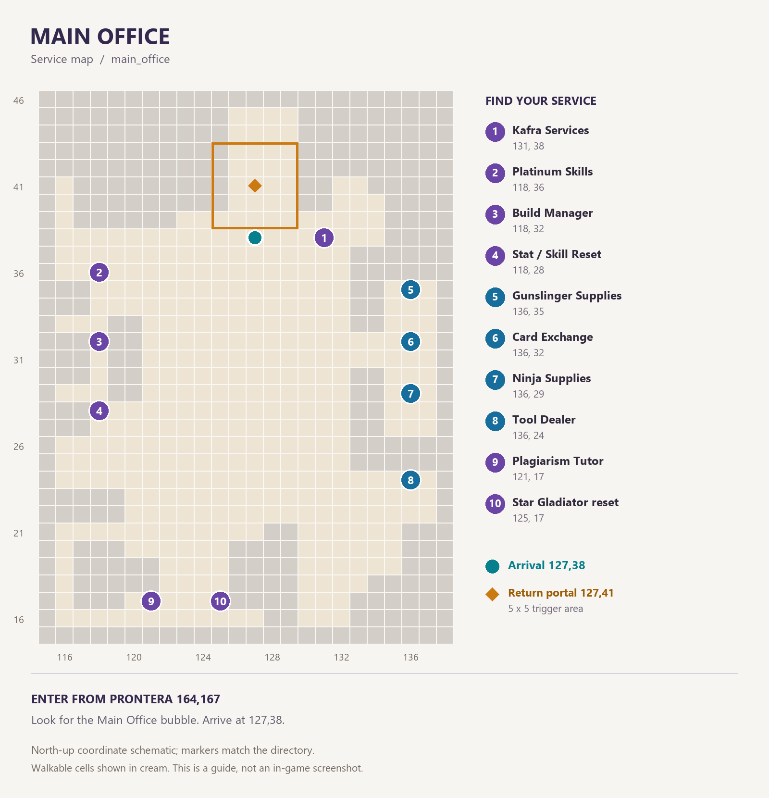

# Main Office

Updated: **November 17, 2026**.

Prepare your next character build, unlock platinum skills, restock supplies and trade spare cards in one stop. **Main Office brings eleven everyday services together**, with a service-name bubble above each NPC.

!!! tip "Start at the Main Office doorway"
    Find the **Main Office** bubble at **Prontera 164,167**.

    ```text
    /navi prontera 164/167
    ```

    The doorway brings you to **main_office 127,38**. Head into the room to find the service NPCs.

## Service map

{ width="1600" height="1660" loading="lazy" }

*Coordinate schematic, with north at the top. The numbered markers match the service directory below.*

## Service directory

| Map marker | Bubble / NPC | Navigation | What you can do |
| --- | --- | --- | --- |
| 1 | **Kafra Services** / Kafra Employee | `/navi main_office 131/38` | Save here, use personal or guild storage, access Universal Rental and learn eligible platinum skills. Personal storage costs **40z**; guild permissions still apply. |
| 2 | **Platinum Skills** / Platinum Skill NPC | `/navi main_office 118/36` | Learn free eligible class and custom platinum skills, and restore applicable unlocks after resets. |
| 3 | **Build Manager** | `/navi main_office 118/32` | Save and load [ten stat and ten skill builds](build-manager.md) per character. Saving is free; loading one build costs **5,000z**. |
| 4 | **Stat / Skill Reset** / Reset Girl | `/navi main_office 118/28` | Reset stats for **5,000z**, skills for **5,000z**, or both for **9,000z**. |
| 5 | **Gunslinger Supplies** | `/navi main_office 136/35` | Buy [bullets, spheres and sphere-crafting supplies](dealers.md#gunslinger-materials). Weapons and armor are excluded. |
| 6 | **Card Exchange** / Putty | `/navi main_office 136/32` | Exchange eligible loose cards for account-wide points and browse the [reward catalogue](card-exchange.md). |
| 7 | **Ninja Supplies** / Jackie | `/navi main_office 136/29` | Buy [shuriken, kunai and ninjutsu supplies](dealers.md#ninja-materials), including Holy, Shadow and Ghost kunai. |
| 8 | **Tool Dealer** / Enhanced Tool Dealer | `/navi main_office 136/24` | Buy the same [everyday-supply catalogue](dealers.md#enhanced-tool-dealers) offered by the existing town dealers. |
| 9 | **Plagiarism Tutor** | `/navi main_office 121/17` | Copy eligible skills as a Rogue or Stalker for **25,000z** per valid lesson. Preserve must be off. |
| 10 | **Star Gladiator Reset** / Salvia | `/navi main_office 125/17` | Reset Feeling maps or Hatred targets for **500,000z** per memory set. The other set is preserved; empty sets are not charged. |
| 11 | **Job Master** | `/navi main_office 122/38` | Free eligible [job changes and rebirth](character-services.md#job-master), beside the arrival point. |

## Plan your visit

- **Ready for your next job?** Job Master is beside the landing, west of Kafra.
- **Changing your setup?** Visit Reset Girl and Build Manager on the west side, then restore your eligible platinum skills.
- **Preparing to hunt?** Use Kafra storage, then pick up tools or class ammunition from the east-side dealers.
- **Clearing spare cards?** Putty is between Gunslinger Supplies and Jackie.
- **Using a specialist service?** Plagiarism Tutor and Salvia are along the south side of the room.

Saving with the office Kafra sets your save point to **main_office 127,38**. Original town Kafras and Tool/Pet Dealers remain available at their usual locations.

## Leaving Main Office

The return portal is centered on **main_office 127,41**, just north of the landing. It covers **5x5 cells** and returns you to **Prontera 162,167**. The outside entrance covers **3x3 cells**; both arrival points sit outside their return triggers.

Random teleportation, Fly Wings, return items and player warp skills are disabled inside Main Office. Use the return doorway to leave.

## Coin Exchange building

The coin shops are in a **separate building**, entered at **Prontera 133,183**. Look for the **Coin Exchange** bubble above its doorway. The original entrance lands at **prt_in 50,105**.

| Bubble / NPC | Navigation | Service |
| --- | --- | --- |
| **Costume Shop** / Gold Point Manager | `/navi prt_in 38/104` | Spend actual [hourly-reward Gold Coins](hourly-rewards.md) on costumes. |
| **Vestige Coin Exchange** / Lydia | `/navi prt_in 38/108` | Spend [Vestige Coins](vestige-coins.md) on the [26-item reward catalogue](coin-exchange.md). |
| **Stylist** | `/navi prt_in 43/114` | Free [hairstyle, hair-color and class-specific clothing-color previews](character-services.md#stylist). |
| **Baby Conversion** / Sister Elara | `/navi prt_in 34/114` | Become an eligible [baby character](baby-characters.md) for **5,000,000z**, without adoption. |

Click the top-right hourly timer to convert eligible points into Gold Coins. The timer does **not** open the costume shop.

## Other useful stops

| Stop | Navigation | What to look for |
| --- | --- | --- |
| **Market** / Merchants Warp | `/navi prontera 164/174` | The **Market** bubble marks entry to [Market Street](vendor-system.md). Its Vending Helper offers a return to Main Office at **121,22**. |
| **Healer** | `/navi prontera 152/187` | Free [HP/SP recovery](character-services.md#healer). |
| **Card Remover** / Wise Old Woman | `/navi prt_in 28/73` | [Remove cards from equipped items](card-removal.md). Read the costs and failure outcomes before confirming. |

The Market entrance is outside Main Office, north of its Prontera doorway. The Card Remover is in the original refining building, rather than inside Main Office or the Coin Exchange building.
