# Monster Changes

Selected monsters have revised loot, spawn behavior and combat rules. The tables show the configured chances for each listed item.

## Drop chances

The listed percentages are **fixed final drop chances**. Weekday/weekend rates, boss multipliers, LUK, Bubble Gum and personal drop bonuses do not increase these listed chances. Other items retain their existing drop rules.

Endless Cellar retains its encounter-specific reduction: affected final-floor monsters roll at **10% of their configured chances**. Its two random Bio Labs MVPs retain normal chances.

## Updated monster drops

| Monster | Drop | Fixed chance |
| --- | --- | ---: |
| 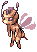{ .tower-monster-sprite loading="lazy" } **Hornet** ID `1004` | { .item-icon loading="lazy" } **Oilpalm Coconut** ID `12369` | 0.1% |
|  | { .item-icon loading="lazy" } **Beehive** ID `102723` | 1% |
| 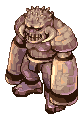{ .tower-monster-sprite loading="lazy" } **Golem** ID `1040` | { .item-icon loading="lazy" } **Magical Lithography** ID `12371` | 0.1% |
| 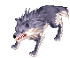{ .tower-monster-sprite loading="lazy" } **Vagabond Wolf** ID `1092` | { .item-icon loading="lazy" } **Vagabond's Skull** ID `14574` | 12% |
| 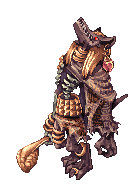{ .tower-monster-sprite loading="lazy" } **Anubis** ID `1098` | 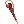{ .item-icon loading="lazy" } **Healing Staff** ID `1625` | 0.35% |
| 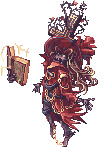{ .tower-monster-sprite loading="lazy" } **Evil Druid** ID `1117` | 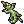{ .item-icon loading="lazy" } **Elixir_Bandage** ID `23256` | 0.5% |
| { .tower-monster-sprite loading="lazy" } **Ghostring** ID `1120` | 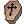{ .item-icon loading="lazy" } **Fit Pipe** ID `12363` | 6% |
| 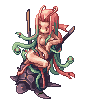{ .tower-monster-sprite loading="lazy" } **Medusa** ID `1148` | { .item-icon loading="lazy" } **Splendid Mirror** ID `12368` | 0.5% |
| 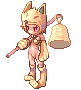{ .tower-monster-sprite loading="lazy" } **Moonlight Flower** ID `1150` | 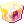{ .item-icon loading="lazy" } **Sap Jelly** ID `23187` | 9% |
| 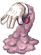{ .tower-monster-sprite loading="lazy" } **Sting** ID `1207` | 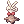{ .item-icon loading="lazy" } **Sting hat** ID `5509` | 0.05% |
| 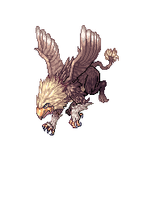{ .tower-monster-sprite loading="lazy" } **Gryphon** ID `1259` | 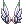{ .item-icon loading="lazy" } **Sigrun's Wings** ID `5592` | 0.9% |
| 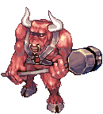{ .tower-monster-sprite loading="lazy" } **Majoruros** ID `1310` | { .item-icon loading="lazy" } **Vecer Axe** ID `1311` | 0.2% |
| 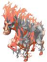{ .tower-monster-sprite loading="lazy" } **Nightmare Terror** ID `1379` | 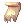{ .item-icon loading="lazy" } **Hell Contract** ID `12372` | 0.5% |
| 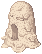{ .tower-monster-sprite loading="lazy" } **Sleeper** ID `1386` | { .item-icon loading="lazy" } **Great Nature** ID `997` | 75% |
| 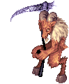{ .tower-monster-sprite loading="lazy" } **Baphomet** ID `1399` | 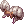{ .item-icon loading="lazy" } **Gigantic Majestic Goat** ID `5518` | 3% |
|  | 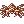{ .item-icon loading="lazy" } **Mercury Riser** ID `18597` | 5.1% |
| 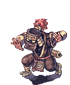{ .tower-monster-sprite loading="lazy" } **Shinobi** ID `1401` | { .item-icon loading="lazy" } **Kuloren** ID `12362` | 0.1% |
| { .tower-monster-sprite loading="lazy" } **Wicked Nymph** ID `1416` | { .item-icon loading="lazy" } **Charming Lotus** ID `12365` | 0.1% |
| 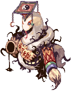{ .tower-monster-sprite loading="lazy" } **Evil Snake Lord** ID `1418` | 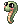{ .item-icon loading="lazy" } **Snake Head Hat** ID `5388` | 0.9% |
| 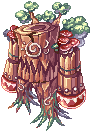{ .tower-monster-sprite loading="lazy" } **Wooden Golem** ID `1497` | { .item-icon loading="lazy" } **Dew_Of_Old_Tree** ID `23257` | 0.1% |
| 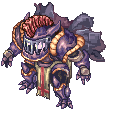{ .tower-monster-sprite loading="lazy" } **Dullahan** ID `1504` | { .item-icon loading="lazy" } **Luxury Whisky Bottle** ID `12367` | 0.1% |
| { .tower-monster-sprite loading="lazy" } **Loli Ruri** ID `1505` | { .item-icon loading="lazy" } **Very Red Juice** ID `12360` | 0.1% |
| 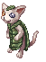{ .tower-monster-sprite loading="lazy" } **Leaf Cat** ID `1586` | 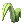{ .item-icon loading="lazy" } **Very Soft Plant** ID `12359` | 0.5% |
| 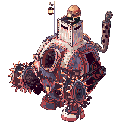{ .tower-monster-sprite loading="lazy" } **RSX 0806** ID `1623` | 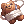{ .item-icon loading="lazy" } **Small Doll Needle** ID `23189` | 9% |
| 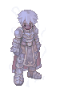{ .tower-monster-sprite loading="lazy" } **Seyren** ID `1634` | 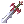{ .item-icon loading="lazy" } **Dragon Slayer** ID `1166` | 0.1% |
| { .tower-monster-sprite loading="lazy" } **Magaleta** ID `1637` | { .item-icon loading="lazy" } **Healing Staff** ID `1625` | 1% |
|  | 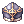{ .item-icon loading="lazy" } **Old Mitra** ID `18972` | 0.1% |
| { .tower-monster-sprite loading="lazy" } **Assassin Cross Eremes** ID `1641` | 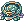{ .item-icon loading="lazy" } **Hermode Cap** ID `5481` | 15% |
| 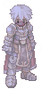{ .tower-monster-sprite loading="lazy" } **Lord Knight Seyren** ID `1646` | { .item-icon loading="lazy" } **Dragon Slayer** ID `1166` | 75% |
| { .tower-monster-sprite loading="lazy" } **High Priest Magaleta** ID `1649` | 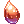{ .item-icon loading="lazy" } **Valkyrie Drop** ID `28564` | 4.95% |
| 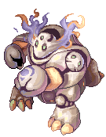{ .tower-monster-sprite loading="lazy" } **Vesper** ID `1685` | { .item-icon loading="lazy" } **Robo Eye** ID `5325` | 2.1% |
| 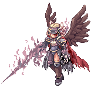{ .tower-monster-sprite loading="lazy" } **Valkyrie Randgris** ID `1751` | 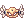{ .item-icon loading="lazy" } **Angel Spirit** ID `5389` | 2.25% |
|  | 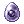{ .item-icon loading="lazy" } **Valkyrie Randgris Egg** ID `9185` | 0.15% |
| 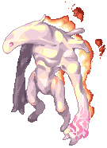{ .tower-monster-sprite loading="lazy" } **Gloom Under Night** ID `1768` | 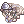{ .item-icon loading="lazy" } **Unprocessed Parts** ID `23188` | 4.5% |
| 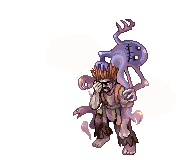{ .tower-monster-sprite loading="lazy" } **Fallen Bishop** ID `1871` | 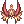{ .item-icon loading="lazy" } **Crown of Deceit** ID `5564` | 6% |
| 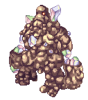{ .tower-monster-sprite loading="lazy" } **Bradium Golem** ID `2024` | 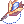{ .item-icon loading="lazy" } **Bradium Brooch** ID `2790` | 0.05% |
| 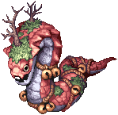{ .tower-monster-sprite loading="lazy" } **Boitata** ID `2068` | 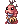{ .item-icon loading="lazy" } **Boitata Hat** ID `5940` | 3% |
| 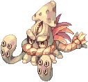{ .tower-monster-sprite loading="lazy" } **Kraken** ID `2202` | { .item-icon loading="lazy" } **Waterdrop Brooch** ID `2787` | 9% |

**Evil Druid no longer drops Yggdrasil Leaf (#610).** Its other existing drops are retained.

## Bio Labs 3 spawns and protection

The six regular Bio Labs 3 monsters spawn across the whole map. Their existing spawn totals and respawn times are retained. **Kill Steal Protection does not lock these monsters**; any player may attack them.

| Sprite | Monster |
| --- | --- |
| { .tower-monster-sprite loading="lazy" } | **Seyren** — ID `1634` |
| { .tower-monster-sprite loading="lazy" } | **Eremes** — ID `1635` |
| { .tower-monster-sprite loading="lazy" } | **Harword** — ID `1636` |
| { .tower-monster-sprite loading="lazy" } | **Magaleta** — ID `1637` |
| { .tower-monster-sprite loading="lazy" } | **Shecil** — ID `1638` |
| { .tower-monster-sprite loading="lazy" } | **Katrinn** — ID `1639` |

## Combat rules

**Critical Slash is Neutral element** for every monster that uses it. It does not inherit the monster's attack element.

| Monster | Configured changes |
| --- | --- |
| { .tower-monster-sprite loading="lazy" } **Corrupted Monk** — ID `20898` | Resurrection cannot trigger its instant-kill effect against this monster. { .item-icon loading="lazy" } **Crystal Mirror** ID `747`: **50%** fixed chance. |
| { .tower-monster-sprite loading="lazy" } **Corrupted Soul** — ID `20575` | **12,500,000 HP**. Only one summoned minion group may be alive at a time. **10% additional evasion against ranged physical attacks**, separate from normal FLEE. |
| { .tower-monster-sprite loading="lazy" } **Maggot** — ID `2467` | **60 DEF**. Disappears after **15 minutes**, without EXP or loot from the timeout. |

## Equipment additions

| Item | Classic effects | Requirements |
| --- | --- | --- |
| { .item-icon loading="lazy" } **Boitata Hat** ID `5940` [1] | DEF +5, MDEF +5. Restore 100 HP per physical monster kill and 5 SP per physical Brute kill. At +5, Brute damage taken -5%; at +7, a further -5%. | Upper headgear; Level 20; all jobs; weight 30. |
| { .item-icon loading="lazy" } **Valkyrie Drop** ID `28564` [1] | Cast time -5%, after-cast delay -5%. Magnus Exorcismus damage +4% per learned Impositio Manus level. | Accessory; Level 70; Priest family; weight 3. |
| { .item-icon loading="lazy" } **Old Mitra** ID `18972` [1] | INT +1, MDEF +5. Every two refine levels: Max HP +1%, Max SP +1%, ATK +8, MATK +4 and Magnus Exorcismus damage +4%. | Upper headgear; DEF 10; Level 70; Priest family; weight 10. |

Related guides: [Pet System](pet-system.md), [Bio Labs 4](biolabs4.md), [Kill Steal Protection](kill-steal-protection.md) and [Endless Cellar](endless-cellar.md).
