# Pet catalogue

Find a pet below for its picture, food, owner bonuses and evolution ingredients. These values describe the active Vestige Rift configuration. See the [Pet System guide](pet-system.md) for taming, care and evolution instructions.

Bonuses apply while the pet is active and at the stated intimacy. Each row is the **complete bonus at that tier**, not an amount added to the rows above. Equipment is not required for the listed owner bonuses.

## Find a pet

[Abandoned Teddy Bear](#pet-abandoned-teddy-bear) | [Abysmal Knight](#pet-abysmal-knight) | [Alice](#pet-alice) | [Alicel](#pet-alicel) | [Aliot](#pet-aliot) | [Aliza](#pet-aliza) | [Am Mut](#pet-am-mut) | [Ancient Mummy](#pet-ancient-mummy) | [Angeling](#pet-angeling) | [Baby Desert Wolf](#pet-baby-desert-wolf) | [Bacsojin](#pet-bacsojin) | [Bacsojin (cosmetic)](#pet-bacsojin-tamed) | [Baphomet](#pet-baphomet) | [Baphomet Jr.](#pet-baphomet-jr) | [Blue Moon Loli Ruri](#pet-blue-moon-loli-ruri) | [Blue Unicorn](#pet-blue-unicorn) | [Bongun](#pet-bongun) | [Cat o' Nine Tails](#pet-cat-o-nine-tails) | [Chaotic Bapho Jr](#pet-chaotic-bapho-jr) | [Choco](#pet-choco) | [Chonchon](#pet-chonchon) | [Christmas Goblin](#pet-christmas-goblin) | [Christmas Snow Rabbit](#pet-christmas-snow-rabbit) | [Chung E](#pet-chung-e) | [Civil Servant](#pet-civil-servant) | [Contaminated Wanderer](#pet-contaminated-wanderer) | [Dark Illusion](#pet-dark-illusion) | [Dark Lord](#pet-dark-lord) | [Dark Priest](#pet-dark-priest) | [Desert Wolf](#pet-desert-wolf) | [Deviruchi](#pet-deviruchi) | [Diabolic](#pet-diabolic) | [Dokebi](#pet-dokebi) | [Drops](#pet-drops) | [Dullahan](#pet-dullahan) | [Earth Deleter](#pet-earth-deleter) | [Eddga](#pet-eddga) | [Eggring](#pet-eggring) | [Evil Nymph](#pet-evil-nymph) | [Familiar](#pet-familiar) | [Fei Chai](#pet-fei-chai) | [Fire Golem](#pet-fire-golem) | [Flail Goblin](#pet-flail-goblin) | [Giant Hornet](#pet-giant-hornet) | [Gloom Under Night](#pet-gloom-under-night) | [Goblin Leader](#pet-goblin-leader) | [Golem](#pet-golem) | [Grand Peco](#pet-grand-peco) | [Green Petite](#pet-green-petite) | [Gremlin](#pet-gremlin) | [Hammer Goblin](#pet-hammer-goblin) | [High Orc](#pet-high-orc) | [Hodremlin](#pet-hodremlin) | [Hornet](#pet-hornet) | [Hunter Fly](#pet-hunter-fly) | [Imp](#pet-imp) | [Incubus](#pet-incubus) | [Isis](#pet-isis) | [Kiel D-01](#pet-kiel-d-01) | [Knife Goblin](#pet-knife-goblin) | [Leaf Cat](#pet-leaf-cat) | [Leaf Lunatic](#pet-leaf-lunatic) | [Little Isis](#pet-little-isis) | [Loli Ruri](#pet-loli-ruri) | [Lunatic](#pet-lunatic) | [Marionette](#pet-marionette) | [Mastering](#pet-mastering) | [Medusa](#pet-medusa) | [Metaller](#pet-metaller) | [Mistress](#pet-mistress) | [Miyabi Doll](#pet-miyabi-doll) | [Moonlight Flower](#pet-moonlight-flower) | [Mummy](#pet-mummy) | [Munak](#pet-munak) | [Mutating White Knight](#pet-mutating-white-knight) | [New Year Doll](#pet-new-year-doll) | [Nightmare Terror](#pet-nightmare-terror) | [Nine Tail](#pet-nine-tail) | [Orc Hero](#pet-orc-hero) | [Orc Warrior](#pet-orc-warrior) | [PecoPeco](#pet-pecopeco) | [Phreeoni](#pet-phreeoni) | [Picky](#pet-picky) | [Poison Spore](#pet-poison-spore) | [Poporing](#pet-poporing) | [Poring](#pet-poring) | [Rice Cake](#pet-rice-cake) | [Rigid Nightmare Terror](#pet-rigid-nightmare-terror) | [Rocker](#pet-rocker) | [Roween](#pet-roween) | [Savage](#pet-savage) | [Savage Babe](#pet-savage-babe) | [Scatleton](#pet-scatleton) | [Shinobi](#pet-shinobi) | [Skelion](#pet-skelion) | [Smokie](#pet-smokie) | [Sohee](#pet-sohee) | [Spore](#pet-spore) | [Steel Chonchon](#pet-steel-chonchon) | [Stone Shooter](#pet-stone-shooter) | [Succubus](#pet-succubus) | [Sweet Drops](#pet-sweet-drops) | [Tai-Zi](#pet-tai-zi) | [Teddy Bear](#pet-teddy-bear) | [Valkyrie Randgris](#pet-valkyrie-randgris) | [Violet](#pet-violet) | [Wanderer](#pet-wanderer) | [Wandering Duck Doll](#pet-wandering-duck-doll) | [Whisper](#pet-whisper) | [White Knight](#pet-white-knight) | [Wild Rose](#pet-wild-rose) | [Willow](#pet-willow) | [Yao Jun](#pet-yao-jun) | [Yoyo](#pet-yoyo) | [Zealotus](#pet-zealotus)

Pet families are arranged from the base form toward its evolutions. On smaller screens, the same cards stack in that order.

## Alice evolution family

[Alice](#pet-alice) &rarr; [Aliza](#pet-aliza)

### Alice {: #pet-alice }

{ .pet-sprite loading="lazy" width="75" height="92" }

**Base Form** &middot; Egg: { .item-icon loading="lazy" } **Alice Egg** (#9027)

**Food:** { .item-icon loading="lazy" } **White Potion** (#504) **Auto-feed:** Unavailable &middot; **Hungry feeding intimacy:** +30

**Obtaining this pet:** Tame using 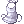{ .item-icon loading="lazy" } **Soft Apron** (#661). Base capture chance: **10%**.

#### Owner bonuses

| Intimacy | Effect |
| --- | --- |
| Loyal (900-1,000) | MDEF +1; Damage received from Demi-Human / player targets -1% |
| Cordial (750-899) Neutral (250-749) Shy (100-249) Awkward (1-99) | No owner stat bonus. |

#### Evolves into

**[Aliza](#pet-aliza)** &mdash; { .pet-evolution-sprite loading="lazy" }

| Material | Quantity |
| --- | ---: |
| 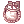{ .item-icon loading="lazy" } **Alice's Apron** (#7047) | **500** |
| 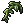{ .item-icon loading="lazy" } **Green Herb** (#511) | **200** |
| 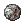{ .item-icon loading="lazy" } **Elunium** (#985) | **30** |
| 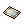{ .item-icon loading="lazy" } **Alice Card** (#4253) | **1** |

### Aliza {: #pet-aliza }

{ .pet-sprite loading="lazy" width="92" height="109" }

**Final Evolution** &middot; Egg: { .item-icon loading="lazy" } **Aliza Egg** (#9120)

**Food:** 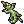{ .item-icon loading="lazy" } **Pet Food** (#537) **Auto-feed:** Available &middot; **Hungry feeding intimacy:** +30

**Obtaining this pet:** Evolve from [Alice](#pet-alice).

#### Owner bonuses

| Intimacy | Effect |
| --- | --- |
| Loyal (900-1,000) | MDEF +7; Healing skill effectiveness +6% |
| Cordial (750-899) | MDEF +6; Healing skill effectiveness +4% |
| Neutral (250-749) | MDEF +5; Healing skill effectiveness +2% |
| Shy (100-249) Awkward (1-99) | MDEF +4 |

**Further evolution:** None.

## Baby Desert Wolf evolution family

[Baby Desert Wolf](#pet-baby-desert-wolf) &rarr; [Desert Wolf](#pet-desert-wolf)

### Baby Desert Wolf {: #pet-baby-desert-wolf }

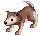{ .pet-sprite loading="lazy" width="40" height="36" }

**Base Form** &middot; Egg: { .item-icon loading="lazy" } **Baby Desert Wolf Egg** (#9010)

**Food:** { .item-icon loading="lazy" } **Pet Food** (#537) **Auto-feed:** Unavailable &middot; **Hungry feeding intimacy:** +30

**Accessory:** { .item-icon loading="lazy" } **Transparent Head Protector** (#10003)

**Obtaining this pet:** Tame using { .item-icon loading="lazy" } **Well-Dried Bone** (#628). Base capture chance: **10%**.

#### Owner bonuses

| Intimacy | Effect |
| --- | --- |
| Loyal (900-1,000) | INT +1; Max SP +50 |
| Cordial (750-899) Neutral (250-749) Shy (100-249) Awkward (1-99) | No owner stat bonus. |

#### Evolves into

**[Desert Wolf](#pet-desert-wolf)** &mdash; 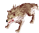{ .pet-evolution-sprite loading="lazy" }

| Material | Quantity |
| --- | ---: |
| { .item-icon loading="lazy" } **Desert Wolf Card** (#4082) | **1** |
| { .item-icon loading="lazy" } **Well-Dried Bone** (#628) | **3** |
| { .item-icon loading="lazy" } **Claw of Desert Wolf** (#7030) | **300** |
| 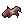{ .item-icon loading="lazy" } **Animal Skin** (#919) | **20** |

### Desert Wolf {: #pet-desert-wolf }

{ .pet-sprite loading="lazy" width="76" height="65" }

**Final Evolution** &middot; Egg: { .item-icon loading="lazy" } **Desert Wolf Egg** (#9129)

**Food:** { .item-icon loading="lazy" } **Pet Food** (#537) **Auto-feed:** Available &middot; **Hungry feeding intimacy:** +30

**Obtaining this pet:** Evolve from [Baby Desert Wolf](#pet-baby-desert-wolf).

#### Owner bonuses

| Intimacy | Effect |
| --- | --- |
| Loyal (900-1,000) | INT +2; Max SP +75; Earth magic damage +5% |
| Cordial (750-899) | INT +1; Max SP +50; Earth magic damage +3% |
| Neutral (250-749) Shy (100-249) Awkward (1-99) | No owner stat bonus. |

**Further evolution:** None.

## Baphomet Jr. evolution family

[Baphomet Jr.](#pet-baphomet-jr) &rarr; [Chaotic Bapho Jr](#pet-chaotic-bapho-jr) [Chaotic Bapho Jr](#pet-chaotic-bapho-jr) &rarr; [Baphomet](#pet-baphomet)

### Baphomet Jr. {: #pet-baphomet-jr }

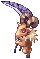{ .pet-sprite loading="lazy" width="40" height="59" }

**Base Form** &middot; Egg: { .item-icon loading="lazy" } **Bapho Jr. Egg** (#9024)

**Food:** { .item-icon loading="lazy" } **Honey** (#518) **Auto-feed:** Unavailable &middot; **Hungry feeding intimacy:** +30

**Accessory:** 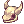{ .item-icon loading="lazy" } **Skull Helm** (#10001)

**Obtaining this pet:** Tame using { .item-icon loading="lazy" } **Book of the Devil** (#642). Base capture chance: **2%**.

#### Owner bonuses

| Intimacy | Effect |
| --- | --- |
| Loyal (900-1,000) | DEF +1; MDEF +1; Stun resistance -1% |
| Cordial (750-899) Neutral (250-749) Shy (100-249) Awkward (1-99) | No owner stat bonus. |

#### Evolves into

**[Chaotic Bapho Jr](#pet-chaotic-bapho-jr)** &mdash; 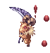{ .pet-evolution-sprite loading="lazy" }

| Material | Quantity |
| --- | ---: |
| { .item-icon loading="lazy" } **Evil Horn** (#923) | **300** |
| 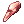{ .item-icon loading="lazy" } **Brigan** (#7054) | **300** |
| { .item-icon loading="lazy" } **Yellow Herb** (#508) | **100** |
| { .item-icon loading="lazy" } **Bapho Jr. Card** (#4129) | **2** |

### Chaotic Bapho Jr {: #pet-chaotic-bapho-jr }

{ .pet-sprite loading="lazy" width="71" height="76" }

**Evolution 1** &middot; Egg: { .item-icon loading="lazy" } **Chaotic Bapho Jr Egg** (#9130)

**Food:** { .item-icon loading="lazy" } **Pet Food** (#537) **Auto-feed:** Available &middot; **Hungry feeding intimacy:** +40

**Obtaining this pet:** Evolve from [Baphomet Jr.](#pet-baphomet-jr).

#### Owner bonuses

| Intimacy | Effect |
| --- | --- |
| Loyal (900-1,000) | FLEE +15; Max SP +3% |
| Cordial (750-899) | FLEE +12; Max SP +2% |
| Neutral (250-749) Shy (100-249) Awkward (1-99) | No owner stat bonus. |

#### Evolves into

**[Baphomet](#pet-baphomet)** &mdash; 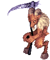{ .pet-evolution-sprite loading="lazy" }

| Material | Quantity |
| --- | ---: |
| { .item-icon loading="lazy" } **Bapho Jr. Card** (#4129) | **5** |
| 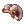{ .item-icon loading="lazy" } **Majestic Goat** (#5160) | **1** |
| { .item-icon loading="lazy" } **Poring Coin** (#7539) | **1,000** |

### Baphomet {: #pet-baphomet }

{ .pet-sprite loading="lazy" width="99" height="120" }

**Final Evolution** &middot; Egg: { .item-icon loading="lazy" } **Baphomet Egg** (#9137)

**Food:** { .item-icon loading="lazy" } **Luxurious Pet Food** (#25377) **Auto-feed:** Available &middot; **Hungry feeding intimacy:** +30

**Obtaining this pet:** Evolve from [Chaotic Bapho Jr](#pet-chaotic-bapho-jr).

#### Owner bonuses

| Intimacy | Effect |
| --- | --- |
| Loyal (900-1,000) | FLEE +20; Max SP +7%; Ranged physical damage +5% |
| Cordial (750-899) | FLEE +16; Max SP +5%; Ranged physical damage +3% |
| Neutral (250-749) Shy (100-249) Awkward (1-99) | No owner stat bonus. |

**Further evolution:** None.

## Bongun evolution family

[Bongun](#pet-bongun) &rarr; [Yao Jun](#pet-yao-jun)

### Bongun {: #pet-bongun }

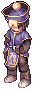{ .pet-sprite loading="lazy" width="36" height="91" }

**Base Form** &middot; Egg: { .item-icon loading="lazy" } **Bongun Egg** (#9025)

**Food:** { .item-icon loading="lazy" } **Pet Food** (#537) **Auto-feed:** Unavailable &middot; **Hungry feeding intimacy:** +30

**Accessory:** { .item-icon loading="lazy" } **Grave Keeper's Sword** (#10020)

**Obtaining this pet:** Tame using { .item-icon loading="lazy" } **Her Heart** (#659). Base capture chance: **5%**.

#### Owner bonuses

| Intimacy | Effect |
| --- | --- |
| Loyal (900-1,000) | VIT +1; Stun resistance +1% |
| Cordial (750-899) Neutral (250-749) Shy (100-249) Awkward (1-99) | No owner stat bonus. |

#### Evolves into

**[Yao Jun](#pet-yao-jun)** &mdash; 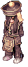{ .pet-evolution-sprite loading="lazy" }

| Material | Quantity |
| --- | ---: |
| 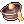{ .item-icon loading="lazy" } **Hyegun Hat** (#5367) | **1** |
| 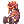{ .item-icon loading="lazy" } **Munak Doll** (#7277) | **100** |
| 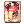{ .item-icon loading="lazy" } **Old Portrait** (#7014) | **50** |
| { .item-icon loading="lazy" } **Yao Jun Card** (#4328) | **1** |

### Yao Jun {: #pet-yao-jun }

{ .pet-sprite loading="lazy" width="40" height="96" }

**Final Evolution** &middot; Egg: { .item-icon loading="lazy" } **Hyegun Egg** (#9093)

**Food:** { .item-icon loading="lazy" } **Pet Food** (#537) **Auto-feed:** Available &middot; **Hungry feeding intimacy:** +30

**Obtaining this pet:** Evolve from [Bongun](#pet-bongun).

#### Owner bonuses

| Intimacy | Effect |
| --- | --- |
| Loyal (900-1,000) | VIT +4; Stun resistance +4%; 1% chance to recover 1% of physical weapon damage as SP |
| Cordial (750-899) | VIT +3; Stun resistance +3%; 1% chance to recover 1% of physical weapon damage as SP |
| Neutral (250-749) | VIT +2; Stun resistance +2% |
| Shy (100-249) Awkward (1-99) | VIT +1; Stun resistance +1% |

**Further evolution:** None.

## Dark Priest evolution family

[Dark Priest](#pet-dark-priest) &rarr; [Dark Illusion](#pet-dark-illusion) [Dark Illusion](#pet-dark-illusion) &rarr; [Dark Lord](#pet-dark-lord)

### Dark Priest {: #pet-dark-priest }

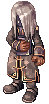{ .pet-sprite loading="lazy" width="49" height="104" }

**Base Form** &middot; Egg: { .item-icon loading="lazy" } **Dark Priest Egg** (#9128)

**Food:** { .item-icon loading="lazy" } **Pet Food** (#537) **Auto-feed:** Unavailable &middot; **Hungry feeding intimacy:** +30

**Obtaining this pet:** Fixed egg drop: **Dark Illusion (0.09%)**, **Dark Lord (0.9%)**.

#### Owner bonuses

| Intimacy | Effect |
| --- | --- |
| Loyal (900-1,000) | INT +4 |
| Cordial (750-899) Neutral (250-749) Shy (100-249) Awkward (1-99) | No owner stat bonus. |

#### Evolves into

**[Dark Illusion](#pet-dark-illusion)** &mdash; 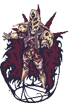{ .pet-evolution-sprite loading="lazy" }

| Material | Quantity |
| --- | ---: |
| { .item-icon loading="lazy" } **Poring Coin** (#7539) | **1,000** |
| { .item-icon loading="lazy" } **Skull** (#7005) | **1,000** |
| { .item-icon loading="lazy" } **Wraith Card** (#4190) | **5** |
| { .item-icon loading="lazy" } **Ghoul Card** (#4110) | **5** |

### Dark Illusion {: #pet-dark-illusion }

{ .pet-sprite loading="lazy" width="151" height="209" }

**Evolution 1** &middot; Egg: { .item-icon loading="lazy" } **Dark Illusion Egg** (#9139)

**Food:** { .item-icon loading="lazy" } **Pet Food** (#537) **Auto-feed:** Available &middot; **Hungry feeding intimacy:** +40

**Obtaining this pet:** Evolve from [Dark Priest](#pet-dark-priest).

#### Owner bonuses

| Intimacy | Effect |
| --- | --- |
| Loyal (900-1,000) | INT +4; Cast time -5% |
| Cordial (750-899) | INT +3; Cast time -3% |
| Neutral (250-749) Shy (100-249) Awkward (1-99) | No owner stat bonus. |

#### Evolves into

**[Dark Lord](#pet-dark-lord)** &mdash; 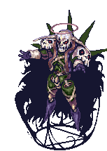{ .pet-evolution-sprite loading="lazy" }

| Material | Quantity |
| --- | ---: |
| { .item-icon loading="lazy" } **Poring Coin** (#7539) | **1,000** |
| { .item-icon loading="lazy" } **Evil Druid Card** (#4141) | **10** |
| { .item-icon loading="lazy" } **Wraith Card** (#4190) | **10** |
| { .item-icon loading="lazy" } **Ghoul Card** (#4110) | **10** |

### Dark Lord {: #pet-dark-lord }

{ .pet-sprite loading="lazy" width="153" height="215" }

**Final Evolution** &middot; Egg: { .item-icon loading="lazy" } **Dark Lord Egg** (#9148)

**Food:** { .item-icon loading="lazy" } **Luxurious Pet Food** (#25377) **Auto-feed:** Available &middot; **Hungry feeding intimacy:** +30

**Obtaining this pet:** Evolve from [Dark Illusion](#pet-dark-illusion).

#### Owner bonuses

| Intimacy | Effect |
| --- | --- |
| Loyal (900-1,000) | INT +5; Cast time -10%; After-cast delay -10% |
| Cordial (750-899) | INT +4; Cast time -7%; After-cast delay -5% |
| Neutral (250-749) Shy (100-249) Awkward (1-99) | No owner stat bonus. |

**Further evolution:** None.

## Deviruchi evolution family

[Deviruchi](#pet-deviruchi) &rarr; [Diabolic](#pet-diabolic)

### Deviruchi {: #pet-deviruchi }

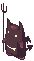{ .pet-sprite loading="lazy" width="34" height="61" }

**Base Form** &middot; Egg: { .item-icon loading="lazy" } **Deviruchi Egg** (#9023)

**Food:** { .item-icon loading="lazy" } **Shoot** (#711) **Auto-feed:** Unavailable &middot; **Hungry feeding intimacy:** +30

**Accessory:** 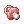{ .item-icon loading="lazy" } **Pacifier** (#10004)

**Obtaining this pet:** Tame using 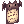{ .item-icon loading="lazy" } **Contract in Shadow** (#641). Base capture chance: **5%**.

#### Owner bonuses

| Intimacy | Effect |
| --- | --- |
| Loyal (900-1,000) | MATK +1%; ATK +1%; Max HP -3%; Max SP -3% |
| Cordial (750-899) Neutral (250-749) Shy (100-249) Awkward (1-99) | No owner stat bonus. |

#### Evolves into

**[Diabolic](#pet-diabolic)** &mdash; 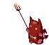{ .pet-evolution-sprite loading="lazy" }

| Material | Quantity |
| --- | ---: |
| { .item-icon loading="lazy" } **Contract in Shadow** (#641) | **3** |
| { .item-icon loading="lazy" } **Little Evil Wing** (#1039) | **250** |
| { .item-icon loading="lazy" } **Hand of God** (#1009) | **30** |
| { .item-icon loading="lazy" } **Deviruchi Card** (#4122) | **1** |

### Diabolic {: #pet-diabolic }

{ .pet-sprite loading="lazy" width="69" height="64" }

**Final Evolution** &middot; Egg: { .item-icon loading="lazy" } **Diabolic Egg** (#9097)

**Food:** { .item-icon loading="lazy" } **Pet Food** (#537) **Auto-feed:** Available &middot; **Hungry feeding intimacy:** +30

**Obtaining this pet:** Evolve from [Deviruchi](#pet-deviruchi).

#### Owner bonuses

| Intimacy | Effect |
| --- | --- |
| Loyal (900-1,000) | ATK +2%; MATK +2%; Max HP +2%; Max SP +2%; 5% chance on melee physical attacks: Fire Bolt (Level 3) |
| Cordial (750-899) | ATK +2%; MATK +2%; Max HP +1%; Max SP +1%; 5% chance on melee physical attacks: Fire Bolt (Level 3) |
| Neutral (250-749) | ATK +1%; MATK +1%; Max HP +1%; Max SP +1% |
| Shy (100-249) Awkward (1-99) | ATK +1%; MATK +1% |

**Further evolution:** None.

## Dokebi evolution family

[Dokebi](#pet-dokebi) &rarr; [Am Mut](#pet-am-mut)

### Dokebi {: #pet-dokebi }

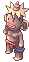{ .pet-sprite loading="lazy" width="29" height="62" }

**Base Form** &middot; Egg: { .item-icon loading="lazy" } **Dokebi Egg** (#9019)

**Food:** { .item-icon loading="lazy" } **Pet Food** (#537) **Auto-feed:** Unavailable &middot; **Hungry feeding intimacy:** +30

**Accessory:** 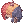{ .item-icon loading="lazy" } **Wig** (#10005)

**Obtaining this pet:** Tame using 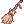{ .item-icon loading="lazy" } **Old Broom** (#637). Base capture chance: **5%**.

#### Owner bonuses

| Intimacy | Effect |
| --- | --- |
| Loyal (900-1,000) | MATK +1%; ATK -1% |
| Cordial (750-899) Neutral (250-749) Shy (100-249) Awkward (1-99) | No owner stat bonus. |

#### Evolves into

**[Am Mut](#pet-am-mut)** &mdash; 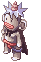{ .pet-evolution-sprite loading="lazy" }

| Material | Quantity |
| --- | ---: |
| { .item-icon loading="lazy" } **Old Broom** (#637) | **3** |
| { .item-icon loading="lazy" } **Violet Dyestuffs** (#981) | **3** |
| 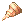{ .item-icon loading="lazy" } **Dokebi Horn** (#1021) | **300** |
| { .item-icon loading="lazy" } **Gold** (#969) | **3** |

### Am Mut {: #pet-am-mut }

{ .pet-sprite loading="lazy" width="41" height="62" }

**Final Evolution** &middot; Egg: { .item-icon loading="lazy" } **Am Mut Egg** (#9089)

**Food:** { .item-icon loading="lazy" } **Pet Food** (#537) **Auto-feed:** Available &middot; **Hungry feeding intimacy:** +30

**Obtaining this pet:** Evolve from [Dokebi](#pet-dokebi).

#### Owner bonuses

| Intimacy | Effect |
| --- | --- |
| Loyal (900-1,000) | MATK +4% |
| Cordial (750-899) | MATK +3% |
| Neutral (250-749) | MATK +2% |
| Shy (100-249) Awkward (1-99) | MATK +1% |

**Further evolution:** None.

## Drops evolution family

[Drops](#pet-drops) &rarr; [Eggring](#pet-eggring) / [Sweet Drops](#pet-sweet-drops)

### Drops {: #pet-drops }

{ .pet-sprite loading="lazy" width="41" height="39" }

**Base Form** &middot; Egg: { .item-icon loading="lazy" } **Drops Egg** (#9002)

**Food:** { .item-icon loading="lazy" } **Yellow Herb** (#508) **Auto-feed:** Unavailable &middot; **Hungry feeding intimacy:** +30

**Accessory:** 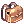{ .item-icon loading="lazy" } **Backpack** (#10013)

**Obtaining this pet:** Tame using 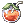{ .item-icon loading="lazy" } **Orange Juice** (#620). Base capture chance: **15%**.

#### Owner bonuses

| Intimacy | Effect |
| --- | --- |
| Loyal (900-1,000) | HIT +3; ATK +3 |
| Cordial (750-899) Neutral (250-749) Shy (100-249) Awkward (1-99) | No owner stat bonus. |

#### Evolves into

**[Eggring](#pet-eggring)** &mdash; { .pet-evolution-sprite loading="lazy" }

| Material | Quantity |
| --- | ---: |
| 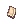{ .item-icon loading="lazy" } **Piece of Egg Shell** (#7032) | **20** |
| { .item-icon loading="lazy" } **Old Frying Pan** (#7031) | **10** |
| 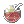{ .item-icon loading="lazy" } **Apple Juice** (#531) | **3** |
| { .item-icon loading="lazy" } **Drops Card** (#4004) | **1** |

**[Sweet Drops](#pet-sweet-drops)** &mdash; 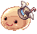{ .pet-evolution-sprite loading="lazy" }

| Material | Quantity |
| --- | ---: |
| { .item-icon loading="lazy" } **Poring Coin** (#7539) | **500** |
| 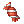{ .item-icon loading="lazy" } **Candy** (#529) | **50** |
| { .item-icon loading="lazy" } **Candy Cane** (#530) | **50** |
| { .item-icon loading="lazy" } **Drops Card** (#4004) | **1** |

### Eggring {: #pet-eggring }

{ .pet-sprite loading="lazy" width="64" height="48" }

**Final Evolution** &middot; Egg: 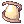{ .item-icon loading="lazy" } **Eggring Egg** (#9092)

**Food:** { .item-icon loading="lazy" } **Pet Food** (#537) **Auto-feed:** Available &middot; **Hungry feeding intimacy:** +30

**Obtaining this pet:** Evolve from [Drops](#pet-drops).

#### Owner bonuses

| Intimacy | Effect |
| --- | --- |
| Loyal (900-1,000) | HIT +15; ATK +15 |
| Cordial (750-899) Neutral (250-749) Shy (100-249) Awkward (1-99) | No owner stat bonus. |

**Further evolution:** None.

### Sweet Drops {: #pet-sweet-drops }

{ .pet-sprite loading="lazy" width="46" height="43" }

**Final Evolution** &middot; Egg: 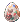{ .item-icon loading="lazy" } **Sweet Drops Egg** (#9109)

**Food:** { .item-icon loading="lazy" } **Candy** (#529) **Auto-feed:** Available &middot; **Hungry feeding intimacy:** +30

**Obtaining this pet:** Evolve from [Drops](#pet-drops).

#### Owner bonuses

| Intimacy | Effect |
| --- | --- |
| Loyal (900-1,000) | Monster EXP +5% |
| Cordial (750-899) Neutral (250-749) Shy (100-249) Awkward (1-99) | No owner stat bonus. |

**Further evolution:** None.

## Evil Nymph evolution family

[Evil Nymph](#pet-evil-nymph) &rarr; [Bacsojin](#pet-bacsojin)

### Evil Nymph {: #pet-evil-nymph }

{ .pet-sprite loading="lazy" width="99" height="150" }

**Base Form** &middot; Egg: { .item-icon loading="lazy" } **Wicked Nymph Egg** (#9047)

**Food:** 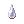{ .item-icon loading="lazy" } **Morning Dew** (#6105) **Auto-feed:** Unavailable &middot; **Hungry feeding intimacy:** +30

**Accessory:** 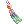{ .item-icon loading="lazy" } **Jade Trinket** (#10029)

**Obtaining this pet:** Tame using { .item-icon loading="lazy" } **Charming Lotus** (#12365). Base capture chance: **5%**.

#### Owner bonuses

| Intimacy | Effect |
| --- | --- |
| Loyal (900-1,000) | Max SP +30; Natural SP recovery +5% |
| Cordial (750-899) Neutral (250-749) Shy (100-249) Awkward (1-99) | No owner stat bonus. |

#### Evolves into

**[Bacsojin](#pet-bacsojin)** &mdash; { .pet-evolution-sprite loading="lazy" }

| Material | Quantity |
| --- | ---: |
| { .item-icon loading="lazy" } **Mao Guai Card** (#4202) | **10** |
| { .item-icon loading="lazy" } **Jing Guai Card** (#4265) | **10** |
| { .item-icon loading="lazy" } **Zhu Po Long Card** (#4272) | **10** |
| { .item-icon loading="lazy" } **Poring Coin** (#7539) | **1,000** |

### Bacsojin {: #pet-bacsojin }

{ .pet-sprite loading="lazy" width="65" height="97" }

**Final Evolution** &middot; Egg: { .item-icon loading="lazy" } **Bacsojin Egg** (#9115)

**Food:** { .item-icon loading="lazy" } **Luxurious Pet Food** (#25377) **Auto-feed:** Available &middot; **Hungry feeding intimacy:** +30

**Obtaining this pet:** Evolve from [Evil Nymph](#pet-evil-nymph).

#### Owner bonuses

| Intimacy | Effect |
| --- | --- |
| Loyal (900-1,000) | Max SP +5%; After-cast delay -3%; Healing skill effectiveness +15% |
| Cordial (750-899) | Max SP +4%; After-cast delay -2%; Healing skill effectiveness +10% |
| Neutral (250-749) | Max SP +3%; After-cast delay -1% |
| Shy (100-249) Awkward (1-99) | Max SP +2% |

**Further evolution:** None.

## Golem evolution family

[Golem](#pet-golem) &rarr; [Fire Golem](#pet-fire-golem)

### Golem {: #pet-golem }

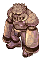{ .pet-sprite loading="lazy" width="82" height="115" }

**Base Form** &middot; Egg: { .item-icon loading="lazy" } **Golem Egg** (#9053)

**Food:** 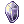{ .item-icon loading="lazy" } **Mystic Stone** (#6111) **Auto-feed:** Unavailable &middot; **Hungry feeding intimacy:** +30

**Accessory:** { .item-icon loading="lazy" } **Spring** (#10035)

**Obtaining this pet:** Tame using { .item-icon loading="lazy" } **Magical Lithography** (#12371). Base capture chance: **5%**.

#### Owner bonuses

| Intimacy | Effect |
| --- | --- |
| Loyal (900-1,000) | Max HP +100; FLEE -5 |
| Cordial (750-899) Neutral (250-749) Shy (100-249) Awkward (1-99) | No owner stat bonus. |

#### Evolves into

**[Fire Golem](#pet-fire-golem)** &mdash; 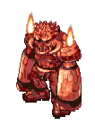{ .pet-evolution-sprite loading="lazy" }

| Material | Quantity |
| --- | ---: |
| { .item-icon loading="lazy" } **Poring Coin** (#7539) | **1,000** |
| { .item-icon loading="lazy" } **Magical Lithography** (#12371) | **3** |
| 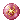{ .item-icon loading="lazy" } **Red Blood** (#990) | **50** |
| { .item-icon loading="lazy" } **Golem Card** (#4072) | **3** |

### Fire Golem {: #pet-fire-golem }

{ .pet-sprite loading="lazy" width="106" height="140" }

**Final Evolution** &middot; Egg: { .item-icon loading="lazy" } **Fire Golem Egg** (#9131)

**Food:** { .item-icon loading="lazy" } **Pet Food** (#537) **Auto-feed:** Available &middot; **Hungry feeding intimacy:** +30

**Obtaining this pet:** Evolve from [Golem](#pet-golem).

#### Owner bonuses

| Intimacy | Effect |
| --- | --- |
| Loyal (900-1,000) | Max HP +500; Fire magic damage +5% |
| Cordial (750-899) | Max HP +400; Fire magic damage +3% |
| Neutral (250-749) Shy (100-249) Awkward (1-99) | No owner stat bonus. |

**Further evolution:** None.

## Green Petite evolution family

[Green Petite](#pet-green-petite) &rarr; [Earth Deleter](#pet-earth-deleter)

### Green Petite {: #pet-green-petite }

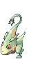{ .pet-sprite loading="lazy" width="48" height="86" }

**Base Form** &middot; Egg: { .item-icon loading="lazy" } **Green Petite Egg** (#9022)

**Food:** { .item-icon loading="lazy" } **Pet Food** (#537) **Auto-feed:** Unavailable &middot; **Hungry feeding intimacy:** +30

**Accessory:** 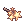{ .item-icon loading="lazy" } **Stellar Hairpin** (#10011)

**Obtaining this pet:** Tame using 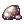{ .item-icon loading="lazy" } **Shining Stone** (#640). Base capture chance: **5%**.

#### Owner bonuses

| Intimacy | Effect |
| --- | --- |
| Loyal (900-1,000) | DEF -2; MDEF -2; Attack speed +1% |
| Cordial (750-899) Neutral (250-749) Shy (100-249) Awkward (1-99) | No owner stat bonus. |

#### Evolves into

**[Earth Deleter](#pet-earth-deleter)** &mdash; 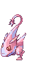{ .pet-evolution-sprite loading="lazy" }

| Material | Quantity |
| --- | ---: |
| { .item-icon loading="lazy" } **Shining Stone** (#640) | **3** |
| { .item-icon loading="lazy" } **Petite's Tail** (#6260) | **100** |
| { .item-icon loading="lazy" } **Aloevera** (#606) | **150** |
| { .item-icon loading="lazy" } **Earth Deleter Card** (#4279) | **1** |

### Earth Deleter {: #pet-earth-deleter }

{ .pet-sprite loading="lazy" width="48" height="86" }

**Final Evolution** &middot; Egg: { .item-icon loading="lazy" } **Earth Deleter Egg** (#9098)

**Food:** { .item-icon loading="lazy" } **Pet Food** (#537) **Auto-feed:** Available &middot; **Hungry feeding intimacy:** +30

**Obtaining this pet:** Evolve from [Green Petite](#pet-green-petite).

#### Owner bonuses

| Intimacy | Effect |
| --- | --- |
| Loyal (900-1,000) | Attack speed +3%; AGI +3 |
| Cordial (750-899) | Attack speed +2%; AGI +2 |
| Neutral (250-749) | Attack speed +1%; AGI +1 |
| Shy (100-249) Awkward (1-99) | Attack speed +1% |

**Further evolution:** None.

## Gremlin evolution family

[Gremlin](#pet-gremlin) &rarr; [Hodremlin](#pet-hodremlin) [Hodremlin](#pet-hodremlin) &rarr; [Gloom Under Night](#pet-gloom-under-night)

### Gremlin {: #pet-gremlin }

{ .pet-sprite loading="lazy" width="94" height="66" }

**Base Form** &middot; Egg: { .item-icon loading="lazy" } **Gremlin Egg** (#9100)

**Food:** { .item-icon loading="lazy" } **Cheap Lubricant** (#25232) **Auto-feed:** Unavailable &middot; **Hungry feeding intimacy:** +30

**Obtaining this pet:** Tame using { .item-icon loading="lazy" } **Unprocessed Parts** (#23188). Base capture chance: **5%**.

#### Owner bonuses

| Intimacy | Effect |
| --- | --- |
| Loyal (900-1,000) | DEX +2; HIT +1 |
| Cordial (750-899) | DEX +1; HIT +1 |
| Neutral (250-749) Shy (100-249) Awkward (1-99) | No owner stat bonus. |

#### Evolves into

**[Hodremlin](#pet-hodremlin)** &mdash; { .pet-evolution-sprite loading="lazy" }

| Material | Quantity |
| --- | ---: |
| { .item-icon loading="lazy" } **Unprocessed Parts** (#23188) | **3** |
| { .item-icon loading="lazy" } **Damp Darkness** (#6100) | **50** |
| { .item-icon loading="lazy" } **Will of the Darkness** (#7340) | **200** |
| { .item-icon loading="lazy" } **Hodremlin Card** (#4413) | **1** |

### Hodremlin {: #pet-hodremlin }

{ .pet-sprite loading="lazy" width="128" height="85" }

**Evolution 1** &middot; Egg: { .item-icon loading="lazy" } **Hodremlin Egg** (#9105)

**Food:** { .item-icon loading="lazy" } **Pet Food** (#537) **Auto-feed:** Available &middot; **Hungry feeding intimacy:** +40

**Obtaining this pet:** Evolve from [Gremlin](#pet-gremlin).

#### Owner bonuses

| Intimacy | Effect |
| --- | --- |
| Loyal (900-1,000) | DEX +2; HIT +2; Critical damage +9% |
| Cordial (750-899) | DEX +2; HIT +2; Critical damage +7% |
| Neutral (250-749) | DEX +2; HIT +1 |
| Shy (100-249) Awkward (1-99) | DEX +1; HIT +1 |

#### Evolves into

**[Gloom Under Night](#pet-gloom-under-night)** &mdash; { .pet-evolution-sprite loading="lazy" }

| Material | Quantity |
| --- | ---: |
| { .item-icon loading="lazy" } **Hodremlin Card** (#4413) | **10** |
| { .item-icon loading="lazy" } **Isilla Card** (#4412) | **10** |
| { .item-icon loading="lazy" } **Agav Card** (#4409) | **10** |
| { .item-icon loading="lazy" } **Poring Coin** (#7539) | **1,000** |

### Gloom Under Night {: #pet-gloom-under-night }

{ .pet-sprite loading="lazy" width="135" height="186" }

**Final Evolution** &middot; Egg: { .item-icon loading="lazy" } **Gloom Under Night Egg** (#9122)

**Food:** { .item-icon loading="lazy" } **Luxurious Pet Food** (#25377) **Auto-feed:** Available &middot; **Hungry feeding intimacy:** +30

**Obtaining this pet:** Evolve from [Hodremlin](#pet-hodremlin).

#### Owner bonuses

| Intimacy | Effect |
| --- | --- |
| Loyal (900-1,000) | MATK +40; Ghost magic damage +7%; Fire magic damage +7% |
| Cordial (750-899) | MATK +30; Ghost magic damage +5%; Fire magic damage +5% |
| Neutral (250-749) | MATK +20 |
| Shy (100-249) Awkward (1-99) | MATK +10 |

**Further evolution:** None.

## Hornet evolution family

[Hornet](#pet-hornet) &rarr; [Giant Hornet](#pet-giant-hornet) [Giant Hornet](#pet-giant-hornet) &rarr; [Mistress](#pet-mistress)

### Hornet {: #pet-hornet }

{ .pet-sprite loading="lazy" width="37" height="52" }

**Base Form** &middot; Egg: { .item-icon loading="lazy" } **Hornet Egg** (#9155)

**Food:** { .item-icon loading="lazy" } **Pet Food** (#537) **Auto-feed:** Unavailable &middot; **Hungry feeding intimacy:** +30

**Obtaining this pet:** Tame using { .item-icon loading="lazy" } **Beehive** (#102723). Base capture chance: **2%**.

#### Owner bonuses

| Intimacy | Effect |
| --- | --- |
| Loyal (900-1,000) | Cast time -2%; Wind magic damage +2% |
| Cordial (750-899) Neutral (250-749) Shy (100-249) Awkward (1-99) | No owner stat bonus. |

#### Evolves into

**[Giant Hornet](#pet-giant-hornet)** &mdash; { .pet-evolution-sprite loading="lazy" }

| Material | Quantity |
| --- | ---: |
| { .item-icon loading="lazy" } **Poring Coin** (#7539) | **1,000** |
| { .item-icon loading="lazy" } **Royal Jelly** (#526) | **200** |
| { .item-icon loading="lazy" } **Hornet Card** (#4019) | **5** |

### Giant Hornet {: #pet-giant-hornet }

{ .pet-sprite loading="lazy" width="37" height="56" }

**Evolution 1** &middot; Egg: { .item-icon loading="lazy" } **Giant Hornet Egg** (#9192)

**Food:** { .item-icon loading="lazy" } **Pet Food** (#537) **Auto-feed:** Available &middot; **Hungry feeding intimacy:** +40

**Obtaining this pet:** Evolve from [Hornet](#pet-hornet).

#### Owner bonuses

| Intimacy | Effect |
| --- | --- |
| Loyal (900-1,000) | Cast time -5%; Wind magic damage +5% |
| Cordial (750-899) | Cast time -4%; Wind magic damage +3% |
| Neutral (250-749) Shy (100-249) Awkward (1-99) | No owner stat bonus. |

#### Evolves into

**[Mistress](#pet-mistress)** &mdash; { .pet-evolution-sprite loading="lazy" }

| Material | Quantity |
| --- | ---: |
| { .item-icon loading="lazy" } **Poring Coin** (#7539) | **2,000** |
| { .item-icon loading="lazy" } **Driller Card** (#4180) | **10** |
| { .item-icon loading="lazy" } **Mantis Card** (#4079) | **10** |
| { .item-icon loading="lazy" } **Sidewinder Card** (#4117) | **10** |
| { .item-icon loading="lazy" } **Young Twig** (#7018) | **1** |

### Mistress {: #pet-mistress }

{ .pet-sprite loading="lazy" width="41" height="68" }

**Final Evolution** &middot; Egg: { .item-icon loading="lazy" } **Mistress Egg** (#9193)

**Food:** { .item-icon loading="lazy" } **Luxurious Pet Food** (#25377) **Auto-feed:** Available &middot; **Hungry feeding intimacy:** +30

**Obtaining this pet:** Evolve from [Giant Hornet](#pet-giant-hornet).

#### Owner bonuses

| Intimacy | Effect |
| --- | --- |
| Loyal (900-1,000) | Physical damage against non-Boss targets +7%; Ignores weapon size damage penalties |
| Cordial (750-899) | Physical damage against non-Boss targets +5% |
| Neutral (250-749) Shy (100-249) Awkward (1-99) | No owner stat bonus. |

**Further evolution:** None.

## Isis evolution family

[Isis](#pet-isis) &rarr; [Little Isis](#pet-little-isis)

### Isis {: #pet-isis }

{ .pet-sprite loading="lazy" width="92" height="108" }

**Base Form** &middot; Egg: { .item-icon loading="lazy" } **Isis Egg** (#9021)

**Food:** { .item-icon loading="lazy" } **Pet Food** (#537) **Auto-feed:** Unavailable &middot; **Hungry feeding intimacy:** +30

**Accessory:** { .item-icon loading="lazy" } **Queen's Hair Ornament** (#10006)

**Obtaining this pet:** Tame using { .item-icon loading="lazy" } **Armlet of Obedience** (#639). Base capture chance: **5%**.

#### Owner bonuses

| Intimacy | Effect |
| --- | --- |
| Loyal (900-1,000) | MATK -1%; ATK +1% |
| Cordial (750-899) Neutral (250-749) Shy (100-249) Awkward (1-99) | No owner stat bonus. |

#### Evolves into

**[Little Isis](#pet-little-isis)** &mdash; { .pet-evolution-sprite loading="lazy" }

| Material | Quantity |
| --- | ---: |
| { .item-icon loading="lazy" } **Shining Scale** (#954) | **300** |
| { .item-icon loading="lazy" } **Armlet of Obedience** (#639) | **3** |
| { .item-icon loading="lazy" } **3carat Diamond** (#732) | **6** |
| { .item-icon loading="lazy" } **Queen's Hair Ornament** (#10006) | **1** |

### Little Isis {: #pet-little-isis }

{ .pet-sprite loading="lazy" width="92" height="108" }

**Final Evolution** &middot; Egg: { .item-icon loading="lazy" } **Little Isis Egg** (#9090)

**Food:** { .item-icon loading="lazy" } **Pet Food** (#537) **Auto-feed:** Available &middot; **Hungry feeding intimacy:** +30

**Obtaining this pet:** Evolve from [Isis](#pet-isis).

#### Owner bonuses

| Intimacy | Effect |
| --- | --- |
| Loyal (900-1,000) | ATK +4% |
| Cordial (750-899) | ATK +3% |
| Neutral (250-749) | ATK +2% |
| Shy (100-249) Awkward (1-99) | ATK +1% |

**Further evolution:** None.

## Leaf Cat evolution family

[Leaf Cat](#pet-leaf-cat) &rarr; [Wild Rose](#pet-wild-rose) [Wild Rose](#pet-wild-rose) &rarr; [Eddga](#pet-eddga)

### Leaf Cat {: #pet-leaf-cat }

{ .pet-sprite loading="lazy" width="51" height="69" }

**Base Form** &middot; Egg: { .item-icon loading="lazy" } **Leaf Cat Egg** (#9041)

**Food:** { .item-icon loading="lazy" } **Fish With Blue Back** (#6096) **Auto-feed:** Available &middot; **Hungry feeding intimacy:** +30

**Accessory:** { .item-icon loading="lazy" } **Green Jewel Bag** (#10023)

**Obtaining this pet:** Tame using { .item-icon loading="lazy" } **Very Soft Plant** (#12359). Base capture chance: **2%**.

#### Owner bonuses

| Intimacy | Effect |
| --- | --- |
| Loyal (900-1,000) | Damage received from Brute targets -3% |
| Cordial (750-899) Neutral (250-749) Shy (100-249) Awkward (1-99) | No owner stat bonus. |

#### Evolves into

**[Wild Rose](#pet-wild-rose)** &mdash; { .pet-evolution-sprite loading="lazy" }

| Material | Quantity |
| --- | ---: |
| { .item-icon loading="lazy" } **Huge Leaf** (#7198) | **500** |
| { .item-icon loading="lazy" } **Black Cat Doll** (#7206) | **200** |
| { .item-icon loading="lazy" } **Fish Tail** (#1023) | **200** |
| { .item-icon loading="lazy" } **Leaf Cat Card** (#4195) | **10** |

### Wild Rose {: #pet-wild-rose }

{ .pet-sprite loading="lazy" width="65" height="64" }

**Evolution 1** &middot; Egg: { .item-icon loading="lazy" } **Wild Rose Egg** (#9141)

**Food:** { .item-icon loading="lazy" } **Pet Food** (#537) **Auto-feed:** Available &middot; **Hungry feeding intimacy:** +40

**Obtaining this pet:** Evolve from [Leaf Cat](#pet-leaf-cat).

#### Owner bonuses

| Intimacy | Effect |
| --- | --- |
| Loyal (900-1,000) | Attack speed +5%; CRIT +7 |
| Cordial (750-899) | Attack speed +3%; CRIT +5 |
| Neutral (250-749) Shy (100-249) Awkward (1-99) | No owner stat bonus. |

#### Evolves into

**[Eddga](#pet-eddga)** &mdash; { .pet-evolution-sprite loading="lazy" }

| Material | Quantity |
| --- | ---: |
| { .item-icon loading="lazy" } **Leaf Cat Card** (#4195) | **10** |
| { .item-icon loading="lazy" } **Wild Rose Card** (#4257) | **10** |
| { .item-icon loading="lazy" } **Tiger's Footskin** (#1030) | **20** |
| { .item-icon loading="lazy" } **Poring Coin** (#7539) | **1,000** |

### Eddga {: #pet-eddga }

{ .pet-sprite loading="lazy" width="105" height="111" }

**Final Evolution** &middot; Egg: { .item-icon loading="lazy" } **Eddga Egg** (#9142)

**Food:** { .item-icon loading="lazy" } **Luxurious Pet Food** (#25377) **Auto-feed:** Available &middot; **Hungry feeding intimacy:** +30

**Obtaining this pet:** Evolve from [Wild Rose](#pet-wild-rose).

#### Owner bonuses

| Intimacy | Effect |
| --- | --- |
| Loyal (900-1,000) | Attack speed +10%; CRIT +15 |
| Cordial (750-899) | Attack speed +8%; CRIT +12 |
| Neutral (250-749) Shy (100-249) Awkward (1-99) | No owner stat bonus. |

**Further evolution:** None.

## Loli Ruri evolution family

[Loli Ruri](#pet-loli-ruri) &rarr; [Blue Moon Loli Ruri](#pet-blue-moon-loli-ruri)

### Loli Ruri {: #pet-loli-ruri }

{ .pet-sprite loading="lazy" width="100" height="126" }

**Base Form** &middot; Egg: { .item-icon loading="lazy" } **Loli Ruri Egg** (#9042)

**Food:** { .item-icon loading="lazy" } **Pumpkin Pie** (#6097) **Auto-feed:** Unavailable &middot; **Hungry feeding intimacy:** +30

**Accessory:** { .item-icon loading="lazy" } **Fashion Glasses** (#10024)

**Obtaining this pet:** Tame using { .item-icon loading="lazy" } **Very Red Juice** (#12360). Base capture chance: **2%**.

#### Owner bonuses

| Intimacy | Effect |
| --- | --- |
| Loyal (900-1,000) | Max HP +3%; 5% chance when hit: Heal (Level 1) |
| Cordial (750-899) Neutral (250-749) Shy (100-249) Awkward (1-99) | No owner stat bonus. |

#### Evolves into

**[Blue Moon Loli Ruri](#pet-blue-moon-loli-ruri)** &mdash; { .pet-evolution-sprite loading="lazy" }

| Material | Quantity |
| --- | ---: |
| { .item-icon loading="lazy" } **Loli Ruri Card** (#4191) | **3** |
| { .item-icon loading="lazy" } **Bat Cage** (#7214) | **500** |
| { .item-icon loading="lazy" } **Loki's Whispers** (#7019) | **1** |
| { .item-icon loading="lazy" } **Blue Herb** (#510) | **50** |

### Blue Moon Loli Ruri {: #pet-blue-moon-loli-ruri }

{ .pet-sprite loading="lazy" width="110" height="140" }

**Final Evolution** &middot; Egg: { .item-icon loading="lazy" } **Blue Moon Loli Ruri Egg** (#9140)

**Food:** { .item-icon loading="lazy" } **Pet Food** (#537) **Auto-feed:** Available &middot; **Hungry feeding intimacy:** +30

**Obtaining this pet:** Evolve from [Loli Ruri](#pet-loli-ruri).

#### Owner bonuses

| Intimacy | Effect |
| --- | --- |
| Loyal (900-1,000) | VIT +4; Max HP +5%; 5% chance when struck by a physical attack: Kyrie Eleison (Level 2, or your learned level if higher) |
| Cordial (750-899) | VIT +3; Max HP +3%; 5% chance when struck by a physical attack: Kyrie Eleison (Level 2, or your learned level if higher) |
| Neutral (250-749) Shy (100-249) Awkward (1-99) | No owner stat bonus. |

**Further evolution:** None.

## Lunatic evolution family

[Lunatic](#pet-lunatic) &rarr; [Leaf Lunatic](#pet-leaf-lunatic)

### Lunatic {: #pet-lunatic }

{ .pet-sprite loading="lazy" width="35" height="28" }

**Base Form** &middot; Egg: { .item-icon loading="lazy" } **Lunatic Egg** (#9004)

**Food:** { .item-icon loading="lazy" } **Carrot Juice** (#534) **Auto-feed:** Unavailable &middot; **Hungry feeding intimacy:** +30

**Accessory:** { .item-icon loading="lazy" } **Silk Ribbon** (#10007)

**Obtaining this pet:** Tame using { .item-icon loading="lazy" } **Rainbow Carrot** (#622). Base capture chance: **15%**.

#### Owner bonuses

| Intimacy | Effect |
| --- | --- |
| Loyal (900-1,000) | CRIT +2; ATK +2 |
| Cordial (750-899) Neutral (250-749) Shy (100-249) Awkward (1-99) | No owner stat bonus. |

#### Evolves into

**[Leaf Lunatic](#pet-leaf-lunatic)** &mdash; { .pet-evolution-sprite loading="lazy" }

| Material | Quantity |
| --- | ---: |
| { .item-icon loading="lazy" } **Clover** (#705) | **250** |
| { .item-icon loading="lazy" } **Four Leaf Clover** (#706) | **30** |
| { .item-icon loading="lazy" } **Lunatic Card** (#4006) | **5** |

### Leaf Lunatic {: #pet-leaf-lunatic }

{ .pet-sprite loading="lazy" width="36" height="29" }

**Final Evolution** &middot; Egg: { .item-icon loading="lazy" } **Leaf Lunatic Egg** (#9094)

**Food:** { .item-icon loading="lazy" } **Pet Food** (#537) **Auto-feed:** Available &middot; **Hungry feeding intimacy:** +30

**Obtaining this pet:** Evolve from [Lunatic](#pet-lunatic).

#### Owner bonuses

| Intimacy | Effect |
| --- | --- |
| Loyal (900-1,000) | CRIT +5; ATK +5; Physical damage against Formless targets +6%; Magic damage against Formless targets +6% |
| Cordial (750-899) | CRIT +4; ATK +4; Physical damage against Formless targets +3%; Magic damage against Formless targets +3% |
| Neutral (250-749) | CRIT +3; ATK +3 |
| Shy (100-249) Awkward (1-99) | CRIT +2; ATK +2 |

**Further evolution:** None.

## Mummy evolution family

[Mummy](#pet-mummy) &rarr; [Ancient Mummy](#pet-ancient-mummy)

### Mummy {: #pet-mummy }

{ .pet-sprite loading="lazy" width="50" height="87" }

**Base Form** &middot; Egg: { .item-icon loading="lazy" } **Mummy Egg** (#9102)

**Food:** { .item-icon loading="lazy" } **Memento** (#934) **Auto-feed:** Unavailable &middot; **Hungry feeding intimacy:** +30

**Obtaining this pet:** Tame using { .item-icon loading="lazy" } **Elixir_Bandage** (#23256). Base capture chance: **10%**.

#### Owner bonuses

| Intimacy | Effect |
| --- | --- |
| Loyal (900-1,000) | HIT +5 |
| Cordial (750-899) | HIT +4 |
| Neutral (250-749) Shy (100-249) Awkward (1-99) | No owner stat bonus. |

#### Evolves into

**[Ancient Mummy](#pet-ancient-mummy)** &mdash; { .pet-evolution-sprite loading="lazy" }

| Material | Quantity |
| --- | ---: |
| { .item-icon loading="lazy" } **Elixir_Bandage** (#23256) | **3** |
| { .item-icon loading="lazy" } **Rune of Darkness** (#7511) | **200** |
| { .item-icon loading="lazy" } **Gold** (#969) | **30** |
| { .item-icon loading="lazy" } **Ancient Mummy Card** (#4248) | **1** |

### Ancient Mummy {: #pet-ancient-mummy }

{ .pet-sprite loading="lazy" width="54" height="91" }

**Final Evolution** &middot; Egg: { .item-icon loading="lazy" } **Ancient Mummy Egg** (#9107)

**Food:** { .item-icon loading="lazy" } **Pet Food** (#537) **Auto-feed:** Available &middot; **Hungry feeding intimacy:** +30

**Obtaining this pet:** Evolve from [Mummy](#pet-mummy).

#### Owner bonuses

| Intimacy | Effect |
| --- | --- |
| Loyal (900-1,000) | HIT +6; Physical damage against Dragon targets +6%; Magic damage against Dragon targets +6% |
| Cordial (750-899) | HIT +6; Physical damage against Dragon targets +3%; Magic damage against Dragon targets +3% |
| Neutral (250-749) | HIT +5 |
| Shy (100-249) Awkward (1-99) | HIT +4 |

**Further evolution:** None.

## Mutating White Knight evolution family

[Mutating White Knight](#pet-mutating-white-knight) &rarr; [White Knight](#pet-white-knight) / [Abysmal Knight](#pet-abysmal-knight)

### Mutating White Knight {: #pet-mutating-white-knight }

{ .pet-sprite loading="lazy" width="319" height="294" }

**Base Form** &middot; Egg: { .item-icon loading="lazy" } **Mutating White Knight Egg** (#9133)

**Food:** { .item-icon loading="lazy" } **Pet Food** (#537) **Auto-feed:** Unavailable &middot; **Hungry feeding intimacy:** +30

#### Owner bonuses

| Intimacy | Effect |
| --- | --- |
| Loyal (900-1,000) | ATK +2%; MATK +2% |
| Cordial (750-899) Neutral (250-749) Shy (100-249) Awkward (1-99) | No owner stat bonus. |

#### Evolves into

**[White Knight](#pet-white-knight)** &mdash; { .pet-evolution-sprite loading="lazy" }

| Material | Quantity |
| --- | ---: |
| { .item-icon loading="lazy" } **Poring Coin** (#7539) | **1,000** |
| { .item-icon loading="lazy" } **Abysmal Knight Card** (#4140) | **3** |
| { .item-icon loading="lazy" } **Blade Lost in Darkness** (#7023) | **100** |
| { .item-icon loading="lazy" } **Reins** (#1064) | **1,000** |

**[Abysmal Knight](#pet-abysmal-knight)** &mdash; { .pet-evolution-sprite loading="lazy" }

| Material | Quantity |
| --- | ---: |
| { .item-icon loading="lazy" } **Poring Coin** (#7539) | **1,000** |
| { .item-icon loading="lazy" } **Abysmal Knight Card** (#4140) | **3** |
| { .item-icon loading="lazy" } **Blade Lost in Darkness** (#7023) | **100** |
| { .item-icon loading="lazy" } **Reins** (#1064) | **1,000** |

### White Knight {: #pet-white-knight }

{ .pet-sprite loading="lazy" width="118" height="154" }

**Final Evolution** &middot; Egg: { .item-icon loading="lazy" } **White Knight Egg** (#9134)

**Food:** { .item-icon loading="lazy" } **Pet Food** (#537) **Auto-feed:** Available &middot; **Hungry feeding intimacy:** +30

**Obtaining this pet:** Evolve from [Mutating White Knight](#pet-mutating-white-knight).

#### Owner bonuses

| Intimacy | Effect |
| --- | --- |
| Loyal (900-1,000) | MATK +5%; Magic damage against Boss-type targets +5% |
| Cordial (750-899) | MATK +4%; Magic damage against Boss-type targets +3% |
| Neutral (250-749) Shy (100-249) Awkward (1-99) | No owner stat bonus. |

**Further evolution:** None.

### Abysmal Knight {: #pet-abysmal-knight }

{ .pet-sprite loading="lazy" width="184" height="287" }

**Final Evolution** &middot; Egg: { .item-icon loading="lazy" } **Abysmal Knight Egg** (#9132)

**Food:** { .item-icon loading="lazy" } **Pet Food** (#537) **Auto-feed:** Available &middot; **Hungry feeding intimacy:** +30

**Obtaining this pet:** Evolve from [Mutating White Knight](#pet-mutating-white-knight).

#### Owner bonuses

| Intimacy | Effect |
| --- | --- |
| Loyal (900-1,000) | ATK +5%; Physical damage against Boss-type targets +5% |
| Cordial (750-899) | ATK +4%; Physical damage against Boss-type targets +3% |
| Neutral (250-749) Shy (100-249) Awkward (1-99) | No owner stat bonus. |

**Further evolution:** None.

## Nightmare Terror evolution family

[Nightmare Terror](#pet-nightmare-terror) &rarr; [Rigid Nightmare Terror](#pet-rigid-nightmare-terror)

### Nightmare Terror {: #pet-nightmare-terror }

{ .pet-sprite loading="lazy" width="98" height="129" }

**Base Form** &middot; Egg: { .item-icon loading="lazy" } **Nightmare Terror Egg** (#9054)

**Food:** { .item-icon loading="lazy" } **Fresh Plant** (#6112) **Auto-feed:** Unavailable &middot; **Hungry feeding intimacy:** +30

**Accessory:** { .item-icon loading="lazy" } **Horn Of Hell** (#10036)

**Obtaining this pet:** Tame using { .item-icon loading="lazy" } **Hell Contract** (#12372). Base capture chance: **2%**.

#### Owner bonuses

| Intimacy | Effect |
| --- | --- |
| Loyal (900-1,000) | Sleep resistance +100% |
| Cordial (750-899) Neutral (250-749) Shy (100-249) Awkward (1-99) | No owner stat bonus. |

#### Evolves into

**[Rigid Nightmare Terror](#pet-rigid-nightmare-terror)** &mdash; { .pet-evolution-sprite loading="lazy" }

| Material | Quantity |
| --- | ---: |
| { .item-icon loading="lazy" } **Burning Horseshoe** (#7120) | **1,000** |
| { .item-icon loading="lazy" } **Blue Herb** (#510) | **100** |
| { .item-icon loading="lazy" } **Shell** (#935) | **100** |
| { .item-icon loading="lazy" } **Nightmare Terror Card** (#4166) | **10** |

### Rigid Nightmare Terror {: #pet-rigid-nightmare-terror }

{ .pet-sprite loading="lazy" width="180" height="155" }

**Final Evolution** &middot; Egg: { .item-icon loading="lazy" } **Rigid Nightmare Terror Egg** (#9116)

**Food:** { .item-icon loading="lazy" } **Pet Food** (#537) **Auto-feed:** Available &middot; **Hungry feeding intimacy:** +30

**Obtaining this pet:** Evolve from [Nightmare Terror](#pet-nightmare-terror).

#### Owner bonuses

| Intimacy | Effect |
| --- | --- |
| Loyal (900-1,000) | INT +4; Max SP +3%; Sleep resistance +100% |
| Cordial (750-899) | INT +3; Max SP +1%; Sleep resistance +100% |
| Neutral (250-749) | INT +2 |
| Shy (100-249) Awkward (1-99) | INT +1 |

**Further evolution:** None.

## Nine Tail evolution family

[Nine Tail](#pet-nine-tail) &rarr; [Cat o' Nine Tails](#pet-cat-o-nine-tails) [Cat o' Nine Tails](#pet-cat-o-nine-tails) &rarr; [Moonlight Flower](#pet-moonlight-flower)

### Nine Tail {: #pet-nine-tail }

{ .pet-sprite loading="lazy" width="59" height="49" }

**Base Form** &middot; Egg: { .item-icon loading="lazy" } **Nine Tails Egg** (#9095)

**Food:** { .item-icon loading="lazy" } **Suspicious Bottle** (#25231) **Auto-feed:** Unavailable &middot; **Hungry feeding intimacy:** +30

**Obtaining this pet:** Tame using { .item-icon loading="lazy" } **Sap Jelly** (#23187). Base capture chance: **10%**.

#### Owner bonuses

| Intimacy | Effect |
| --- | --- |
| Loyal (900-1,000) | CRIT +3; HIT +3 |
| Cordial (750-899) | CRIT +2; HIT +2 |
| Neutral (250-749) Shy (100-249) Awkward (1-99) | No owner stat bonus. |

#### Evolves into

**[Cat o' Nine Tails](#pet-cat-o-nine-tails)** &mdash; { .pet-evolution-sprite loading="lazy" }

| Material | Quantity |
| --- | ---: |
| { .item-icon loading="lazy" } **Sap Jelly** (#23187) | **3** |
| { .item-icon loading="lazy" } **Nine Tails** (#1022) | **999** |
| { .item-icon loading="lazy" } **Punisher** (#10008) | **1** |
| { .item-icon loading="lazy" } **Nine Tail Card** (#4159) | **1** |

### Cat o' Nine Tails {: #pet-cat-o-nine-tails }

{ .pet-sprite loading="lazy" width="71" height="88" }

**Evolution 1** &middot; Egg: { .item-icon loading="lazy" } **Cat o' Nine Tails Egg** (#9096)

**Food:** { .item-icon loading="lazy" } **Pet Food** (#537) **Auto-feed:** Available &middot; **Hungry feeding intimacy:** +40

**Obtaining this pet:** Evolve from [Nine Tail](#pet-nine-tail).

#### Owner bonuses

| Intimacy | Effect |
| --- | --- |
| Loyal (900-1,000) | CRIT +5; HIT +5; 2% chance on melee physical attacks: Recover 400 HP every 1 second(s) for 5 seconds |
| Cordial (750-899) | CRIT +4; HIT +4; 2% chance on melee physical attacks: Recover 300 HP every 1 second(s) for 5 seconds |
| Neutral (250-749) | CRIT +3; HIT +3 |
| Shy (100-249) Awkward (1-99) | CRIT +2; HIT +2 |

#### Evolves into

**[Moonlight Flower](#pet-moonlight-flower)** &mdash; { .pet-evolution-sprite loading="lazy" }

| Material | Quantity |
| --- | ---: |
| { .item-icon loading="lazy" } **Nine Tail Card** (#4159) | **10** |
| { .item-icon loading="lazy" } **Sohee Card** (#4100) | **10** |
| { .item-icon loading="lazy" } **Munak Card** (#4090) | **10** |
| { .item-icon loading="lazy" } **Poring Coin** (#7539) | **1,000** |

### Moonlight Flower {: #pet-moonlight-flower }

{ .pet-sprite loading="lazy" width="81" height="90" }

**Final Evolution** &middot; Egg: { .item-icon loading="lazy" } **Moonlight Flower Egg** (#9112)

**Food:** { .item-icon loading="lazy" } **Luxurious Pet Food** (#25377) **Auto-feed:** Available &middot; **Hungry feeding intimacy:** +30

**Obtaining this pet:** Evolve from [Cat o' Nine Tails](#pet-cat-o-nine-tails).

#### Owner bonuses

| Intimacy | Effect |
| --- | --- |
| Loyal (900-1,000) | CRIT +6; HIT +6; 2% chance on melee physical attacks: Recover 500 HP every 1 second(s); Recover 20 SP every 1 second(s) for 5 seconds |
| Cordial (750-899) | CRIT +5; HIT +5; 2% chance on melee physical attacks: Recover 400 HP every 1 second(s); Recover 10 SP every 1 second(s) for 5 seconds |
| Neutral (250-749) | CRIT +4; HIT +4; 2% chance on melee physical attacks: Recover 300 HP every 1 second(s) for 5 seconds |
| Shy (100-249) Awkward (1-99) | CRIT +3; HIT +3 |

**Further evolution:** None.

## Orc Warrior evolution family

[Orc Warrior](#pet-orc-warrior) &rarr; [High Orc](#pet-high-orc) [High Orc](#pet-high-orc) &rarr; [Orc Hero](#pet-orc-hero)

### Orc Warrior {: #pet-orc-warrior }

{ .pet-sprite loading="lazy" width="69" height="100" }

**Base Form** &middot; Egg: { .item-icon loading="lazy" } **Orc Warrior Egg** (#9017)

**Food:** { .item-icon loading="lazy" } **Pet Food** (#537) **Auto-feed:** Unavailable &middot; **Hungry feeding intimacy:** +30

**Accessory:** { .item-icon loading="lazy" } **Wild Flower** (#10009)

**Obtaining this pet:** Tame using { .item-icon loading="lazy" } **Orc Trophy** (#635). Base capture chance: **5%**.

#### Owner bonuses

| Intimacy | Effect |
| --- | --- |
| Loyal (900-1,000) | ATK +10; DEF -3 |
| Cordial (750-899) Neutral (250-749) Shy (100-249) Awkward (1-99) | No owner stat bonus. |

#### Evolves into

**[High Orc](#pet-high-orc)** &mdash; { .pet-evolution-sprite loading="lazy" }

| Material | Quantity |
| --- | ---: |
| { .item-icon loading="lazy" } **Orc Trophy** (#635) | **3** |
| { .item-icon loading="lazy" } **Orcish Sword** (#1124) | **1** |
| { .item-icon loading="lazy" } **Orcish Voucher** (#931) | **500** |
| { .item-icon loading="lazy" } **Cigarette** (#2267) | **1** |
| { .item-icon loading="lazy" } **Orc Warrior Card** (#4066) | **1** |

### High Orc {: #pet-high-orc }

{ .pet-sprite loading="lazy" width="81" height="100" }

**Evolution 1** &middot; Egg: { .item-icon loading="lazy" } **High Orc Egg** (#9087)

**Food:** { .item-icon loading="lazy" } **Pet Food** (#537) **Auto-feed:** Available &middot; **Hungry feeding intimacy:** +40

**Obtaining this pet:** Evolve from [Orc Warrior](#pet-orc-warrior).

#### Owner bonuses

| Intimacy | Effect |
| --- | --- |
| Loyal (900-1,000) | ATK +25 |
| Cordial (750-899) | ATK +20 |
| Neutral (250-749) | ATK +15 |
| Shy (100-249) Awkward (1-99) | ATK +10 |

#### Evolves into

**[Orc Hero](#pet-orc-hero)** &mdash; { .pet-evolution-sprite loading="lazy" }

| Material | Quantity |
| --- | ---: |
| { .item-icon loading="lazy" } **Orc Warrior Card** (#4066) | **10** |
| { .item-icon loading="lazy" } **Orc Baby Card** (#4375) | **5** |
| { .item-icon loading="lazy" } **Heroic Emblem** (#968) | **100** |
| { .item-icon loading="lazy" } **Poring Coin** (#7539) | **1,000** |

### Orc Hero {: #pet-orc-hero }

{ .pet-sprite loading="lazy" width="74" height="164" }

**Final Evolution** &middot; Egg: { .item-icon loading="lazy" } **Orc Hero Egg** (#9121)

**Food:** { .item-icon loading="lazy" } **Luxurious Pet Food** (#25377) **Auto-feed:** Available &middot; **Hungry feeding intimacy:** +30

**Obtaining this pet:** Evolve from [High Orc](#pet-high-orc).

#### Owner bonuses

| Intimacy | Effect |
| --- | --- |
| Loyal (900-1,000) | ATK +50; Critical damage +3% |
| Cordial (750-899) | ATK +40; Critical damage +1% |
| Neutral (250-749) Shy (100-249) Awkward (1-99) | No owner stat bonus. |

**Further evolution:** None.

## PecoPeco evolution family

[PecoPeco](#pet-pecopeco) &rarr; [Grand Peco](#pet-grand-peco)

### PecoPeco {: #pet-pecopeco }

{ .pet-sprite loading="lazy" width="66" height="92" }

**Base Form** &middot; Egg: { .item-icon loading="lazy" } **Peco Peco Egg** (#9014)

**Food:** { .item-icon loading="lazy" } **Pet Food** (#537) **Auto-feed:** Unavailable &middot; **Hungry feeding intimacy:** +30

**Accessory:** { .item-icon loading="lazy" } **Battered Pot** (#10010)

**Obtaining this pet:** Tame using { .item-icon loading="lazy" } **Fatty Chubby Earthworm** (#632). Base capture chance: **10%**.

#### Owner bonuses

| Intimacy | Effect |
| --- | --- |
| Loyal (900-1,000) | Max HP +150; Max SP -10 |
| Cordial (750-899) Neutral (250-749) Shy (100-249) Awkward (1-99) | No owner stat bonus. |

#### Evolves into

**[Grand Peco](#pet-grand-peco)** &mdash; { .pet-evolution-sprite loading="lazy" }

| Material | Quantity |
| --- | ---: |
| { .item-icon loading="lazy" } **Pet Food** (#537) | **10** |
| { .item-icon loading="lazy" } **Fatty Chubby Earthworm** (#632) | **3** |
| { .item-icon loading="lazy" } **Peco Peco Feather** (#7101) | **300** |
| { .item-icon loading="lazy" } **Peco Peco Card** (#4031) | **1** |
| { .item-icon loading="lazy" } **Mastela Fruit** (#522) | **10** |

### Grand Peco {: #pet-grand-peco }

{ .pet-sprite loading="lazy" width="92" height="95" }

**Final Evolution** &middot; Egg: { .item-icon loading="lazy" } **Grand Peco Peco Egg** (#9071)

**Food:** { .item-icon loading="lazy" } **Pet Food** (#537) **Auto-feed:** Available &middot; **Hungry feeding intimacy:** +30

**Obtaining this pet:** Evolve from [PecoPeco](#pet-pecopeco).

#### Owner bonuses

| Intimacy | Effect |
| --- | --- |
| Loyal (900-1,000) | Max HP +400 |
| Cordial (750-899) | Max HP +300 |
| Neutral (250-749) | Max HP +200 |
| Shy (100-249) Awkward (1-99) | Max HP +150 |

**Further evolution:** None.

## Poring evolution family

[Poring](#pet-poring) &rarr; [Mastering](#pet-mastering) [Mastering](#pet-mastering) &rarr; [Angeling](#pet-angeling)

### Poring {: #pet-poring }

{ .pet-sprite loading="lazy" width="41" height="39" }

**Base Form** &middot; Egg: { .item-icon loading="lazy" } **Poring Egg** (#9001)

**Food:** { .item-icon loading="lazy" } **Apple Juice** (#531) **Auto-feed:** Unavailable &middot; **Hungry feeding intimacy:** +30

**Accessory:** { .item-icon loading="lazy" } **Backpack** (#10013)

**Obtaining this pet:** Tame using { .item-icon loading="lazy" } **Unripe Apple** (#619). Base capture chance: **20%**.

#### Owner bonuses

| Intimacy | Effect |
| --- | --- |
| Loyal (900-1,000) | LUK +2; CRIT +1 |
| Cordial (750-899) Neutral (250-749) Shy (100-249) Awkward (1-99) | No owner stat bonus. |

#### Evolves into

**[Mastering](#pet-mastering)** &mdash; { .pet-evolution-sprite loading="lazy" }

| Material | Quantity |
| --- | ---: |
| { .item-icon loading="lazy" } **Yggdrasil Leaf** (#610) | **10** |
| { .item-icon loading="lazy" } **Unripe Apple** (#619) | **3** |

### Mastering {: #pet-mastering }

{ .pet-sprite loading="lazy" width="100" height="96" }

**Evolution 1** &middot; Egg: { .item-icon loading="lazy" } **Mastering Egg** (#9069)

**Food:** { .item-icon loading="lazy" } **Pet Food** (#537) **Auto-feed:** Available &middot; **Hungry feeding intimacy:** +40

**Obtaining this pet:** Evolve from [Poring](#pet-poring).

#### Owner bonuses

| Intimacy | Effect |
| --- | --- |
| Loyal (900-1,000) | LUK +3; CRIT +3 |
| Cordial (750-899) | LUK +3; CRIT +2 |
| Neutral (250-749) | LUK +3; CRIT +1 |
| Shy (100-249) Awkward (1-99) | LUK +2; CRIT +1 |

#### Evolves into

**[Angeling](#pet-angeling)** &mdash; { .pet-evolution-sprite loading="lazy" }

| Material | Quantity |
| --- | ---: |
| { .item-icon loading="lazy" } **Yellow Potion** (#503) | **20** |
| { .item-icon loading="lazy" } **Halo** (#2282) | **1** |
| { .item-icon loading="lazy" } **White Herb** (#509) | **50** |
| { .item-icon loading="lazy" } **Jellopy** (#909) | **200** |

### Angeling {: #pet-angeling }

{ .pet-sprite loading="lazy" width="68" height="47" }

**Final Evolution** &middot; Egg: { .item-icon loading="lazy" } **Angeling Egg** (#9088)

**Food:** { .item-icon loading="lazy" } **Pet Food** (#537) **Auto-feed:** Available &middot; **Hungry feeding intimacy:** +30

**Obtaining this pet:** Evolve from [Mastering](#pet-mastering).

#### Owner bonuses

| Intimacy | Effect |
| --- | --- |
| Loyal (900-1,000) | Max HP +2%; Healing skill effectiveness +8% |
| Cordial (750-899) | Max HP +2%; Healing skill effectiveness +6% |
| Neutral (250-749) | Max HP +1%; Healing skill effectiveness +4% |
| Shy (100-249) Awkward (1-99) | Max HP +1%; Healing skill effectiveness +2% |

**Further evolution:** None.

## Rocker evolution family

[Rocker](#pet-rocker) &rarr; [Metaller](#pet-metaller)

### Rocker {: #pet-rocker }

{ .pet-sprite loading="lazy" width="64" height="119" }

**Base Form** &middot; Egg: { .item-icon loading="lazy" } **Rocker Egg** (#9011)

**Food:** { .item-icon loading="lazy" } **Pet Food** (#537) **Auto-feed:** Unavailable &middot; **Hungry feeding intimacy:** +30

**Accessory:** { .item-icon loading="lazy" } **Rocker Glasses** (#10014)

**Obtaining this pet:** Tame using { .item-icon loading="lazy" } **Singing Flower** (#629). Base capture chance: **15%**.

#### Owner bonuses

| Intimacy | Effect |
| --- | --- |
| Loyal (900-1,000) | Natural HP recovery +5%; Max HP +25 |
| Cordial (750-899) Neutral (250-749) Shy (100-249) Awkward (1-99) | No owner stat bonus. |

#### Evolves into

**[Metaller](#pet-metaller)** &mdash; { .pet-evolution-sprite loading="lazy" }

| Material | Quantity |
| --- | ---: |
| { .item-icon loading="lazy" } **Singing Plant** (#707) | **3** |
| { .item-icon loading="lazy" } **Grasshopper's Leg** (#940) | **777** |
| { .item-icon loading="lazy" } **Yellow Herb** (#508) | **200** |
| { .item-icon loading="lazy" } **Metaller Card** (#4057) | **1** |

### Metaller {: #pet-metaller }

{ .pet-sprite loading="lazy" width="64" height="119" }

**Final Evolution** &middot; Egg: { .item-icon loading="lazy" } **Metaller Egg** (#9106)

**Food:** { .item-icon loading="lazy" } **Pet Food** (#537) **Auto-feed:** Available &middot; **Hungry feeding intimacy:** +30

**Obtaining this pet:** Evolve from [Rocker](#pet-rocker).

#### Owner bonuses

| Intimacy | Effect |
| --- | --- |
| Loyal (900-1,000) | Natural HP recovery +20%; Max HP +70; Physical damage against Plant targets +6%; Magic damage against Plant targets +6% |
| Cordial (750-899) | Natural HP recovery +15%; Max HP +55; Physical damage against Plant targets +3%; Magic damage against Plant targets +3% |
| Neutral (250-749) | Natural HP recovery +10%; Max HP +38 |
| Shy (100-249) Awkward (1-99) | Natural HP recovery +5%; Max HP +25 |

**Further evolution:** None.

## Savage Babe evolution family

[Savage Babe](#pet-savage-babe) &rarr; [Savage](#pet-savage)

### Savage Babe {: #pet-savage-babe }

{ .pet-sprite loading="lazy" width="23" height="18" }

**Base Form** &middot; Egg: { .item-icon loading="lazy" } **Savage Babe Egg** (#9009)

**Food:** { .item-icon loading="lazy" } **Pet Food** (#537) **Auto-feed:** Unavailable &middot; **Hungry feeding intimacy:** +30

**Accessory:** { .item-icon loading="lazy" } **Green Lace** (#10015)

**Obtaining this pet:** Tame using { .item-icon loading="lazy" } **Sweet Milk** (#627). Base capture chance: **15%**.

#### Owner bonuses

| Intimacy | Effect |
| --- | --- |
| Loyal (900-1,000) | VIT +1; Max HP +50 |
| Cordial (750-899) Neutral (250-749) Shy (100-249) Awkward (1-99) | No owner stat bonus. |

#### Evolves into

**[Savage](#pet-savage)** &mdash; { .pet-evolution-sprite loading="lazy" }

| Material | Quantity |
| --- | ---: |
| { .item-icon loading="lazy" } **Meat** (#517) | **100** |
| { .item-icon loading="lazy" } **Pet Food** (#537) | **10** |
| { .item-icon loading="lazy" } **Sweet Milk** (#627) | **3** |
| { .item-icon loading="lazy" } **Feather** (#949) | **50** |

### Savage {: #pet-savage }

{ .pet-sprite loading="lazy" width="80" height="50" }

**Final Evolution** &middot; Egg: { .item-icon loading="lazy" } **Savage Egg** (#9070)

**Food:** { .item-icon loading="lazy" } **Pet Food** (#537) **Auto-feed:** Available &middot; **Hungry feeding intimacy:** +30

**Obtaining this pet:** Evolve from [Savage Babe](#pet-savage-babe).

#### Owner bonuses

| Intimacy | Effect |
| --- | --- |
| Loyal (900-1,000) | VIT +2; Max HP +200 |
| Cordial (750-899) | VIT +2; Max HP +100 |
| Neutral (250-749) | VIT +2; Max HP +50 |
| Shy (100-249) Awkward (1-99) | VIT +1; Max HP +50 |

**Further evolution:** None.

## Scatleton evolution family

[Scatleton](#pet-scatleton) &rarr; [Skelion](#pet-skelion)

### Scatleton {: #pet-scatleton }

{ .pet-sprite loading="lazy" width="71" height="68" }

**Base Form** &middot; Egg: { .item-icon loading="lazy" } **Scatleton Egg** (#9101)

**Food:** { .item-icon loading="lazy" } **Fresh Fish** (#579) **Auto-feed:** Unavailable &middot; **Hungry feeding intimacy:** +30

**Accessory:** { .item-icon loading="lazy" } **Red Bell Necklace** (#10040)

#### Owner bonuses

| Intimacy | Effect |
| --- | --- |
| Loyal (900-1,000) | Fresh Fish healing +70% |
| Cordial (750-899) Neutral (250-749) Shy (100-249) Awkward (1-99) | No owner stat bonus. |

#### Evolves into

**[Skelion](#pet-skelion)** &mdash; { .pet-evolution-sprite loading="lazy" }

| Material | Quantity |
| --- | ---: |
| { .item-icon loading="lazy" } **Skel-Bone** (#932) | **200** |
| { .item-icon loading="lazy" } **Delicious Meat** (#11616) | **100** |
| { .item-icon loading="lazy" } **Cookie Bat** (#11605) | **100** |

### Skelion {: #pet-skelion }

{ .pet-sprite loading="lazy" width="143" height="93" }

**Final Evolution** &middot; Egg: { .item-icon loading="lazy" } **Skelion Egg** (#9113)

**Food:** { .item-icon loading="lazy" } **Delicious Meat** (#11616) **Auto-feed:** Available &middot; **Hungry feeding intimacy:** +30

**Accessory:** { .item-icon loading="lazy" } **Dark_Mane** (#10042)

**Obtaining this pet:** Evolve from [Scatleton](#pet-scatleton).

#### Owner bonuses

| Intimacy | Effect |
| --- | --- |
| Loyal (900-1,000) | Fresh Fish healing +100% |
| Cordial (750-899) Neutral (250-749) Shy (100-249) Awkward (1-99) | No owner stat bonus. |

**Further evolution:** None.

## Teddy Bear evolution family

[Teddy Bear](#pet-teddy-bear) &rarr; [Abandoned Teddy Bear](#pet-abandoned-teddy-bear) / [Aliot](#pet-aliot) / [Alicel](#pet-alicel) [Aliot](#pet-aliot) &rarr; [Kiel D-01](#pet-kiel-d-01)

### Teddy Bear {: #pet-teddy-bear }

{ .pet-sprite loading="lazy" width="24" height="43" }

**Base Form** &middot; Egg: { .item-icon loading="lazy" } **Teddy Bear Egg** (#9099)

**Food:** { .item-icon loading="lazy" } **Cotton Wads** (#25233) **Auto-feed:** Unavailable &middot; **Hungry feeding intimacy:** +30

**Obtaining this pet:** Tame using { .item-icon loading="lazy" } **Small Doll Needle** (#23189). Base capture chance: **5%**.

#### Owner bonuses

| Intimacy | Effect |
| --- | --- |
| Loyal (900-1,000) | Max SP +100 |
| Cordial (750-899) | Max SP +50 |
| Neutral (250-749) Shy (100-249) Awkward (1-99) | No owner stat bonus. |

#### Evolves into

**[Abandoned Teddy Bear](#pet-abandoned-teddy-bear)** &mdash; { .pet-evolution-sprite loading="lazy" }

| Material | Quantity |
| --- | ---: |
| { .item-icon loading="lazy" } **Small Doll Needle** (#23189) | **3** |
| { .item-icon loading="lazy" } **Cursed Seal** (#7442) | **300** |
| { .item-icon loading="lazy" } **Cursed Ruby** (#724) | **50** |
| { .item-icon loading="lazy" } **Teddy Bear Card** (#4340) | **1** |

**[Aliot](#pet-aliot)** &mdash; { .pet-evolution-sprite loading="lazy" }

| Material | Quantity |
| --- | ---: |
| { .item-icon loading="lazy" } **Rusty Screw** (#7317) | **500** |
| { .item-icon loading="lazy" } **Honey** (#518) | **100** |
| { .item-icon loading="lazy" } **Opal** (#727) | **10** |
| { .item-icon loading="lazy" } **Teddy Bear Card** (#4340) | **1** |

**[Alicel](#pet-alicel)** &mdash; { .pet-evolution-sprite loading="lazy" }

| Material | Quantity |
| --- | ---: |
| { .item-icon loading="lazy" } **Rusty Screw** (#7317) | **500** |
| { .item-icon loading="lazy" } **Honey** (#518) | **100** |
| { .item-icon loading="lazy" } **Bloody Page** (#7449) | **50** |
| { .item-icon loading="lazy" } **Teddy Bear Card** (#4340) | **1** |

### Abandoned Teddy Bear {: #pet-abandoned-teddy-bear }

{ .pet-sprite loading="lazy" width="29" height="60" }

**Final Evolution** &middot; Egg: { .item-icon loading="lazy" } **Abandoned Teddy Bear Egg** (#9108)

**Food:** { .item-icon loading="lazy" } **Pet Food** (#537) **Auto-feed:** Available &middot; **Hungry feeding intimacy:** +30

**Obtaining this pet:** Evolve from [Teddy Bear](#pet-teddy-bear).

#### Owner bonuses

| Intimacy | Effect |
| --- | --- |
| Loyal (900-1,000) | Max SP +150; 3% chance on magic attacks: Recover 40 SP every 1 second(s) for 5 seconds |
| Cordial (750-899) | Max SP +150; 3% chance on magic attacks: Recover 30 SP every 1 second(s) for 5 seconds |
| Neutral (250-749) | Max SP +100 |
| Shy (100-249) Awkward (1-99) | Max SP +50 |

**Further evolution:** None.

### Aliot {: #pet-aliot }

{ .pet-sprite loading="lazy" width="112" height="118" }

**Evolution 1** &middot; Egg: { .item-icon loading="lazy" } **Aliot Egg** (#9118)

**Food:** { .item-icon loading="lazy" } **Pet Food** (#537) **Auto-feed:** Available &middot; **Hungry feeding intimacy:** +40

**Obtaining this pet:** Evolve from [Teddy Bear](#pet-teddy-bear).

#### Owner bonuses

| Intimacy | Effect |
| --- | --- |
| Loyal (900-1,000) | Attack speed +5%; HIT +12 |
| Cordial (750-899) | Attack speed +4%; HIT +9 |
| Neutral (250-749) | Attack speed +3%; HIT +6 |
| Shy (100-249) Awkward (1-99) | Attack speed +2% |

#### Evolves into

**[Kiel D-01](#pet-kiel-d-01)** &mdash; { .pet-evolution-sprite loading="lazy" }

| Material | Quantity |
| --- | ---: |
| { .item-icon loading="lazy" } **Alicel Card** (#4401) | **10** |
| { .item-icon loading="lazy" } **Aliza Card** (#4400) | **10** |
| { .item-icon loading="lazy" } **Aliot Card** (#4402) | **5** |
| { .item-icon loading="lazy" } **Poring Coin** (#7539) | **1,000** |

### Alicel {: #pet-alicel }

{ .pet-sprite loading="lazy" width="66" height="103" }

**Final Evolution** &middot; Egg: { .item-icon loading="lazy" } **Alicel Egg** (#9119)

**Food:** { .item-icon loading="lazy" } **Pet Food** (#537) **Auto-feed:** Available &middot; **Hungry feeding intimacy:** +30

**Obtaining this pet:** Evolve from [Teddy Bear](#pet-teddy-bear).

#### Owner bonuses

| Intimacy | Effect |
| --- | --- |
| Loyal (900-1,000) | Cast time -5%; Magic damage against Neutral targets +5% |
| Cordial (750-899) | Cast time -4%; Magic damage against Neutral targets +3% |
| Neutral (250-749) | Cast time -3% |
| Shy (100-249) Awkward (1-99) | Cast time -2% |

**Further evolution:** None.

### Kiel D-01 {: #pet-kiel-d-01 }

{ .pet-sprite loading="lazy" width="151" height="154" }

**Final Evolution** &middot; Egg: { .item-icon loading="lazy" } **Kiel D-01 Egg** (#9126)

**Food:** { .item-icon loading="lazy" } **Luxurious Pet Food** (#25377) **Auto-feed:** Available &middot; **Hungry feeding intimacy:** +30

**Obtaining this pet:** Evolve from [Aliot](#pet-aliot).

#### Owner bonuses

| Intimacy | Effect |
| --- | --- |
| Loyal (900-1,000) | Attack speed +7%; HIT +18; Melee physical damage +5% |
| Cordial (750-899) | Attack speed +5%; HIT +15; Melee physical damage +3% |
| Neutral (250-749) Shy (100-249) Awkward (1-99) | No owner stat bonus. |

**Further evolution:** None.

## Wanderer evolution family

[Wanderer](#pet-wanderer) &rarr; [Contaminated Wanderer](#pet-contaminated-wanderer)

### Wanderer {: #pet-wanderer }

{ .pet-sprite loading="lazy" width="91" height="115" }

**Base Form** &middot; Egg: { .item-icon loading="lazy" } **Wanderer Egg** (#9037)

**Food:** { .item-icon loading="lazy" } **Spirit Liquor** (#7824) **Auto-feed:** Unavailable &middot; **Hungry feeding intimacy:** +30

**Obtaining this pet:** Tame using { .item-icon loading="lazy" } **Vagabond's Skull** (#14574). Base capture chance: **10%**.

#### Owner bonuses

| Intimacy | Effect |
| --- | --- |
| Loyal (900-1,000) Cordial (750-899) Neutral (250-749) Shy (100-249) Awkward (1-99) | No owner stat bonus. |

#### Evolves into

**[Contaminated Wanderer](#pet-contaminated-wanderer)** &mdash; { .pet-evolution-sprite loading="lazy" }

| Material | Quantity |
| --- | ---: |
| { .item-icon loading="lazy" } **Wanderer Card** (#4210) | **3** |
| { .item-icon loading="lazy" } **Skull** (#7005) | **500** |
| { .item-icon loading="lazy" } **Hand of God** (#1009) | **50** |
| { .item-icon loading="lazy" } **Fabric** (#1059) | **100** |

### Contaminated Wanderer {: #pet-contaminated-wanderer }

{ .pet-sprite loading="lazy" width="118" height="144" }

**Final Evolution** &middot; Egg: { .item-icon loading="lazy" } **Contaminated Wanderer Egg** (#9117)

**Food:** { .item-icon loading="lazy" } **Pet Food** (#537) **Auto-feed:** Available &middot; **Hungry feeding intimacy:** +30

**Obtaining this pet:** Evolve from [Wanderer](#pet-wanderer).

#### Owner bonuses

| Intimacy | Effect |
| --- | --- |
| Loyal (900-1,000) | AGI +4; CRIT +3; Critical damage +7% |
| Cordial (750-899) | AGI +4; CRIT +2; Critical damage +5% |
| Neutral (250-749) | AGI +4; CRIT +1 |
| Shy (100-249) Awkward (1-99) | AGI +4 |

**Further evolution:** None.

## Yoyo evolution family

[Yoyo](#pet-yoyo) &rarr; [Choco](#pet-choco)

### Yoyo {: #pet-yoyo }

{ .pet-sprite loading="lazy" width="35" height="38" }

**Base Form** &middot; Egg: { .item-icon loading="lazy" } **Yoyo Egg** (#9016)

**Food:** { .item-icon loading="lazy" } **Banana Juice** (#532) **Auto-feed:** Unavailable &middot; **Hungry feeding intimacy:** +30

**Accessory:** { .item-icon loading="lazy" } **Monkey Circlet** (#10018)

**Obtaining this pet:** Tame using { .item-icon loading="lazy" } **Tropical Banana** (#634). Base capture chance: **10%**.

#### Owner bonuses

| Intimacy | Effect |
| --- | --- |
| Loyal (900-1,000) | CRIT +3; LUK -1 |
| Cordial (750-899) Neutral (250-749) Shy (100-249) Awkward (1-99) | No owner stat bonus. |

#### Evolves into

**[Choco](#pet-choco)** &mdash; { .pet-evolution-sprite loading="lazy" }

| Material | Quantity |
| --- | ---: |
| { .item-icon loading="lazy" } **Tropical Banana** (#634) | **3** |
| { .item-icon loading="lazy" } **Yoyo Doll** (#753) | **2** |
| { .item-icon loading="lazy" } **Cacao** (#7182) | **300** |
| { .item-icon loading="lazy" } **Yoyo Card** (#4051) | **1** |

### Choco {: #pet-choco }

{ .pet-sprite loading="lazy" width="35" height="38" }

**Final Evolution** &middot; Egg: { .item-icon loading="lazy" } **Choco Egg** (#9091)

**Food:** { .item-icon loading="lazy" } **Pet Food** (#537) **Auto-feed:** Available &middot; **Hungry feeding intimacy:** +30

**Obtaining this pet:** Evolve from [Yoyo](#pet-yoyo).

#### Owner bonuses

| Intimacy | Effect |
| --- | --- |
| Loyal (900-1,000) | CRIT +9; Ranged physical damage +3% |
| Cordial (750-899) | CRIT +7; Ranged physical damage +2% |
| Neutral (250-749) | CRIT +5; Ranged physical damage +1% |
| Shy (100-249) Awkward (1-99) | CRIT +3 |

**Further evolution:** None.

## Pets without evolution

### Bacsojin (cosmetic) {: #pet-bacsojin-tamed }

{ .pet-sprite loading="lazy" width="65" height="97" }

**No Evolution** &middot; Egg: { .item-icon loading="lazy" } **Bacsojin Egg** (#9039)

**Food:** { .item-icon loading="lazy" } **Traditional Sweets** (#6094) **Auto-feed:** Available &middot; **Hungry feeding intimacy:** +30

**Accessory:** { .item-icon loading="lazy" } **Circular Headgear** (#10021)

**Obtaining this pet:** Tame using { .item-icon loading="lazy" } **Shiny Wing Gown** (#12357). Base capture chance: **20%**. The cosmetic Bacsojin obtained through Abracadabra; it has no owner bonuses. This is a different egg from the evolved Bacsojin.

#### Owner bonuses

| Intimacy | Effect |
| --- | --- |
| Loyal (900-1,000) Cordial (750-899) Neutral (250-749) Shy (100-249) Awkward (1-99) | No owner stat bonus. |

**Further evolution:** None.

### Blue Unicorn {: #pet-blue-unicorn }

{ .pet-sprite loading="lazy" width="81" height="85" }

**No Evolution** &middot; Egg: { .item-icon loading="lazy" } **Blue Unicorn Egg** (#9068)

**Food:** { .item-icon loading="lazy" } **Pet Food** (#537) **Auto-feed:** Available &middot; **Hungry feeding intimacy:** +30

#### Owner bonuses

| Intimacy | Effect |
| --- | --- |
| Loyal (900-1,000) Cordial (750-899) Neutral (250-749) Shy (100-249) Awkward (1-99) | No owner stat bonus. |

**Further evolution:** None.

### Chonchon {: #pet-chonchon }

{ .pet-sprite loading="lazy" width="37" height="34" }

**No Evolution** &middot; Egg: { .item-icon loading="lazy" } **Chonchon Egg** (#9006)

**Food:** { .item-icon loading="lazy" } **Pet Food** (#537) **Auto-feed:** Available &middot; **Hungry feeding intimacy:** +30

**Accessory:** { .item-icon loading="lazy" } **Monster Oxygen Mask** (#10002)

**Obtaining this pet:** Tame using { .item-icon loading="lazy" } **Rotten Fish** (#624). Base capture chance: **15%**.

#### Owner bonuses

| Intimacy | Effect |
| --- | --- |
| Loyal (900-1,000) | AGI +1; FLEE +2 |
| Cordial (750-899) Neutral (250-749) Shy (100-249) Awkward (1-99) | No owner stat bonus. |

**Further evolution:** None.

### Christmas Goblin {: #pet-christmas-goblin }

{ .pet-sprite loading="lazy" width="75" height="95" }

**No Evolution** &middot; Egg: { .item-icon loading="lazy" } **Christmas Goblin's Egg** (#9029)

**Food:** { .item-icon loading="lazy" } **Scell** (#911) **Auto-feed:** Available &middot; **Hungry feeding intimacy:** +30

**Obtaining this pet:** Tame using { .item-icon loading="lazy" } **Sweet Candy Cane** (#12225). Base capture chance: **20%**.

#### Owner bonuses

| Intimacy | Effect |
| --- | --- |
| Loyal (900-1,000) | Max HP +30; Water damage received -1% |
| Cordial (750-899) Neutral (250-749) Shy (100-249) Awkward (1-99) | No owner stat bonus. |

**Further evolution:** None.

### Christmas Snow Rabbit {: #pet-christmas-snow-rabbit }

{ .pet-sprite loading="lazy" width="61" height="37" }

**No Evolution** &middot; Egg: { .item-icon loading="lazy" } **Christmas Snow Rabbit Egg** (#9058)

**Food:** { .item-icon loading="lazy" } **Candy** (#529) **Auto-feed:** Available &middot; **Hungry feeding intimacy:** +30

#### Owner bonuses

| Intimacy | Effect |
| --- | --- |
| Loyal (900-1,000) | Monster EXP +5% |
| Cordial (750-899) Neutral (250-749) Shy (100-249) Awkward (1-99) | No owner stat bonus. |

**Further evolution:** None.

### Chung E {: #pet-chung-e }

{ .pet-sprite loading="lazy" width="92" height="151" }

**No Evolution** &middot; Egg: { .item-icon loading="lazy" } **Green Maiden Egg** (#9030)

**Food:** { .item-icon loading="lazy" } **Bun** (#6115) **Auto-feed:** Available &middot; **Hungry feeding intimacy:** +30

**Obtaining this pet:** Tame using { .item-icon loading="lazy" } **Tantan Noodle** (#12395). Base capture chance: **20%**.

#### Owner bonuses

| Intimacy | Effect |
| --- | --- |
| Loyal (900-1,000) | DEF +1; Damage received from Demi-Human / player targets -1% |
| Cordial (750-899) Neutral (250-749) Shy (100-249) Awkward (1-99) | No owner stat bonus. |

**Further evolution:** None.

### Civil Servant {: #pet-civil-servant }

{ .pet-sprite loading="lazy" width="39" height="92" }

**No Evolution** &middot; Egg: { .item-icon loading="lazy" } **Civil Servant Egg** (#9040)

**Food:** { .item-icon loading="lazy" } **Flavored Alcohol** (#6095) **Auto-feed:** Available &middot; **Hungry feeding intimacy:** +30

**Accessory:** { .item-icon loading="lazy" } **Gold Earring** (#10022)

**Obtaining this pet:** Tame using { .item-icon loading="lazy" } **Fan Of Wind** (#12358). Base capture chance: **5%**.

#### Owner bonuses

| Intimacy | Effect |
| --- | --- |
| Loyal (900-1,000) | Max SP +10 |
| Cordial (750-899) Neutral (250-749) Shy (100-249) Awkward (1-99) | No owner stat bonus. |

**Further evolution:** None.

### Dullahan {: #pet-dullahan }

{ .pet-sprite loading="lazy" width="114" height="120" }

**No Evolution** &middot; Egg: { .item-icon loading="lazy" } **Dullahan Egg** (#9049)

**Food:** { .item-icon loading="lazy" } **Sunset On The Rock** (#6107) **Auto-feed:** Available &middot; **Hungry feeding intimacy:** +30

**Accessory:** { .item-icon loading="lazy" } **Ring Of Death** (#10031)

**Obtaining this pet:** Tame using { .item-icon loading="lazy" } **Luxury Whisky Bottle** (#12367). Base capture chance: **2%**.

#### Owner bonuses

| Intimacy | Effect |
| --- | --- |
| Loyal (900-1,000) | Critical damage +5% |
| Cordial (750-899) Neutral (250-749) Shy (100-249) Awkward (1-99) | No owner stat bonus. |

**Further evolution:** None.

### Familiar {: #pet-familiar }

{ .pet-sprite loading="lazy" width="56" height="40" }

**No Evolution** &middot; Egg: { .item-icon loading="lazy" } **Familiar Egg** (#9138)

**Food:** { .item-icon loading="lazy" } **Pet Food** (#537) **Auto-feed:** Available &middot; **Hungry feeding intimacy:** +30

**Obtaining this pet:** Fixed egg drop: **Dracula (0.45%)**.

#### Owner bonuses

| Intimacy | Effect |
| --- | --- |
| Loyal (900-1,000) | INT +4; Immune to Hallucination |
| Cordial (750-899) Neutral (250-749) Shy (100-249) Awkward (1-99) | No owner stat bonus. |

**Further evolution:** None.

### Fei Chai {: #pet-fei-chai }

{ .pet-sprite loading="lazy" width="45" height="61" }

**No Evolution** &middot; Egg: { .item-icon loading="lazy" } **Fei Chai Egg** (#9183)

**Food:** { .item-icon loading="lazy" } **Pet Food** (#537) **Auto-feed:** Available &middot; **Hungry feeding intimacy:** +30

#### Owner bonuses

| Intimacy | Effect |
| --- | --- |
| Loyal (900-1,000) Cordial (750-899) Neutral (250-749) Shy (100-249) Awkward (1-99) | No owner stat bonus. |

**Further evolution:** None.

### Flail Goblin {: #pet-flail-goblin }

{ .pet-sprite loading="lazy" width="70" height="80" }

**No Evolution** &middot; Egg: { .item-icon loading="lazy" } **Flail Goblin Egg** (#9033)

**Food:** { .item-icon loading="lazy" } **Green Apple** (#7821) **Auto-feed:** Available &middot; **Hungry feeding intimacy:** +30

**Obtaining this pet:** Tame using { .item-icon loading="lazy" } **Flail Goblin Ring** (#14570). Base capture chance: **10%**.

#### Owner bonuses

| Intimacy | Effect |
| --- | --- |
| Loyal (900-1,000) Cordial (750-899) Neutral (250-749) Shy (100-249) Awkward (1-99) | No owner stat bonus. |

**Further evolution:** None.

### Goblin Leader {: #pet-goblin-leader }

{ .pet-sprite loading="lazy" width="75" height="82" }

**No Evolution** &middot; Egg: { .item-icon loading="lazy" } **Goblin Leader Egg** (#9046)

**Food:** { .item-icon loading="lazy" } **Big Cell** (#6104) **Auto-feed:** Available &middot; **Hungry feeding intimacy:** +30

**Accessory:** { .item-icon loading="lazy" } **Beautiful Badges** (#10028)

**Obtaining this pet:** Tame using { .item-icon loading="lazy" } **Staff Of Leader** (#12364). Base capture chance: **0.5%**.

#### Owner bonuses

| Intimacy | Effect |
| --- | --- |
| Loyal (900-1,000) | Physical damage against Demi-Human / player targets +3% |
| Cordial (750-899) Neutral (250-749) Shy (100-249) Awkward (1-99) | No owner stat bonus. |

**Further evolution:** None.

### Hammer Goblin {: #pet-hammer-goblin }

{ .pet-sprite loading="lazy" width="60" height="95" }

**No Evolution** &middot; Egg: { .item-icon loading="lazy" } **Hammer Goblin Egg** (#9034)

**Food:** { .item-icon loading="lazy" } **Green Apple** (#7821) **Auto-feed:** Available &middot; **Hungry feeding intimacy:** +30

**Obtaining this pet:** Tame using { .item-icon loading="lazy" } **Hammer Goblin Ring** (#14571). Base capture chance: **10%**.

#### Owner bonuses

| Intimacy | Effect |
| --- | --- |
| Loyal (900-1,000) Cordial (750-899) Neutral (250-749) Shy (100-249) Awkward (1-99) | No owner stat bonus. |

**Further evolution:** None.

### Hunter Fly {: #pet-hunter-fly }

{ .pet-sprite loading="lazy" width="37" height="34" }

**No Evolution** &middot; Egg: { .item-icon loading="lazy" } **Hunter Fly Egg** (#9008)

**Food:** { .item-icon loading="lazy" } **Red Gemstone** (#716) **Auto-feed:** Available &middot; **Hungry feeding intimacy:** +30

**Accessory:** { .item-icon loading="lazy" } **Monster Oxygen Mask** (#10002)

**Obtaining this pet:** Tame using { .item-icon loading="lazy" } **Monster Juice** (#626). Base capture chance: **5%**.

#### Owner bonuses

| Intimacy | Effect |
| --- | --- |
| Loyal (900-1,000) | FLEE -5; Perfect Dodge +2 |
| Cordial (750-899) Neutral (250-749) Shy (100-249) Awkward (1-99) | No owner stat bonus. |

**Further evolution:** None.

### Imp {: #pet-imp }

{ .pet-sprite loading="lazy" width="85" height="95" }

**No Evolution** &middot; Egg: { .item-icon loading="lazy" } **Imp Egg** (#9056)

**Food:** { .item-icon loading="lazy" } **Flame Gemstone** (#6114) **Auto-feed:** Available &middot; **Hungry feeding intimacy:** +30

**Accessory:** { .item-icon loading="lazy" } **Horn Barrier** (#10038)

**Obtaining this pet:** Tame using { .item-icon loading="lazy" } **Ice Fireworks** (#12374). Base capture chance: **2%**.

#### Owner bonuses

| Intimacy | Effect |
| --- | --- |
| Loyal (900-1,000) | Fire damage received -2%; Physical damage against Fire targets +2% |
| Cordial (750-899) Neutral (250-749) Shy (100-249) Awkward (1-99) | No owner stat bonus. |

**Further evolution:** None.

### Incubus {: #pet-incubus }

{ .pet-sprite loading="lazy" width="76" height="107" }

**No Evolution** &middot; Egg: { .item-icon loading="lazy" } **Incubus Egg** (#9052)

**Food:** { .item-icon loading="lazy" } **Vital Flower** (#6110) **Auto-feed:** Available &middot; **Hungry feeding intimacy:** +20

**Accessory:** { .item-icon loading="lazy" } **Masked Ball** (#10034)

**Obtaining this pet:** Tame using { .item-icon loading="lazy" } **Girl's Naivety** (#12370). Base capture chance: **0.5%**.

#### Owner bonuses

| Intimacy | Effect |
| --- | --- |
| Loyal (900-1,000) | Max SP +3%; 5% chance to recover 5% of physical weapon damage as SP |
| Cordial (750-899) Neutral (250-749) Shy (100-249) Awkward (1-99) | No owner stat bonus. |

**Further evolution:** None.

### Knife Goblin {: #pet-knife-goblin }

{ .pet-sprite loading="lazy" width="51" height="70" }

**No Evolution** &middot; Egg: { .item-icon loading="lazy" } **Knife Goblin Egg** (#9032)

**Food:** { .item-icon loading="lazy" } **Green Apple** (#7821) **Auto-feed:** Available &middot; **Hungry feeding intimacy:** +30

**Obtaining this pet:** Tame using { .item-icon loading="lazy" } **Knife Goblin Ring** (#14569). Base capture chance: **10%**.

#### Owner bonuses

| Intimacy | Effect |
| --- | --- |
| Loyal (900-1,000) Cordial (750-899) Neutral (250-749) Shy (100-249) Awkward (1-99) | No owner stat bonus. |

**Further evolution:** None.

### Marionette {: #pet-marionette }

{ .pet-sprite loading="lazy" width="63" height="109" }

**No Evolution** &middot; Egg: { .item-icon loading="lazy" } **Marionette Egg** (#9043)

**Food:** { .item-icon loading="lazy" } **Small Snow Flower** (#6098) **Auto-feed:** Available &middot; **Hungry feeding intimacy:** +30

**Accessory:** { .item-icon loading="lazy" } **Hairband Of Stars** (#10025)

**Obtaining this pet:** Tame using { .item-icon loading="lazy" } **Delicious Shaved Ice** (#12361). Base capture chance: **5%**.

#### Owner bonuses

| Intimacy | Effect |
| --- | --- |
| Loyal (900-1,000) | Natural SP recovery +3% |
| Cordial (750-899) Neutral (250-749) Shy (100-249) Awkward (1-99) | No owner stat bonus. |

**Further evolution:** None.

### Medusa {: #pet-medusa }

{ .pet-sprite loading="lazy" width="85" height="105" }

**No Evolution** &middot; Egg: { .item-icon loading="lazy" } **Medusa Egg** (#9050)

**Food:** { .item-icon loading="lazy" } **Apple Pudding** (#6108) **Auto-feed:** Available &middot; **Hungry feeding intimacy:** +30

**Accessory:** { .item-icon loading="lazy" } **Queen's Coronet** (#10032)

**Obtaining this pet:** Tame using { .item-icon loading="lazy" } **Splendid Mirror** (#12368). Base capture chance: **2%**.

#### Owner bonuses

| Intimacy | Effect |
| --- | --- |
| Loyal (900-1,000) | VIT +1; Stone Curse resistance +5% |
| Cordial (750-899) Neutral (250-749) Shy (100-249) Awkward (1-99) | No owner stat bonus. |

**Further evolution:** None.

### Miyabi Doll {: #pet-miyabi-doll }

{ .pet-sprite loading="lazy" width="86" height="98" }

**No Evolution** &middot; Egg: { .item-icon loading="lazy" } **Miyabi Ningyo Egg** (#9048)

**Food:** { .item-icon loading="lazy" } **Well Ripened Berry** (#6106) **Auto-feed:** Available &middot; **Hungry feeding intimacy:** +30

**Accessory:** { .item-icon loading="lazy" } **Summer Fan** (#10030)

**Obtaining this pet:** Tame using { .item-icon loading="lazy" } **Girl's Doll** (#12366). Base capture chance: **2%**.

#### Owner bonuses

| Intimacy | Effect |
| --- | --- |
| Loyal (900-1,000) | INT +1; Cast time -3% |
| Cordial (750-899) Neutral (250-749) Shy (100-249) Awkward (1-99) | No owner stat bonus. |

**Further evolution:** None.

### Munak {: #pet-munak }

{ .pet-sprite loading="lazy" width="59" height="105" }

**No Evolution** &middot; Egg: { .item-icon loading="lazy" } **Munak Egg** (#9018)

**Food:** { .item-icon loading="lazy" } **Pet Food** (#537) **Auto-feed:** Available &middot; **Hungry feeding intimacy:** +30

**Accessory:** { .item-icon loading="lazy" } **Punisher** (#10008)

**Obtaining this pet:** Tame using { .item-icon loading="lazy" } **No Recipient** (#636). Base capture chance: **5%**.

#### Owner bonuses

| Intimacy | Effect |
| --- | --- |
| Loyal (900-1,000) | INT +1; DEF +1 |
| Cordial (750-899) Neutral (250-749) Shy (100-249) Awkward (1-99) | No owner stat bonus. |

**Further evolution:** None.

### New Year Doll {: #pet-new-year-doll }

{ .pet-sprite loading="lazy" width="26" height="68" }

**No Evolution** &middot; Egg: { .item-icon loading="lazy" } **New Year Doll Egg** (#9038)

**Food:** { .item-icon loading="lazy" } **Mochi** (#554) **Auto-feed:** Available &middot; **Hungry feeding intimacy:** +30

#### Owner bonuses

| Intimacy | Effect |
| --- | --- |
| Loyal (900-1,000) Cordial (750-899) Neutral (250-749) Shy (100-249) Awkward (1-99) | No owner stat bonus. |

**Further evolution:** None.

### Phreeoni {: #pet-phreeoni }

{ .pet-sprite loading="lazy" width="139" height="126" }

**Final Evolution** &middot; Egg: { .item-icon loading="lazy" } **Phreeoni Egg** (#9111)

**Food:** { .item-icon loading="lazy" } **Luxurious Pet Food** (#25377) **Auto-feed:** Available &middot; **Hungry feeding intimacy:** +20

**Obtaining this pet:** Fixed egg drop: **Phreeoni (0.09%)**.

#### Owner bonuses

| Intimacy | Effect |
| --- | --- |
| Loyal (900-1,000) | HIT +18; Perfect Hit +15% |
| Cordial (750-899) | HIT +14; Perfect Hit +10% |
| Neutral (250-749) | HIT +10; Perfect Hit +5% |
| Shy (100-249) Awkward (1-99) | HIT +6 |

**Further evolution:** None.

### Picky {: #pet-picky }

{ .pet-sprite loading="lazy" width="17" height="38" }

**No Evolution** &middot; Egg: { .item-icon loading="lazy" } **Picky Egg** (#9005)

**Food:** { .item-icon loading="lazy" } **Red Herb** (#507) **Auto-feed:** Available &middot; **Hungry feeding intimacy:** +30

**Accessory:** { .item-icon loading="lazy" } **Tiny Egg Shell** (#10012)

**Obtaining this pet:** Tame using { .item-icon loading="lazy" } **Earthworm the Dude** (#623). Base capture chance: **20%**.

#### Owner bonuses

| Intimacy | Effect |
| --- | --- |
| Loyal (900-1,000) | STR +1; ATK +5 |
| Cordial (750-899) Neutral (250-749) Shy (100-249) Awkward (1-99) | No owner stat bonus. |

**Further evolution:** None.

### Poison Spore {: #pet-poison-spore }

{ .pet-sprite loading="lazy" width="55" height="56" }

**No Evolution** &middot; Egg: { .item-icon loading="lazy" } **Poison Spore Egg** (#9013)

**Food:** { .item-icon loading="lazy" } **Pet Food** (#537) **Auto-feed:** Available &middot; **Hungry feeding intimacy:** +30

**Accessory:** { .item-icon loading="lazy" } **Bark Shorts** (#10017)

**Obtaining this pet:** Tame using { .item-icon loading="lazy" } **Deadly Noxious Herb** (#631). Base capture chance: **10%**.

#### Owner bonuses

| Intimacy | Effect |
| --- | --- |
| Loyal (900-1,000) | STR +1; INT +1 |
| Cordial (750-899) Neutral (250-749) Shy (100-249) Awkward (1-99) | No owner stat bonus. |

**Further evolution:** None.

### Poporing {: #pet-poporing }

{ .pet-sprite loading="lazy" width="41" height="39" }

**No Evolution** &middot; Egg: { .item-icon loading="lazy" } **Poporing Egg** (#9003)

**Food:** { .item-icon loading="lazy" } **Green Herb** (#511) **Auto-feed:** Available &middot; **Hungry feeding intimacy:** +30

**Accessory:** { .item-icon loading="lazy" } **Backpack** (#10013)

**Obtaining this pet:** Tame using { .item-icon loading="lazy" } **Bitter Herb** (#621). Base capture chance: **10%**.

#### Owner bonuses

| Intimacy | Effect |
| --- | --- |
| Loyal (900-1,000) | LUK +2; Poison damage received -10% |
| Cordial (750-899) Neutral (250-749) Shy (100-249) Awkward (1-99) | No owner stat bonus. |

**Further evolution:** None.

### Rice Cake {: #pet-rice-cake }

{ .pet-sprite loading="lazy" width="68" height="84" }

**No Evolution** &middot; Egg: { .item-icon loading="lazy" } **Hard Rice Cake** (#9028)

**Food:** { .item-icon loading="lazy" } **Green Herb** (#511) **Auto-feed:** Available &middot; **Hungry feeding intimacy:** +30

#### Owner bonuses

| Intimacy | Effect |
| --- | --- |
| Loyal (900-1,000) | Neutral damage received -1%; Max HP -1% |
| Cordial (750-899) Neutral (250-749) Shy (100-249) Awkward (1-99) | No owner stat bonus. |

**Further evolution:** None.

### Roween {: #pet-roween }

{ .pet-sprite loading="lazy" width="34" height="70" }

**No Evolution** &middot; Egg: { .item-icon loading="lazy" } **Roween Egg** (#9104)

**Food:** { .item-icon loading="lazy" } **Rotten Meat** (#7564) **Auto-feed:** Available &middot; **Hungry feeding intimacy:** +30

**Obtaining this pet:** Fixed egg drop: **Galion (0.03%)**.

#### Owner bonuses

| Intimacy | Effect |
| --- | --- |
| Loyal (900-1,000) | MATK +3% |
| Cordial (750-899) Neutral (250-749) Shy (100-249) Awkward (1-99) | No owner stat bonus. |

**Further evolution:** None.

### Shinobi {: #pet-shinobi }

{ .pet-sprite loading="lazy" width="117" height="142" }

**No Evolution** &middot; Egg: { .item-icon loading="lazy" } **Shinobi Egg** (#9044)

**Food:** { .item-icon loading="lazy" } **Grilled Rice Cake** (#6099) **Auto-feed:** Available &middot; **Hungry feeding intimacy:** +30

**Accessory:** { .item-icon loading="lazy" } **Tassel for Durumagi** (#10026)

**Obtaining this pet:** Tame using { .item-icon loading="lazy" } **Kuloren** (#12362). Base capture chance: **5%**.

#### Owner bonuses

| Intimacy | Effect |
| --- | --- |
| Loyal (900-1,000) | AGI +2 |
| Cordial (750-899) Neutral (250-749) Shy (100-249) Awkward (1-99) | No owner stat bonus. |

**Further evolution:** None.

### Smokie {: #pet-smokie }

{ .pet-sprite loading="lazy" width="45" height="50" }

**No Evolution** &middot; Egg: { .item-icon loading="lazy" } **Smokie Egg** (#9015)

**Food:** { .item-icon loading="lazy" } **Pet Food** (#537) **Auto-feed:** Available &middot; **Hungry feeding intimacy:** +30

**Accessory:** { .item-icon loading="lazy" } **Red Scarf** (#10019)

**Obtaining this pet:** Tame using { .item-icon loading="lazy" } **Sweet Potato** (#633). Base capture chance: **10%**.

#### Owner bonuses

| Intimacy | Effect |
| --- | --- |
| Loyal (900-1,000) | AGI +1; Perfect Dodge +1 |
| Cordial (750-899) Neutral (250-749) Shy (100-249) Awkward (1-99) | No owner stat bonus. |

**Further evolution:** None.

### Sohee {: #pet-sohee }

{ .pet-sprite loading="lazy" width="110" height="107" }

**No Evolution** &middot; Egg: { .item-icon loading="lazy" } **Sohee Egg** (#9020)

**Food:** { .item-icon loading="lazy" } **Pet Food** (#537) **Auto-feed:** Available &middot; **Hungry feeding intimacy:** +30

**Accessory:** { .item-icon loading="lazy" } **Golden Bell** (#10016)

**Obtaining this pet:** Tame using { .item-icon loading="lazy" } **Silver Knife of Chastity** (#638). Base capture chance: **5%**.

#### Owner bonuses

| Intimacy | Effect |
| --- | --- |
| Loyal (900-1,000) | STR +1; DEX +1 |
| Cordial (750-899) Neutral (250-749) Shy (100-249) Awkward (1-99) | No owner stat bonus. |

**Further evolution:** None.

### Spore {: #pet-spore }

{ .pet-sprite loading="lazy" width="55" height="56" }

**No Evolution** &middot; Egg: { .item-icon loading="lazy" } **Spore Egg** (#9012)

**Food:** { .item-icon loading="lazy" } **Pet Food** (#537) **Auto-feed:** Available &middot; **Hungry feeding intimacy:** +30

**Accessory:** { .item-icon loading="lazy" } **Bark Shorts** (#10017)

**Obtaining this pet:** Tame using { .item-icon loading="lazy" } **Dew Laden Moss** (#630). Base capture chance: **15%**.

#### Owner bonuses

| Intimacy | Effect |
| --- | --- |
| Loyal (900-1,000) | HIT +5; ATK -2 |
| Cordial (750-899) Neutral (250-749) Shy (100-249) Awkward (1-99) | No owner stat bonus. |

**Further evolution:** None.

### Steel Chonchon {: #pet-steel-chonchon }

{ .pet-sprite loading="lazy" width="37" height="34" }

**No Evolution** &middot; Egg: { .item-icon loading="lazy" } **Steel Chonchon Egg** (#9007)

**Food:** { .item-icon loading="lazy" } **Iron Ore** (#1002) **Auto-feed:** Available &middot; **Hungry feeding intimacy:** +30

**Accessory:** { .item-icon loading="lazy" } **Monster Oxygen Mask** (#10002)

**Obtaining this pet:** Tame using { .item-icon loading="lazy" } **Rusty Iron** (#625). Base capture chance: **10%**.

#### Owner bonuses

| Intimacy | Effect |
| --- | --- |
| Loyal (900-1,000) | FLEE +6; AGI -1 |
| Cordial (750-899) Neutral (250-749) Shy (100-249) Awkward (1-99) | No owner stat bonus. |

**Further evolution:** None.

### Stone Shooter {: #pet-stone-shooter }

{ .pet-sprite loading="lazy" width="84" height="116" }

**No Evolution** &middot; Egg: { .item-icon loading="lazy" } **Stone Shooter Egg** (#9051)

**Food:** { .item-icon loading="lazy" } **Plant Neutrient** (#6109) **Auto-feed:** Available &middot; **Hungry feeding intimacy:** +30

**Accessory:** { .item-icon loading="lazy" } **Afro** (#10033)

**Obtaining this pet:** Tame using { .item-icon loading="lazy" } **Oilpalm Coconut** (#12369). Base capture chance: **5%**.

#### Owner bonuses

| Intimacy | Effect |
| --- | --- |
| Loyal (900-1,000) | Fire damage received -3% |
| Cordial (750-899) Neutral (250-749) Shy (100-249) Awkward (1-99) | No owner stat bonus. |

**Further evolution:** None.

### Succubus {: #pet-succubus }

{ .pet-sprite loading="lazy" width="120" height="120" }

**No Evolution** &middot; Egg: { .item-icon loading="lazy" } **Succubus Egg** (#9055)

**Food:** { .item-icon loading="lazy" } **Vital Flower** (#6113) **Auto-feed:** Available &middot; **Hungry feeding intimacy:** +20

**Accessory:** { .item-icon loading="lazy" } **Black Butterfly Mask** (#10037)

**Obtaining this pet:** Tame using { .item-icon loading="lazy" } **Boy's Pure Heart** (#12373). Base capture chance: **2%**.

#### Owner bonuses

| Intimacy | Effect |
| --- | --- |
| Loyal (900-1,000) | 5% chance to recover 5% of physical weapon damage as HP |
| Cordial (750-899) Neutral (250-749) Shy (100-249) Awkward (1-99) | No owner stat bonus. |

**Further evolution:** None.

### Tai-Zi {: #pet-tai-zi }

{ .pet-sprite loading="lazy" width="39" height="49" }

**No Evolution** &middot; Egg: { .item-icon loading="lazy" } **Tai-Zi Egg** (#9184)

**Food:** { .item-icon loading="lazy" } **Pet Food** (#537) **Auto-feed:** Available &middot; **Hungry feeding intimacy:** +30

#### Owner bonuses

| Intimacy | Effect |
| --- | --- |
| Loyal (900-1,000) Cordial (750-899) Neutral (250-749) Shy (100-249) Awkward (1-99) | No owner stat bonus. |

**Further evolution:** None.

### Valkyrie Randgris {: #pet-valkyrie-randgris }

{ .pet-sprite loading="lazy" width="172" height="148" }

**Final Evolution** &middot; Egg: { .item-icon loading="lazy" } **Valkyrie Randgris Egg** (#9185)

**Food:** { .item-icon loading="lazy" } **Luxurious Pet Food** (#25377) **Auto-feed:** Available &middot; **Hungry feeding intimacy:** +30

**Obtaining this pet:** Fixed egg drop: **Valkyrie Randgris (0.15%)**.

#### Owner bonuses

| Intimacy | Effect |
| --- | --- |
| Loyal (900-1,000) | Physical damage against Shadow targets +20%; Magic damage against Shadow targets +20%; Physical damage against Neutral targets +20%; Magic damage against Neutral targets +20% |
| Cordial (750-899) | Physical damage against Shadow targets +15%; Magic damage against Shadow targets +15%; Physical damage against Neutral targets +15%; Magic damage against Neutral targets +15% |
| Neutral (250-749) Shy (100-249) Awkward (1-99) | No owner stat bonus. |

**Further evolution:** None.

### Violet {: #pet-violet }

{ .pet-sprite loading="lazy" width="29" height="62" }

**No Evolution** &middot; Egg: { .item-icon loading="lazy" } **Violet Egg** (#9144)

**Food:** { .item-icon loading="lazy" } **Pet Food** (#537) **Auto-feed:** Available &middot; **Hungry feeding intimacy:** +30

#### Owner bonuses

| Intimacy | Effect |
| --- | --- |
| Loyal (900-1,000) Cordial (750-899) Neutral (250-749) Shy (100-249) Awkward (1-99) | No owner stat bonus. |

**Further evolution:** None.

### Wandering Duck Doll {: #pet-wandering-duck-doll }

{ .pet-sprite loading="lazy" width="38" height="40" }

**No Evolution** &middot; Egg: { .item-icon loading="lazy" } **Wandering Duck Doll Egg** (#9125)

**Food:** { .item-icon loading="lazy" } **Pet Food** (#537) **Auto-feed:** Available &middot; **Hungry feeding intimacy:** +30

#### Owner bonuses

| Intimacy | Effect |
| --- | --- |
| Loyal (900-1,000) | Perfect Hit +10% |
| Cordial (750-899) Neutral (250-749) Shy (100-249) Awkward (1-99) | No owner stat bonus. |

**Further evolution:** None.

### Whisper {: #pet-whisper }

{ .pet-sprite loading="lazy" width="35" height="43" }

**No Evolution** &middot; Egg: { .item-icon loading="lazy" } **Whisper Egg** (#9045)

**Food:** { .item-icon loading="lazy" } **Damp Darkness** (#6100) **Auto-feed:** Available &middot; **Hungry feeding intimacy:** +30

**Accessory:** { .item-icon loading="lazy" } **Pet Soul Ring** (#10027)

**Obtaining this pet:** Tame using { .item-icon loading="lazy" } **Fit Pipe** (#12363). Base capture chance: **5%**.

#### Owner bonuses

| Intimacy | Effect |
| --- | --- |
| Loyal (900-1,000) | FLEE +7; DEF -3 |
| Cordial (750-899) Neutral (250-749) Shy (100-249) Awkward (1-99) | No owner stat bonus. |

**Further evolution:** None.

### Willow {: #pet-willow }

{ .pet-sprite loading="lazy" width="64" height="70" }

**No Evolution** &middot; Egg: { .item-icon loading="lazy" } **Willow Egg** (#9103)

**Food:** { .item-icon loading="lazy" } **Pet Food** (#537) **Auto-feed:** Available &middot; **Hungry feeding intimacy:** +30

**Obtaining this pet:** Tame using { .item-icon loading="lazy" } **Dew_Of_Old_Tree** (#23257). Base capture chance: **10%**.

#### Owner bonuses

| Intimacy | Effect |
| --- | --- |
| Loyal (900-1,000) | INT +3 |
| Cordial (750-899) | INT +2 |
| Neutral (250-749) Shy (100-249) Awkward (1-99) | No owner stat bonus. |

**Further evolution:** None.

### Zealotus {: #pet-zealotus }

{ .pet-sprite loading="lazy" width="62" height="118" }

**No Evolution** &middot; Egg: { .item-icon loading="lazy" } **Zealotus Egg** (#9026)

**Food:** { .item-icon loading="lazy" } **Immortal Heart** (#929) **Auto-feed:** Available &middot; **Hungry feeding intimacy:** +30

**Obtaining this pet:** Tame using { .item-icon loading="lazy" } **Forbidden Red Candle** (#660). Base capture chance: **3%**.

#### Owner bonuses

| Intimacy | Effect |
| --- | --- |
| Loyal (900-1,000) | Physical damage against Demi-Human / player targets +2%; Magic damage against Demi-Human / player targets +2% |
| Cordial (750-899) Neutral (250-749) Shy (100-249) Awkward (1-99) | No owner stat bonus. |

**Further evolution:** None.

## Artwork

Pet artwork is stored with this site rather than hotlinked, and item icons match the installed game data. Ragnarok Online artwork belongs to Gravity. Gameplay values and recipes above come from Vestige Rift's active server definitions.
