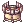

# Pet System

Tame a companion, build its trust and evolve it into a new form. The [illustrated pet catalogue](pet-catalogue.md) lists **115 pet entries**, their owner bonuses, food, accessories and **43 evolution paths**. Every evolution ingredient has a picture and an exact quantity.

[Browse pets and evolution recipes](pet-catalogue.md){ .md-button .md-button--primary }

## Getting started

1. Obtain the taming item listed for your chosen pet and use it on a matching, living monster.
2. Hatch its egg with a **Pet Incubator**.
3. Carry the pet's correct food and feed it while hungry. For eligible pets, enable **Automatic feeding** in the pet window (`Alt+J`).
4. Reach **Loyal intimacy**, remove the pet accessory and collect the listed ingredients before evolving.

{ .item-icon } **Pet Incubator (#643)** is used to hatch or switch pets. Pet food and Incubators are sold by the [Pet Dealers](dealers.md#pet-supplies).

## Taming

Each catalogue entry identifies the taming item and the server's configured base capture chance. A lure is consumed only after a valid target is accepted; a genuine failed capture consumes one. Cancelled selections, dead targets and mismatched targets do not consume it.

For ordinary taming, the base capture chance doubles only when the monster is **strictly below 1% HP**. At exactly 1% HP it remains unchanged.

{ .item-icon } **Taming Gift Set (#12105)** draws from **55 registered taming lures**. It supplies lures, not guaranteed pets.

Abracadabra uses the pet's configured capture rules. Evolved forms with an explicit Abracadabra setting use a fixed **0.01%** capture chance. The bonusless cosmetic Bacsojin and the evolved bonus-bearing Bacsojin are separate pets; check which egg you are buying.

## Feeding and intimacy

Hunger decreases by **3 points every 60 seconds** while a pet is active. Auto-feed triggers at **25 hunger or below**, requires the correct food in your inventory and must be switched on for that pet. The catalogue shows which pets support it.

| Relationship | Intimacy |
| --- | ---: |
| Awkward | 1-99 |
| Shy | 100-249 |
| Neutral | 250-749 |
| Cordial | 750-899 |
| Loyal | 900-1,000 |

New and newly evolved pets start at **250 intimacy (Neutral)**. Intimacy is capped at **1,000** and never drops below **1**. Owner death costs **5 intimacy**.

The catalogue's feeding gain is the amount awarded at **11-25 hunger**:

| Pet group | Intimacy per properly timed feeding |
| --- | ---: |
| First evolution tier | +40 |
| Other ordinary and final forms | +30 |
| Incubus, Succubus and Phreeoni | +20 |

Feeding at 26-75 hunger gives 75% of that gain, rounded down; feeding at 0-10 gives half. Feeding above 75 can reduce intimacy. Keep the correct food available rather than overfeeding to rush Loyal.

If a pet starves, it returns to its egg at **1 intimacy**. It retains its identity and nickname instead of disappearing permanently.

## Switching pets

Use a Pet Incubator while a pet is active, then choose another valid egg. Keep **one inventory slot free**. A successful switch returns the current pet to its egg and consumes one Incubator.

Cancelling the egg-selection window leaves the active pet and Incubator unchanged. Invalid selections do not consume the item.

## Evolution

1. Raise the active pet to **Loyal (900+)**.
2. Remove its accessory and carry **all** ingredients listed under **Evolves into** in the [catalogue](pet-catalogue.md).
3. Open the pet window, select the evolution option, choose the target form and confirm.
4. Use an Incubator to hatch the resulting egg.

The ingredients are checked before withdrawal. Refined, carded or equipped gear is not taken as ordinary recipe equipment. A rejected recipe consumes no materials.

After evolution:

- The original egg becomes the **evolved pet's egg in the same slot**. Evolution does not award a second copy of the old pet.
- The pet keeps its identity and any custom nickname.
- Intimacy resets to **250**, and hunger resets to **100**.
- Auto-feed stays enabled if it was on and the new form supports it. Otherwise, enable it when the form becomes eligible.

### Example: Poring to Mastering

| Material | Quantity |
| --- | ---: |
| { .item-icon } **Yggdrasil Leaf (#610)** | 10 |
| { .item-icon } **Unripe Apple (#619)** | 3 |

A Loyal Poring with no accessory evolves into Mastering. Hatch the **Mastering Egg** afterward. See [Poring](pet-catalogue.md#pet-poring) and [Mastering](pet-catalogue.md#pet-mastering) for their bonuses and next steps.

### Classic-compatible ingredients

The recipes use obtainable server materials in place of three ingredients from later content:

| Original ingredient | Vestige Rift requirement |
| --- | --- |
| Eggring Card | { .item-icon } **1 Drops Card (#4004)** |
| 500 Sweets Coins | { .item-icon } **500 Vestige Coins (#7539)** |
| 2 Memory of Gyol | { .item-icon } **200 Skel-Bones (#932)** |

All quantities in the catalogue already include these substitutions.

## Fixed-chance egg drops

These are **final drop chances**. Server rates, weekend rates, Bubble Gum and LUK do not multiply them. Other monster drops keep their usual rules.

| Monster | Pet egg | Chance |
| --- | --- | ---: |
| Dracula | [Familiar](pet-catalogue.md#pet-familiar) | 0.45% |
| Galion | [Roween](pet-catalogue.md#pet-roween) | 0.03% |
| Phreeoni | [Phreeoni](pet-catalogue.md#pet-phreeoni) | 0.09% |
| Dark Illusion | [Dark Priest](pet-catalogue.md#pet-dark-priest) | 0.09% |
| Dark Lord | [Dark Priest](pet-catalogue.md#pet-dark-priest) | 0.90% |
| Valkyrie Randgris | [Valkyrie Randgris](pet-catalogue.md#pet-valkyrie-randgris) | 0.15% |

A dropped egg contains a real pet. If inventory cannot accept it, delivery uses an owner-protected ground egg.

## Bonuses and visibility

Each pet's owner bonus is listed by intimacy in the catalogue. These are complete tier totals, so do not add several rows together. Some pets provide no owner stat bonus.

**Incubus** keeps Vestige Rift's existing Loyal bonus: **+3% Max SP**, plus a **5% chance to recover 5% of physical weapon damage as SP**.

**Blue Moon Loli Ruri** has a **5% chance per incoming physical hit** to cast Kyrie Eleison at the eligible intimacy tiers. It casts Level 2, or your learned level if higher.

Use [Personal Settings](personal-settings.md) for **Hide Pets** and **Mute Pets**. Visual and chatter preferences do not remove the pet's owner bonuses.
