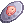

# Vestige Coin System

{ .item-icon width="32" height="32" } **Vestige Coins** are a tradable currency dropped by eligible monsters. Spend them at [Lydia's Coin Exchange](coin-exchange.md), or trade them with other players.

## The currency

| Property | Value |
| --- | --- |
| Item | Vestige Coin |
| Item ID | **35363** |
| Weight | **0** |
| NPC sale value | **0z** |
| Binding | Unbound; not tied to a character or account |

Coins can be traded, vended, dropped, placed in carts or personal/guild storage, and mailed, subject to the usual system and map rules.

## Monster drops

Each eligible monster death has one independent chance to drop **one coin**.

| Monster | Chance |
| --- | ---: |
| Eligible monsters without an exception below | **5%** |
| Familiar, Female Thief Bug, Male Thief Bug and Orc Zombie | **1%** |

The same reduced or excluded rule applies to database variants of those species.

### Monsters that do not drop coins

- Hydra
- Thief Bug Egg, Peco Peco Egg and Ant Egg
- Blue, Green, Yellow, White and Shining Plants
- Black and Red Mushrooms
- Thief Bug, Tarou and Plankton

The roll requires normal player loot credit. Special player-summon AI, clones, guardians, no-loot deaths and expired summons do not generate coins.

## Fixed chances

Coin chances stay at **5% or 1%**. Weekday/weekend rates, boss-drop rates, Bubble Gum, LUK and other drop modifiers do not increase them.

Normal loot ownership, party sharing, pickup rules and carrying limits still apply. You can add **#35363** to an [Autoloot](autoloot.md) group or ignore list. Percentage filtering uses the coin's original 5% or 1% chance; an active group's explicit item choice takes priority over the ignore list.

## Where to spend them

Visit **Lydia at prt_in 38,108**: `/navi prt_in 38/108`. Enter the Coin Exchange building through **Prontera 133,183**. Her shop accepts Vestige Coins and offers consumables, supply boxes and reusable wings. See the [complete exchange catalogue](coin-exchange.md).

**Astrid at Prontera 147,187** also accepts Vestige Coins together with crafting ingredients for [22 headgear quests](headgear-quests.md). Her guide lists every reward, material quantity and effect.

Vestige Coins are separate from hourly **Gold Coins** and Card Exchange points. Existing quests and events do not award Vestige Coins unless that reward is explicitly added later.
